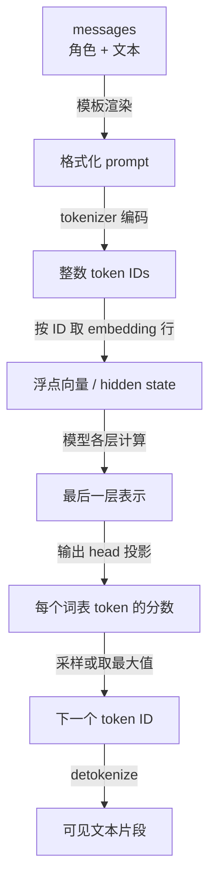
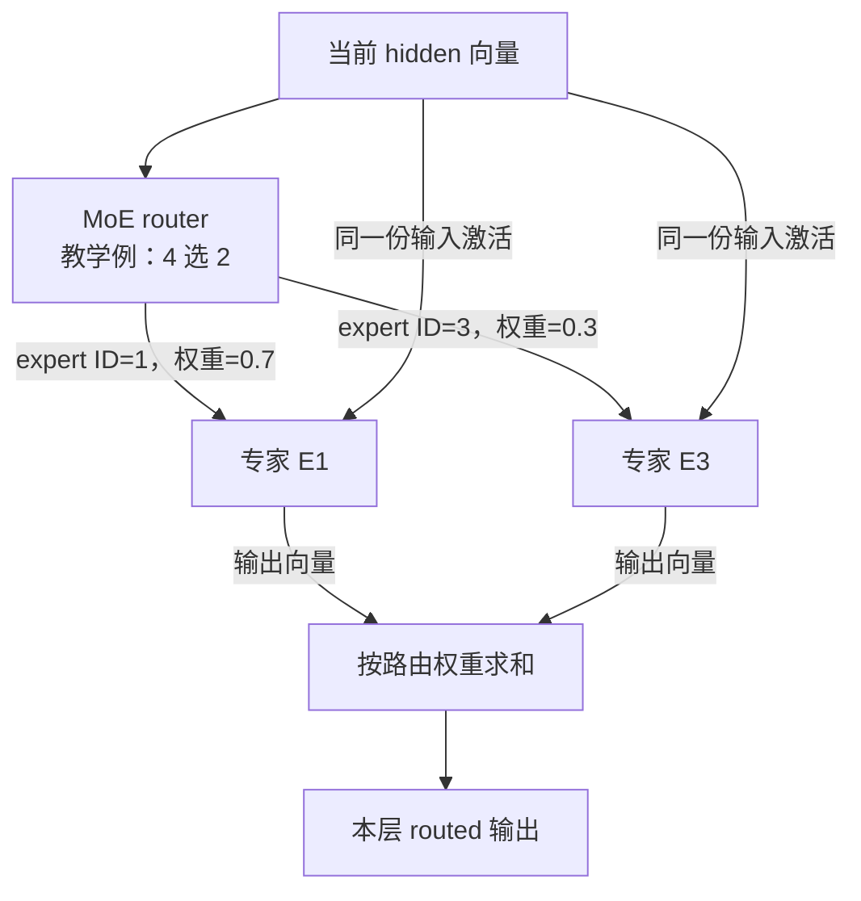
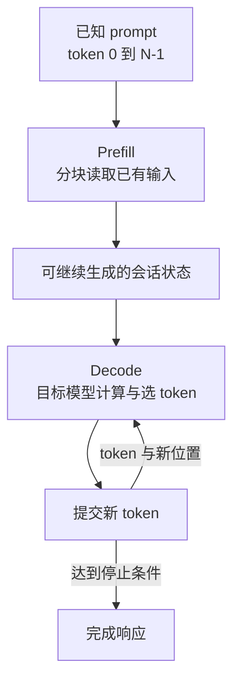

# 01 · 先建立概念：一句话怎样变成模型计算

[返回学习地图](README.md) · [下一章：项目架构](02-architecture.md)

这一章先解释后续图中会出现的数据和动作。读完后，你应该能够区分“模型参数”“一次请求的数据”和“为加速保留的状态”，再去看 CPU、GPU、RAM 之间的分工。

> **阅读范围**：概念图描述共同原理，不是某个文件逐行执行的顺序。具体实现以 Strata `ffa80d73133ea5c548aefe57889a16e8085a938f`、Basalt `4998eb3733ee83b7e7d6ff94854c399dd89cfebe` 两个源码快照为例。下面的玩具模型和 token ID 均为教学虚构，不代表真实 tokenizer 或 benchmark。

## 1. 模型、推理引擎和服务程序分别是什么

| 名词 | 它保存或处理什么 | 在这里对应什么 |
|---|---|---|
| 模型 | 网络结构、训练好的权重，以及与之配套的词表等资料 | Qwen、DeepSeek 模型及其量化版本 |
| 推理引擎 | 把输入转换为模型计算，安排权重、状态、CPU/GPU 运算，选出输出 token | Strata/Basalt 的 C++ 与计算内核 |
| API 服务 | 接收 HTTP 请求、渲染消息模板、排队、管理引擎进程、返回结果 | 两项目的 Python `serve/` |
| 使用入口 | 安装、配置、启动或交互 | Strata 桌面/Terminal；Basalt CLI/Web UI 等 |

下载了模型文件，不代表 GPU 已经载入它；服务端口能连接，也不代表模型已经准备好。模型加载与 HTTP 服务有各自的生命周期。

推理引擎通常常驻并复用权重。一条请求到来时，主要建立或恢复这次会话的状态，不是把整个程序重新启动一遍。[Strata 进程协议][s-process] [Basalt 进程协议][b-process]

## 2. 从字符到数字：token 与 tokenizer

人看到的是文本，模型处理的是整数编号序列。**Tokenizer** 根据配套词表及分词规则，把文本编码成 **token IDs**；生成结束后再把 ID 解码成文本。

Token 不等于一个汉字、一个英文单词或一个字节。它可能表示一个词、词的一部分、标点或字节片段。不同模型的 tokenizer 可以不同，同一句话得到的 token 数也会不同。

下面只演示数据形状：

```text
输入文本：          今天的天气如何？
假设的编码结果：    [17, 83, 204, 9]
类型：              四个整数，不是四个浮点向量
```

真实请求通常先把 `system/user/assistant` 消息按 **chat template** 拼成模型训练时使用的对话格式，再 tokenize。模板还可能加入角色、轮次、思考或工具调用相关标记。因此只对用户可见文本数 token，不一定等于请求实际占用的 token 数。

Tokenizer 放在哪一层是实现选择：Strata 这个快照的 Python 服务有 `encode_prompt()`；Basalt 的单流无图片路径可把 UTF-8 prompt 交给 C++ tokenize，batch 或图片路径仍由 Python 处理。[Strata 编码入口][s-encode] [Basalt 条件分支][b-prepare]

## 3. Token ID、embedding 和 hidden state

**Embedding** 是把一个整数 ID 映射成向量。可以先把 embedding 权重看作一张很大的表：第 17 行就是 token 17 的初始表示。

假设玩具词表大小为 1000，向量宽度为 4：embedding 表形状就是 `1000 × 4`。输入 `[17,83,204,9]` 后得到四行向量，形状是 `4 × 4`。真实模型的宽度要大得多。

**Hidden state（隐藏表示）** 是 token 经过模型各层后产生的中间向量。它与输入内容、历史上下文、所在层和位置有关。Embedding 是初始表示，hidden state 是不断变化的计算结果，两者不是同一张静态表。



图中有两次类型变化：`IDs → Hidden` 从整数索引变成向量；`Logits → Next` 从一整个词表的分数变回一个整数。真正的大量矩阵运算发生在两者之间。

流式响应中的一个文本片段不一定对应一个 token。服务端还需要处理 UTF-8、特殊标记、reasoning 或 tool-call 结构，可能累积多个 token 后才发出可见片段。

## 4. 权重、激活和状态：三个容易混淆的对象

| 对象 | 是否随当前请求内容变化 | 例子 | 生命周期 |
|---|---|---|---|
| 权重 `weights` | 普通推理时不更新 | embedding 表、投影矩阵、专家 gate/up/down 矩阵 | 模型加载后复用 |
| 激活 `activations` | 会变化 | 当前层 hidden、router 输入、某个专家的输出 | 一层或一个窗口内流动 |
| 会话状态 `state` | 会随已处理前缀增长或更新 | KV、递归矩阵、卷积历史、位置及 token history | 跨 decode 步保留，可能保存/恢复 |

“把专家换进 GPU”搬的是权重；“把当前 token 交给第二张 GPU”主要搬的是激活和任务信息；“恢复上次对话”恢复的是状态。它们有不同大小、访问频率和正确性条件。

模型学习发生在训练阶段。这里的专家缓存适应访问频率，是改变参数放在哪里，并非在线训练或改变模型权重。

## 5. Dense 与 MoE：每个 token 是否要用所有专家

在常见的 dense 前馈层里，token 经过同一组前馈网络参数。**MoE（Mixture of Experts）** 把前馈计算分成多组专家参数，再由一个小的路由器挑选其中一部分。

路由器输入当前 hidden state，输出各专家分数。它选出 top-k 专家，并给选中的结果分配合并权重。不同 token、不同层可能选到不同专家。

用一个**四专家选二**的虚构例子：路由器为当前 token 选中 E1、E3，权重分别为 0.7、0.3。这一层的 routed 结果可写为：

```text
routed_output = 0.7 × E1(hidden) + 0.3 × E3(hidden)
```

E0、E2 的权重还存在于模型中，但这个 token 的这次前向不需要执行它们。这里的 E1/E3 是前馈参数块，不是分别运行两个聊天模型。



两类箭头携带不同数据：router 发的是“专家编号与系数”；输入箭头发的是要计算的向量。具体执行时它们可以合并成一个任务描述。

有些模型还包含 **shared expert**，它不占 routed top-k 的名额。其输出按模型定义加入结果，可能有自己的 gate；不能把它也自动乘上上面的 0.7 或 0.3。

具体到 Strata 快照中的标准 Qwen3.8-Flash-Next 几何，代码记录每层 512 个 routed experts、使用 10 个；这个数字只属于对应模型形状，不是所有 MoE 的定义，裁剪版本也可能不同。[模型几何][s-geometry]

### 同名 top-k，含义完全不同

| 名称 | 选什么 | 在哪里发生 | 参数影响 |
|---|---|---|---|
| MoE 路由 top-k | 这一层的专家 | 模型中间的 MoE 层 | 决定该层使用哪些专家参数，通常由模型结构规定 |
| 生成采样 `top_k` | 词表中的候选 token | 输出 head 之后 | 限制下一 token 的候选集合，属于生成策略 |
| Attention 检索 top-k | 历史位置或块 | 特定注意力/indexer 实现 | 决定读哪些历史状态，不是在选专家或新 token |

## 6. Logits、概率和采样

**Logits** 是模型给词表候选打出的原始分数，不是已经归一化的概率。例如虚构词表只有三项时，logits 可能是 `[2.0, 1.0, -1.0]`。

**Softmax** 把分数转换为和为 1 的非负数，可理解为候选概率分布。**Sampler** 再按生成设置选出下一 token。常见设置如下：

- **Greedy**：取最高分候选；不需要按概率随机抽取。
- **Temperature**：改变分布的尖锐程度；较低通常更集中，较高通常更分散。
- **Top-k**：只在最高分的 k 个候选中选择。
- **Top-p**：保留累积概率达到阈值的一组高概率候选。
- **惩罚与 logit bias**：按历史或请求调整分数，再参与选择。

实际内核可以融合这些操作，不一定先生成一份完整 softmax 概率数组。采样、约束、数值精度、随机种子和状态都可能影响最终文本，不能仅看到“同一模型”就期待每次输出逐字一致。[Strata sampler 接口][s-sampler] [Basalt sampling 说明][b-sampling]

## 7. Prefill 与 decode 是两个计算阶段

**Prefill** 读取已知的 prompt，计算可供后续生成使用的状态。因为这段输入已经知道，能把多个位置放进一个 chunk，用较大的矩阵运算处理；自回归的因果约束仍然保留，不能让一个位置读取未来输入。

**Decode** 根据已有前缀生成新 token。普通路径每轮选一个新 token，再把它作为后续输入；推测解码可以让一轮处理一个验证窗口。它们仍然要逐步扩展同一条生成序列。



循环箭头传的是下一轮输入 token、位置以及更新后的状态，通常不是整段 prompt 再从头算一遍。是否可直接复用旧状态，需要检查前缀和会话条件。

工程中还可能把很短的 prompt 尾部送进 decode/verify 形式的窗口。`prefill` 是“处理已知输入”的任务角色，不表示它必须调用唯一一个名为 prefill 的 kernel。[Strata verify 状态说明][s-verify] [Basalt 请求阶段][b-request]

## 8. 四种“缓存”要分开理解

| 缓存或状态 | 保存的内容 | 为什么保留 | 容易误解的地方 |
|---|---|---|---|
| 专家权重缓存 | 模型专家参数 | 热专家留在 VRAM，减少慢层读取或运算 | 不保存对话语义，也不是 KV |
| KV cache | 已处理位置的 key/value 或相应压缩表示 | 后续注意力复用历史计算结果 | 不等于整句文本；格式和布局依模型而异 |
| 递归/卷积状态 | GDN 等结构的递推状态、历史窗口 | 下一步继续递推 | 不能只靠截掉几个 KV 位置来恢复 |
| 会话 checkpoint/停放缓存 | token 前缀与可恢复的多类模型状态 | 跨请求、槽位或重启复用前缀 | 必须匹配模型、位置、图片等条件；不能随意拼接 |

标准 Transformer 的“每层保存 K/V”只是入门图景。这里的 Qwen 混合 QSA 与 GDN，还带 hyper-connection/PLE 等结构；DeepSeek 有自己的压缩、indexer、Engram 等路径。学习缓存时应先问“这个模型需要延续哪些状态”，而不是预设全部状态都是 KV。[Strata 几何][s-geometry] [Basalt session 接口][b-adapter]

## 9. RAM、VRAM、PCIe 和量化

**RAM** 是主机内存，**VRAM** 是 GPU 本地显存。CPU 和 GPU 的计算路径都可以参与 MoE 推理。专家放在 RAM，不代表 CPU 只负责保存它，也不代表 GPU 总会先把整个专家复制进显存。

**PCIe** 是主机与 GPU、以及相关中转数据经过的总线之一。Pinned/mapped memory 能帮助异步传输或让设备寻址主机数据，但数据访问仍有带宽与延迟，不能理解成“零字节传输”。

**量化** 用较少 bit 表示权重或激活，并配合 scale 等信息完成计算。它可以减少存储和搬运，也可能改变数值。W4A8 表示权重约 4 bit、激活约 8 bit；不表示累加器也是 4 或 8 bit。实际总大小还包括 scale、索引、对齐和其他 tensor。

**GGUF 或 `.basalt` 是文件/容器概念**，NVFP4、Q6_K、INT8 是其中数据表示或计算路径的概念。一个容器可以装多种精度；文件名称里的 FP4 不代表全部 tensor、KV 和所有阶段都用 FP4。[Basalt 模型文件][b-file] [Basalt 精度表][b-precision]

## 10. 读下一章前，检查自己是否能回答

1. 一个整数 token ID 如何变成向量，又如何变回下一个整数 ID？
2. “选择两个专家”和“采样 top_k=2”分别在哪一步发生？
3. 专家换入显存与会话恢复分别搬运什么？
4. 为什么 prefill 可以利用更大的矩阵运算，而生成仍然是自回归的？
5. 为什么 GDN 等递归结构使回滚不能只处理 KV？

如果这些问题已清楚，下一章就可以把概念对应到真实模块、进程和硬件。

[返回学习地图](README.md) · [下一章：项目架构](02-architecture.md)

[s-process]: https://github.com/Niko1221/Strata/blob/ffa80d73133ea5c548aefe57889a16e8085a938f/serve/server.py#L1056
[s-encode]: https://github.com/Niko1221/Strata/blob/ffa80d73133ea5c548aefe57889a16e8085a938f/serve/server.py#L5489
[s-geometry]: https://github.com/Niko1221/Strata/blob/ffa80d73133ea5c548aefe57889a16e8085a938f/include/strata/core/geometry.hpp#L23
[s-sampler]: https://github.com/Niko1221/Strata/blob/ffa80d73133ea5c548aefe57889a16e8085a938f/include/strata/kernels/sampler.hpp#L1
[s-verify]: https://github.com/Niko1221/Strata/blob/ffa80d73133ea5c548aefe57889a16e8085a938f/include/strata/core/verify.hpp#L1
[b-process]: https://github.com/jesdga95/basalt/blob/4998eb3733ee83b7e7d6ff94854c399dd89cfebe/serve/engine/process.py#L1
[b-prepare]: https://github.com/jesdga95/basalt/blob/4998eb3733ee83b7e7d6ff94854c399dd89cfebe/serve/service.py#L791
[b-sampling]: https://github.com/jesdga95/basalt/blob/4998eb3733ee83b7e7d6ff94854c399dd89cfebe/docs/configuration/sampling.md
[b-request]: https://github.com/jesdga95/basalt/blob/4998eb3733ee83b7e7d6ff94854c399dd89cfebe/src/program/serve/request.cpp#L6
[b-adapter]: https://github.com/jesdga95/basalt/blob/4998eb3733ee83b7e7d6ff94854c399dd89cfebe/include/basalt/model/adapter.hpp#L128
[b-file]: https://github.com/jesdga95/basalt/blob/4998eb3733ee83b7e7d6ff94854c399dd89cfebe/docs/model-file.md
[b-precision]: https://github.com/jesdga95/basalt/blob/4998eb3733ee83b7e7d6ff94854c399dd89cfebe/docs/precision/qwen38-flash-next.md#L21
