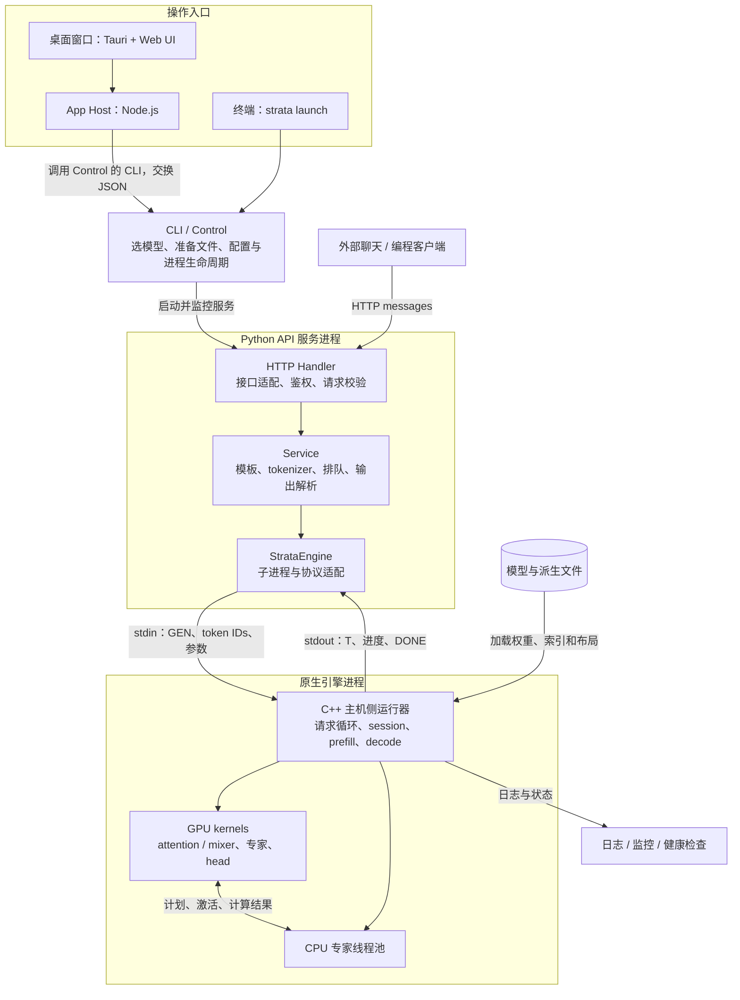
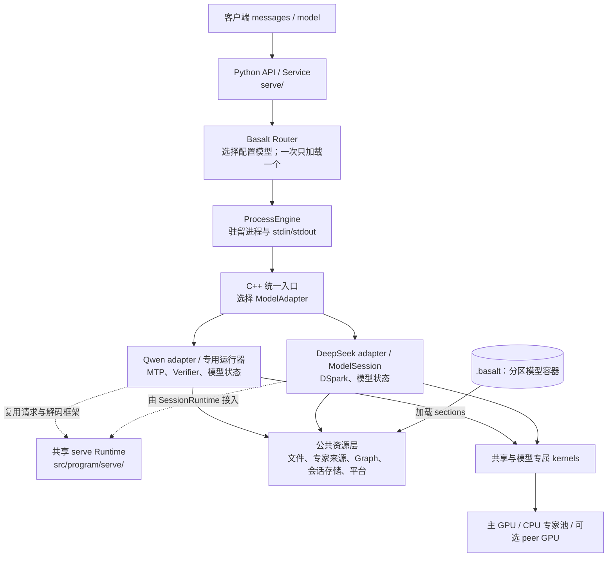

# 02｜整体架构：谁接收请求，谁真正计算

[上一章：基础概念](01-foundations.md) · [目录](README.md) · [下一章：数据流向](03-dataflow.md)

读完这一章，你应能沿着“用户发出一句话”的路径，区分桌面界面、启动控制、HTTP 服务、模型引擎和计算设备，并知道它们之间传递什么。

> 核对基线：Strata `ffa80d73133ea5c548aefe57889a16e8085a938f`，Basalt `4998eb3733ee83b7e7d6ff94854c399dd89cfebe`。这是固定源码的静态阅读，不代表所有历史或未来版本。下图是职责图，不是进程数量或硬件容量的保证。

## 1. 先把系统分成三件事

**把模型启动起来、接待一次请求、算出下一个 token，是三种不同工作。**

| 工作 | 典型输入 | 典型输出 | 主要承担者 |
|---|---|---|---|
| 启动控制 | 模型选择、硬件信息、配置文件 | 可运行的服务进程、状态与日志 | Strata CLI / Control；Basalt CLI / server 启动逻辑 |
| 请求服务 | HTTP JSON：messages、model、采样参数 | HTTP JSON 或逐段 SSE 响应 | Python 服务 |
| 数值推理 | token IDs、当前位置、权重、会话状态 | logits、生成 token、更新后的状态 | C++ 主机编排与 GPU/CPU kernels |

例如，下载权重需要联网和文件管理，但不会决定某一层选中哪个专家；HTTP 验证请求里的 `max_tokens`，也不等于它亲自完成矩阵乘法。区分这些职责后，代码中的同名“启动”“路由”“缓存”就容易理解了。

## 2. Strata：启动入口与推理主链



按图读一次：

1. 桌面窗口把操作交给 App Host；终端则直接进入 CLI。它们是两种使用入口。
2. Control 负责选择组件、准备配置和管理服务。其 runtime 启动 `python -m serve.server`。
3. API 服务接收具体聊天请求，渲染模板并把消息变成 token IDs。
4. `StrataEngine` 启动常驻原生子进程，通过管道交给它推理任务。
5. C++ 运行器安排 GPU kernels 和 CPU 专家池工作，返回 token IDs。
6. Python 把 token IDs 还原、解析成文本、思考或工具调用，再发回客户端。

桌面 shell 自己的头部注释明确：它主要启动 App Host、打开同源 WebView 并处理退出；App Host 调用 Control，而非在 JavaScript 中运行大模型。[桌面壳][desktop] [App Host 桥接][host-control] [服务进程启动][control-runtime]

图没有要求每次请求都经过 Terminal。服务启动后，外部客户端可直接向 API 发请求，权重和引擎进程也不会为每句话重新创建。

## 3. Python 与 C++ 之间的边界

Strata 的常用文本请求主链可以写成：

```text
HTTP messages
  → Python：应用 chat template、tokenize、检查长度
  → stdin：GEN max_new 参数 token_ids
  → C++：恢复状态、prefill、decode
  → stdout：T token_id ... DONE
  → Python：detokenize、解析输出、形成 API 事件
  → HTTP/SSE
```

这里的 **IPC** 是“进程间通信”。普通文本生成协议主要走 stdin/stdout 管道；`T` 后面是 token ID，不是完整 JSON 聊天响应。stdout 属于机器协议，stderr/日志承担诊断信息。[StrataEngine 与进程创建][strata-engine] [生成器入口][generate]

但不能把“管道 IPC”推广为整个系统“没有共享内存”：引擎内的 CPU/GPU 协作使用 pinned/mapped 缓冲区，某些副本模式也会共享专家存储。**进程间的请求协议与设备间的数据运输，是两层不同机制。**

图像、批处理、会话存档会扩展这条协议，例如传图片 embedding 的描述或文件位置、携带 slot ID。学习时先走普通文本，再看这些条件分支。

## 4. 引擎并不等于 GPU

“原生引擎”包含两类代码：

- **主机代码：** 在 CPU 上运行的 C++，负责分配内存、建立 session、选择路径、启动 kernels、等待结果、处理停止请求。
- **设备代码：** 在 GPU 上运行的 CUDA/HIP/SYCL/Metal kernels，负责矩阵乘法、归约、路由、合并等计算。

CPU 专家线程池又是另一种 CPU 工作：它直接读取 RAM 中的量化专家权重并计算结果，不只是管理 GPU。CPU 控制线程、CPU 专家计算线程和 GPU 计算可以有重叠，但某一层合并结果前仍需要满足依赖。

Strata 的 `ExpertDispatch` 合同明确要求专家池返回各专家结果，由设备上的 `moe_combine` 再乘路由权重；如果 CPU 池也乘一次，就会重复加权。这是“看清数据由谁负责”比只记函数名更重要的例子。[专家接口合同][expert-contract]

## 5. 模型参数与会话状态分别属于谁

| 对象 | 生命周期 | 作用 |
|---|---|---|
| 模型权重 | 通常随模型加载，多个请求可复用 | 保存模型学到的参数 |
| 专家驻留表与缓存 | 随模型运行，可能动态更新 | 记录专家位于主卡、peer、RAM 还是文件后备 |
| KV / 递归状态 | 随具体会话或请求槽变化 | 保存该段历史参与后续计算所需的信息 |
| Checkpoint | 在可恢复位置建立 | 保存一个前缀位置及必要运行状态 |
| HTTP 请求对象 | 一次请求 | 持有参数、取消标记、输出缓冲等 |

所以，“两个人问同一个模型”可以共享权重，但不能把两个人的 KV 或递归状态混在一起；“专家缓存命中”省的是参数读取/执行成本，“前缀命中”省的是重新处理历史 prompt 的工作。下一章会进一步跟踪这些字节如何移动。

## 6. Basalt：沿用分层思路，重新整理服务与模型接口

Basalt 同样保留 Python 服务与原生引擎两个层次，但模型接入和服务代码进行了更明确的拆分。



`ModelAdapter` 描述和加载模型；`ModelSession` 暴露 `prefill_chunk`、`decode_window`、draft 与状态存取等能力。Qwen 可以通过 adapter 的专用运行入口接入其优化路径，DeepSeek 接到共享 SessionRuntime。接口一致不代表模型内部算子或 batch 调度完全一样。[Basalt 接口][basalt-adapter] [共享请求阶段][basalt-request]

Basalt 还有三个需要单独标出的行为：

- Python Router 等当前模型的活动请求结束后才切换模型，退出旧引擎并加载新引擎。配置列表里有两个模型，不等于两个模型同时驻留。[模型 Router][basalt-router]
- 无图片、非 batch 且引擎支持文本输入时，Python 可发 `GENT` 文本，由 C++ tokenize；batch 或图像等路径仍会在 Python 编码。[tokenizer 条件][basalt-tokenizer]
- Grammar 是生成过程的一部分。作为对照，本章 Strata 基线的结构化输出路径标记为 `prompt_and_validate`，不能把 Basalt 的约束解码流程直接套到 Strata。[Strata 结构化输出][structured] [Basalt decode loop][basalt-loop]

## 7. 多种“并行”和“路由”不要混在一起

| 名称 | 解决的问题 | 是否等于其他模式 |
|---|---|---|
| 多 HTTP 连接 | 同时接待客户端 | 不保证 GPU 同时计算所有请求 |
| 多请求 slot | 保存并调度多个会话状态 | 不等于多个独立模型 |
| Strata replicas | 在多个引擎副本中选择前缀复用和负载代价较低者 | 不等于 Basalt 的不同模型轮换 |
| Strata `serve/split.py` | 先让 prefill 引擎处理 prompt，再通过会话文件交给 decode 引擎 | 是两个阶段的服务编排，不等于每层张量切分 |
| Layer split | 不同设备负责连续的不同层 | 不等于每个设备都算每一层 |
| Strata `strata-split-N` | 每层在多卡运行，切分 heads、专家 FF 宽度和词表 | 是独立引擎路径；不能照搬它的参数给普通引擎 |
| Basalt expert tier | peer 卡保存并就地计算部分专家 | 主要交换激活、计划、结果，不是统一显存 |
| 模型内部 MoE router | 为这一层的 token 选专家及路由权重 | 与 HTTP 服务选择模型/副本的 Router 完全不同 |

Strata replica 选择器直接计算“需要重读的 prompt token 数 + 正在运行请求的负载代价”；服务级 prefill/decode split 明确执行 save/restore 会话文件；`strata-split-N` 则在模型定义中说明每层都分到多卡。[副本选择][replicas] [阶段交接][serve-split] [每层切分][split-model]

Basalt 的 Tensor Parallel 在所分析快照中只是成本估算项、尚未实现；它仍有条件可选的 layer split。因此“Strata 有 split”和“Basalt 某个 TP 路径未实现”并不矛盾，必须先说清具体模式和版本。[多卡机制估算与可运行标记][basalt-multi-gpu]

## 8. 读完后应能回答

1. 关闭 HTTP 连接时，哪个层发现断连，哪个层真正停止计算？
2. 一条 `T 123` 为什么还不能直接当成用户看到的一段文字？
3. GPU 没有某个专家时，为什么不一定需要读 SSD？
4. 权重可以被多个请求共享，为什么 session 状态必须分开？
5. 看到函数名 `Router` 或配置名 `split` 时，还需要确认哪种作用域？

若你能回答前四题，就可以继续看[数据流向](03-dataflow.md)。最后一题将在[源码阅读路线](05-source-reading.md)中变成实际查找方法。

[desktop]: https://github.com/Niko1221/Strata/blob/ffa80d73133ea5c548aefe57889a16e8085a938f/apps/desktop/src-tauri/src/main.rs#L1
[host-control]: https://github.com/Niko1221/Strata/blob/ffa80d73133ea5c548aefe57889a16e8085a938f/apps/host/server/control-runtime.mjs#L1
[control-runtime]: https://github.com/Niko1221/Strata/blob/ffa80d73133ea5c548aefe57889a16e8085a938f/strata_control/runtime.py#L908
[strata-engine]: https://github.com/Niko1221/Strata/blob/ffa80d73133ea5c548aefe57889a16e8085a938f/serve/server.py#L1055
[generate]: https://github.com/Niko1221/Strata/blob/ffa80d73133ea5c548aefe57889a16e8085a938f/src/program/generate.cpp#L1
[expert-contract]: https://github.com/Niko1221/Strata/blob/ffa80d73133ea5c548aefe57889a16e8085a938f/include/strata/core/expert_source.hpp#L1
[structured]: https://github.com/Niko1221/Strata/blob/ffa80d73133ea5c548aefe57889a16e8085a938f/serve/structured.py#L1
[replicas]: https://github.com/Niko1221/Strata/blob/ffa80d73133ea5c548aefe57889a16e8085a938f/serve/replicas.py#L506
[serve-split]: https://github.com/Niko1221/Strata/blob/ffa80d73133ea5c548aefe57889a16e8085a938f/serve/split.py#L378
[split-model]: https://github.com/Niko1221/Strata/blob/ffa80d73133ea5c548aefe57889a16e8085a938f/src/split/src/model.hpp#L1
[basalt-adapter]: https://github.com/jesdga95/basalt/blob/4998eb3733ee83b7e7d6ff94854c399dd89cfebe/include/basalt/model/adapter.hpp#L128
[basalt-request]: https://github.com/jesdga95/basalt/blob/4998eb3733ee83b7e7d6ff94854c399dd89cfebe/src/program/serve/request.cpp#L6
[basalt-router]: https://github.com/jesdga95/basalt/blob/4998eb3733ee83b7e7d6ff94854c399dd89cfebe/serve/router.py#L195
[basalt-tokenizer]: https://github.com/jesdga95/basalt/blob/4998eb3733ee83b7e7d6ff94854c399dd89cfebe/serve/service.py#L791
[basalt-loop]: https://github.com/jesdga95/basalt/blob/4998eb3733ee83b7e7d6ff94854c399dd89cfebe/src/program/serve/decode_loop.hpp#L35
[basalt-multi-gpu]: https://github.com/jesdga95/basalt/blob/4998eb3733ee83b7e7d6ff94854c399dd89cfebe/src/program/multi_gpu_plan.cpp#L98
