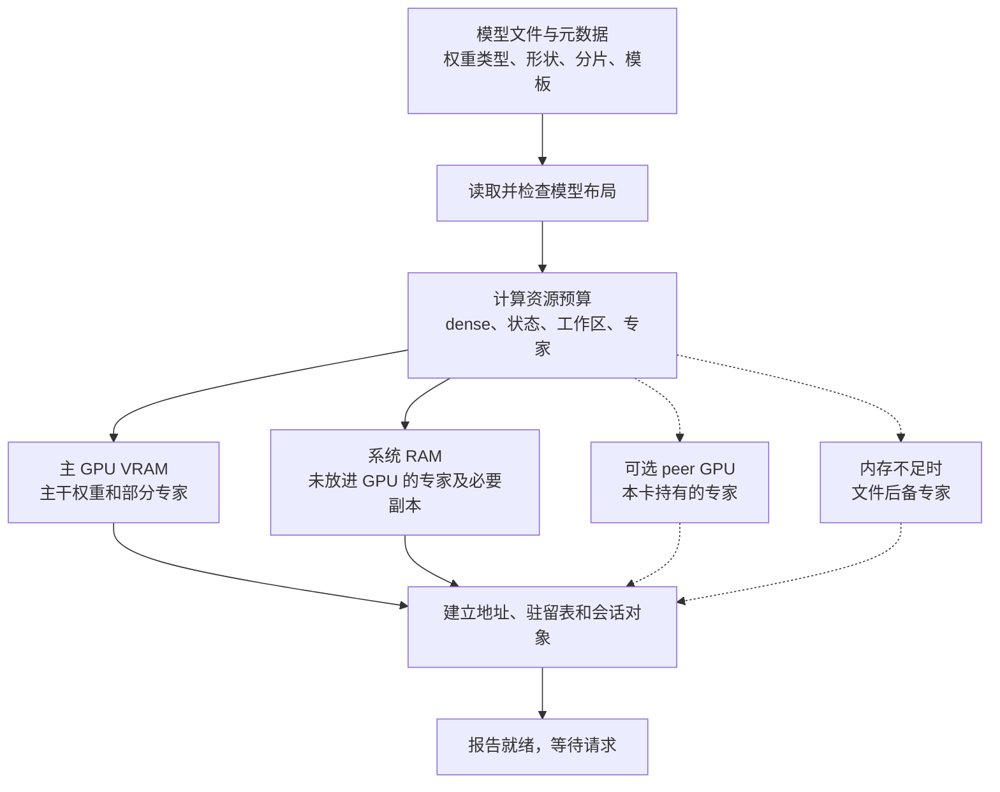
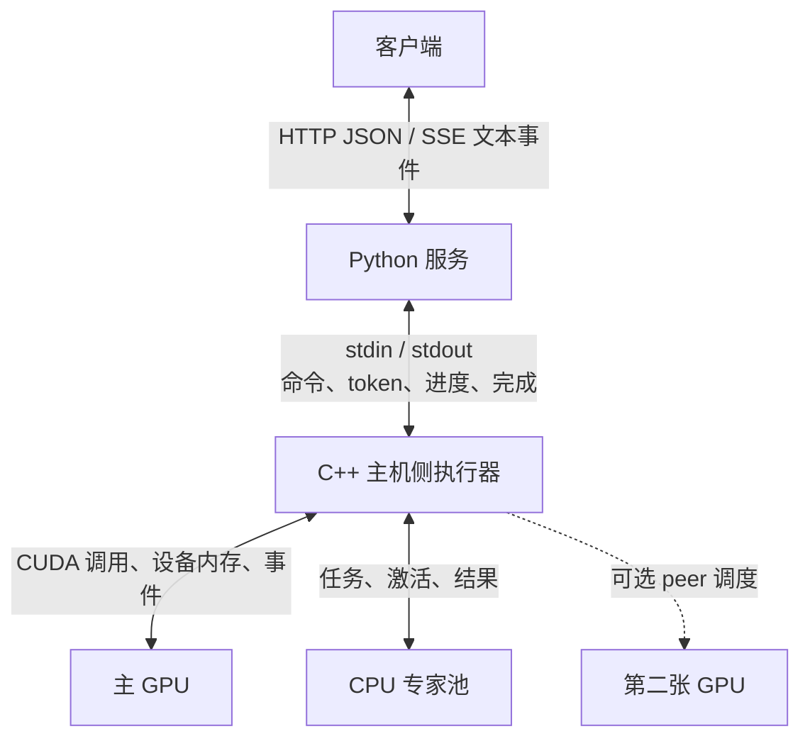
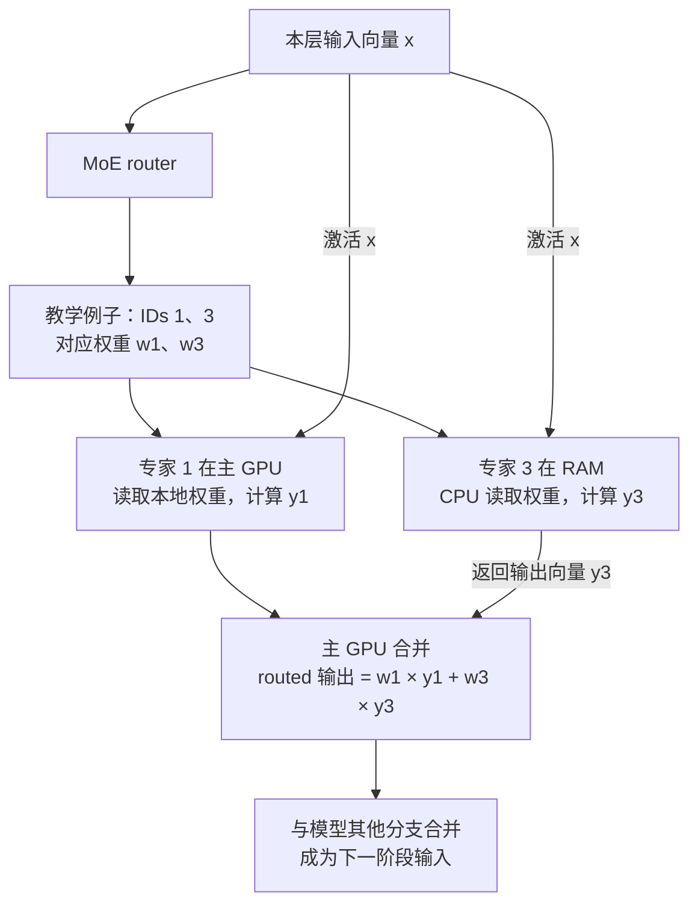

# 03｜数据流：请求、模型权重和会话状态分别怎样移动

[返回学习地图](README.md) · [上一章：整体架构](02-architecture.md) · [下一章：推理流程](04-inference.md)

读完本章，你应能在图上指出：一句输入什么时候变成 token，GPU/CPU 收到的究竟是什么，以及一次聊天结束后哪些数据还保留着。

本章先画两项目共同的数据关系，再注明具体实现差异。图是教学抽象：不表示所有后端采用同一个 kernel，也不表示每次请求都会触发每条支路。

## 1. 先区分三类数据

“数据从 CPU 到 GPU”太笼统。真正分析性能时，至少要拆成下面三类。

| 数据 | 例子 | 从哪里产生 | 更新频率与寿命 |
|---|---|---|---|
| 模型参数 | attention 投影权重、专家 gate/up/down、输出 head | 下载/转换后的模型文件 | 推理时通常只读；模型加载后可被很多请求共用 |
| 请求内容与中间结果 | messages、token IDs、hidden state、路由 IDs、logits | 客户端输入及每层计算 | 每个请求或每个生成窗口都变化 |
| 会话运行状态 | KV、GDN 递归状态、位置、已接受 token 历史、checkpoint | prefill 和 decode | 随会话增长或推进；需要时可停放、恢复或丢弃 |

**专家缓存保存参数，会话缓存保存运行状态。** 同一个专家可服务很多请求；一个会话的 KV 则不能随意拿给完全不同的 prompt 使用。

还有一类较小的控制数据：配置、采样参数、取消信号、完成事件、错误信息。它们决定执行什么，通常不是最大的内存流量来源。

## 2. 启动时：文件如何成为可以计算的权重

启动的任务是建立可执行的内存布局。不能把“模型文件下载完”当成“模型已经可以回答”。



图中前三条分支传的是**权重字节**；到 `Tables` 的关系表示加载器登记地址与位置，不是再把所有权重复制一遍。

在 Strata 的 Qwen 路径中，GGUF 可以先被准备成引擎使用的 pack、索引和专家文件。Basalt 将许多制品组合成一个 `.basalt` 分区文件，再按 section 读取。两者最终都需要把“文件里的 tensor”变成“kernel 能识别的地址、形状与量化布局”。[Strata 权重接口][strata-weights] [Basalt 容器][basalt-format]

模型加载还可能准备图、临时缓冲区和 drafter。**CUDA Graph 不要求一律在 READY 前全部捕获**：某些路径预捕获，某些路径首次使用时才惰性捕获。例如 Basalt 的通用会话服务在 `prepare()` 成功后报告 READY，而 DeepSeek 的 `run_graph()` 仍可在首次执行对应图时捕获它。[READY 位置][basalt-ready] [惰性构图][basalt-graph]

### 显存为什么不能全部用来存专家

可以用下面的预算关系理解，不必记某一版本的固定 MiB 数：

```text
可用于专家的显存
≈ 当前可用显存
  − 主干等必要权重
  − KV / 递归状态
  − drafter（如启用）
  − prefill 与 decode 工作区
  − 运行时及预留空间
```

因此增加上下文、并发槽或 drafter 可能缩小专家缓存。计算 kernel 没变，速度也可能变化，因为更多专家需要从 RAM 计算或搬运。

## 3. 请求时：从 JSON 到 token，再变回文本

以下表格按一次文本请求的顺序阅读。左右两端常常都是字符串，但中间大部分阶段不是字符串处理。

| 阶段 | 输入 | 输出 | 谁负责 |
|---|---|---|---|
| API 适配 | HTTP JSON：messages、model、参数 | 统一的对话结构和生成选项 | Python 服务 |
| 模板渲染 | 角色、内容、工具定义、特殊标记 | 符合模型 chat template 的完整 prompt | 服务的模板/dialect 层 |
| Tokenization | prompt 文本 | 整数 token ID 序列 | 取决于项目和请求路径 |
| Embedding | token IDs | 每个位置的向量 | 推理引擎 / 设备 kernel |
| Prefill | prompt 向量及已有状态 | 更新后的 KV/递归状态、生成起点 | 模型执行器 |
| Decode | 当前 token/window、历史状态 | 目标词表分数和候选 token | 模型执行器与 sampler |
| 增量解码与解析 | 已提交 token IDs | 文本片段、reasoning、tool-call 字段 | 服务层 |
| 响应封装 | 统一事件 | OpenAI/Anthropic/Responses 的 JSON 或 SSE | API 适配层 |

Strata 学习基线的常规 Qwen 服务路径在 Python 编码 prompt，再用 `GEN` 等协议发送 token IDs。Basalt 的单流纯文本路径可通过 `GENT` 发 UTF-8 文本，由 C++ tokenizer 编码；batch 或图片路径仍可能由 Python 编码。不要把 tokenizer 的位置当成两项目永远相同的事实。[Strata 服务][strata-server] [Basalt 选择条件][basalt-tokenizer]

SSE 的一小段文本也未必对应一个 token：UTF-8 字节可能需要拼接，工具调用和特殊标记可能需要等更多内容才能解析。

## 4. 两条通信链不能混在一起



**第一条链是服务与引擎的进程通信。** 传的是请求描述、prompt/token、生成结果、取消与状态事件。常驻引擎可以处理很多请求，不必每条 HTTP 请求重启一次。

**第二条链是引擎内部的计算协同。** 这里才涉及大权重、激活、CUDA stream、CPU 线程池及设备同步。Python stdout 管道不是传送全部专家权重的通道。

图中设备调用以 CUDA 后端为例；Strata 的其他后端使用各自的设备接口。

图中的 `Host → GPU` 也不意味着主机亲自逐条算乘法。主机侧负责组织资源与发起计算，GPU kernel 才执行设备上的运算；某些专家计划还可在 GPU 侧形成。

## 5. 一层 MoE：移动的是哪些东西

先用一个明确的教学例子：**假设**某层只有 4 个专家，每个 token 选 2 个；真实模型的专家数和 top-k 从模型配置读取，不按这个例子推断。

某个 token 的 router 选中了专家 1 和专家 3。若专家 1 在 GPU、专家 3 在 RAM，执行关系可以是：



这里有三组不同的数据：

1. **IDs 与路由权重：** 告诉执行器要用哪几个专家、结果如何加权，体积相对较小。
2. **输入向量 x：** 选中的专家都要读取它；需要送到相应计算位置。
3. **专家矩阵：** 体积较大；已经驻留在哪个设备，就尽量在那里计算，避免重复搬走整块权重。

专家内部一般有 gate/up/down 投影及激活组合，但具体格式与 kernel 随模型、量化包、prefill/decode 阶段变化。shared expert 若存在，是另一条模型分支，可有自己的 gate；它不自动使用 top-k router 的那组权重。

图中的 CPU 路径返回每个专家的输出向量 `y3`，路由权重在主 GPU 的 combine 阶段应用；不应在 CPU 返回前先乘一次、合并时又乘一次。两个学习基线的 Qwen 验证路径都能找到“读取 CPU 结果行，再带路由权重合并”的实现。[Strata 合并][strata-combine] [Basalt 合并][basalt-combine]

### 放不进主显存的专家不只有一种处理方式

| 当前位置/路径 | 计算在哪里发生 | 通常要跨越什么边界 |
|---|---|---|
| 主卡 VRAM 命中 | 主卡 | 设备内部读权重 |
| peer VRAM 命中 | peer 卡 | 激活、路由、输出经过相应通信路径 |
| RAM CPU 路径 | CPU | 主卡/主机之间交换激活和结果 |
| RAM staging 路径 | 搬入或暂存后在 GPU | 权重经 PCIe 传输，还需等待 staging 完成 |
| 文件后备 | 读入后再进入适用计算路径 | 文件读取或缺页，再加后续计算/传输 |

这些是可选分支。**不能画成每个 token 都依次经过“SSD → RAM → GPU”**；也不能把所有 RAM 专家都描述为 GPU 直接读取。[Strata 专家来源][strata-source] [Basalt 专家分发][basalt-dispatch]

## 6. Pinned、mapped、doorbell 到底是什么

这几个词描述的是通信机制，不是新的模型算法。

- **Pinned memory：** 页锁定的主机内存，便于设备传输和稳定寻址，但会占用系统可用 RAM。
- **Mapped host memory：** 把某段主机内存映射为 GPU 可寻址区域。GPU 能访问它，不代表访问速度等于显存。
- **Doorbell：** 一小段通知状态。可以把它理解成“任务已就绪/结果已完成”的序号，而不是传输整个任务的容器。
- **Stream / event：** 描述设备任务的顺序与完成依赖；创建多个 stream 不自动保证有足够硬件资源并行运行。

Pinned 与 mapped 是不同属性：页锁定本身不等于已经取得 GPU 可用的映射地址；具体分配/注册标志与设备指针获取过程仍要看实现。

典型协同是：GPU 完成 router → 写入激活/IDs 和就绪信号 → host/peer 读取任务 → CPU/peer 计算 → 写结果与完成信号 → 主 GPU 合并。具体实现可以使用预捕获图、persistent kernel 或不同缓冲区，不能仅凭上述抽象推断每层有多少次 memcpy。

本手册固定的 Basalt `4998eb37` 提交正好说明这个区别：DeepSeek 的 plain-tier peer 路径由量化 kernel 直接从 mapped 输入读激活，并从 mapped staging 复制计划，减少与专家换入争用 copy engine 的排队。它减少的是一段调度等待，不是让 PCIe 流量变为零；也不能据此认为所有 peer 路径都已采用同一实现。[具体提交][mapped-change]

## 7. 会话状态从哪里恢复

用户每轮可能重发整个 messages 列表，但引擎不必重算全部历史。

```text
本次完整 prompt tokens
   │
   ├─ 与已有 live 状态匹配？
   ├─ 与可用 checkpoint 匹配？
   ├─ 与其他 slot / RAM 停放状态匹配？
   └─ 配置允许时，与磁盘保存状态匹配？
          ↓
选择可安全恢复的前缀 → 恢复对应状态 → 只 prefill 新增后缀
```

上述候选是否存在取决于项目、模型与配置。复用的前提是 token 前缀及相关身份一致，还可能包括图片、模型/量化、KV 形式、位置与其他状态条件。只找到一段相同文字，不足以证明可以复用内部状态。

对含递归层的模型，checkpoint 不只包含 KV，还必须考虑 GDN 等运行状态；推测解码拒绝某些候选后，也要保证下一个窗口看到的是正确状态。[Strata 会话快照][strata-conversation] [Basalt 恢复路径][basalt-restore]

### 聊天结束时，不同数据去向不同

| 数据 | 一次回复完成后的典型处理 |
|---|---|
| 模型权重 | 引擎仍驻留时继续保留，供下一请求使用 |
| 专家热度/驻留表 | 可继续适应后续请求，不等同用户对话内容 |
| 本次临时工作区 | 可复用、回收或在下一窗口覆盖 |
| 当前会话 KV/递归状态 | 可保留在 slot，或按策略停放 RAM/磁盘 |
| 已发出的文本 | 客户端保留；它与引擎内部运行状态是两份不同表示 |

## 8. 怎样从数据流判断慢在哪里

本节是读日志和源码的思考方法，不是未经测试的调参建议。

- **启动慢：** 先辨认下载、转换、文件读取、权重上传、构图和首次使用各占多少时间。
- **首 token 慢：** 先辨认排队、模型加载/切换、状态恢复、prefill、首次 decode；它不只等于“prompt 算得慢”。
- **后续 token 慢：** 看有效 token/window、权重读取、CPU 专家尾部、PCIe 等待、peer 与主卡汇合点。
- **长上下文才慢：** 除 attention 计算，还要看 KV 增长是否挤占专家槽、是否出现状态搬运。
- **显存仍有空闲却慢：** 空闲容量不等于有效带宽，也不能排除 CPU、RAM、磁盘或调度等待。

检查自己是否理解：若主 GPU 已算完本层驻留专家，而 CPU 专家还没返回，下一层能否马上使用完整 MoE 结果？通常必须等合并依赖满足；因此只看 GPU 峰值 TFLOPS 无法预测整个窗口的耗时。

下一章会把这些数据关系按时间排起来，跟着一个请求从 prefill 走到最后一个已提交 token。

## 源码定位

- Strata 学习基线的 `serve/server.py`、`ExpertSource`、`WeightTable`、会话快照接口用于理解服务输入与数据生命周期。
- Basalt 的 `expert_dispatch.cpp`、`request_restore.cpp` 和 `peer_experts.cpp` 用于追踪具体的分工、恢复和 mapped 输入优化。
- 源码修订版本统一见[来源与版本说明](SOURCES.md)；旧笔记的行号不能直接套到另一提交。

[strata-weights]: https://github.com/Niko1221/Strata/blob/ffa80d73133ea5c548aefe57889a16e8085a938f/include/strata/core/weights.hpp
[strata-server]: https://github.com/Niko1221/Strata/blob/ffa80d73133ea5c548aefe57889a16e8085a938f/serve/server.py
[strata-source]: https://github.com/Niko1221/Strata/blob/ffa80d73133ea5c548aefe57889a16e8085a938f/include/strata/core/expert_source.hpp
[strata-conversation]: https://github.com/Niko1221/Strata/blob/ffa80d73133ea5c548aefe57889a16e8085a938f/include/strata/core/conversation_snapshot.hpp
[basalt-format]: https://github.com/jesdga95/basalt/blob/4998eb3733ee83b7e7d6ff94854c399dd89cfebe/include/basalt/core/model_format.hpp
[basalt-tokenizer]: https://github.com/jesdga95/basalt/blob/4998eb3733ee83b7e7d6ff94854c399dd89cfebe/serve/service.py#L791
[basalt-dispatch]: https://github.com/jesdga95/basalt/blob/4998eb3733ee83b7e7d6ff94854c399dd89cfebe/src/models/qwen4exp/decode/expert_dispatch.cpp
[basalt-restore]: https://github.com/jesdga95/basalt/blob/4998eb3733ee83b7e7d6ff94854c399dd89cfebe/src/program/serve/request_restore.cpp
[basalt-ready]: https://github.com/jesdga95/basalt/blob/4998eb3733ee83b7e7d6ff94854c399dd89cfebe/src/program/serve/session_engine.cpp#L109
[basalt-graph]: https://github.com/jesdga95/basalt/blob/4998eb3733ee83b7e7d6ff94854c399dd89cfebe/src/models/deepseek41/session.cpp#L784
[strata-combine]: https://github.com/Niko1221/Strata/blob/ffa80d73133ea5c548aefe57889a16e8085a938f/src/core/verify.cpp#L2421
[basalt-combine]: https://github.com/jesdga95/basalt/blob/4998eb3733ee83b7e7d6ff94854c399dd89cfebe/src/models/qwen4exp/decode/verify/record_moe.cpp#L162
[mapped-change]: https://github.com/jesdga95/basalt/commit/4998eb3733ee83b7e7d6ff94854c399dd89cfebe
