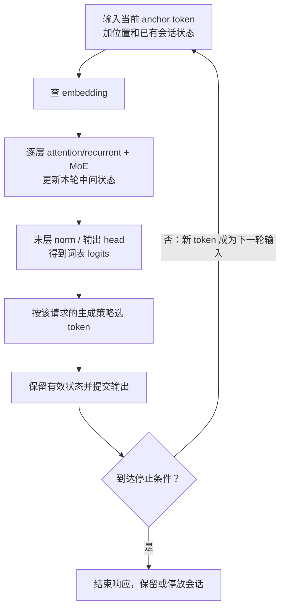
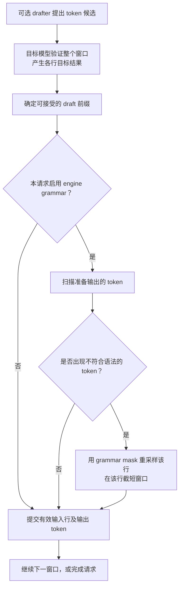
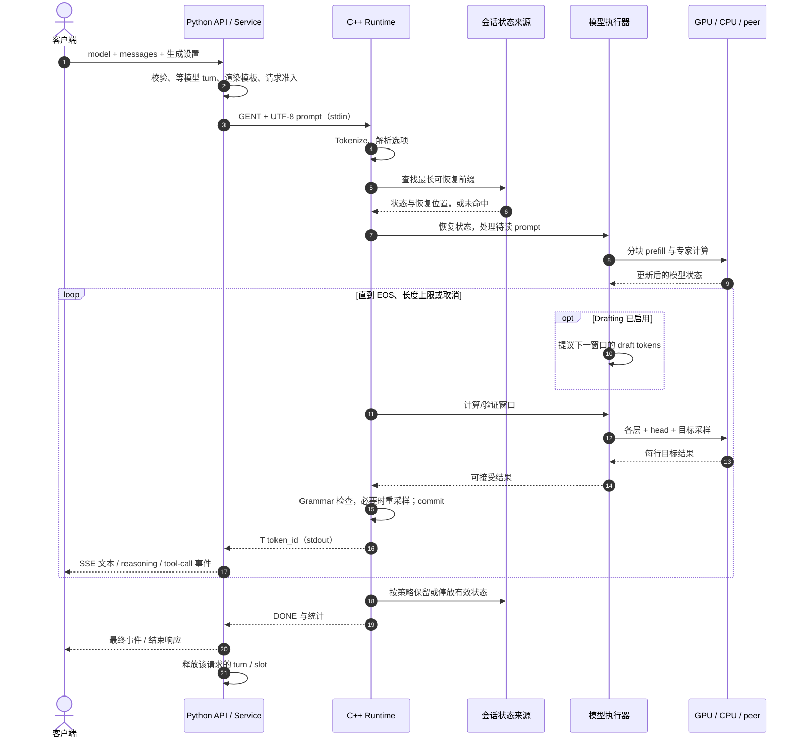

# 04 · 完整推理流程：从一次请求到最后一个 token

[返回学习地图](README.md) · [上一章：数据流](03-dataflow.md) · [下一章：源码阅读路线](05-source-reading.md)

本章沿着一条请求解释“先做什么、为什么需要这一步、下一步拿到什么”。先掌握普通生成，再理解推测解码；后者只是把多次目标模型计算合并成验证窗口，最终输出仍由目标模型验证。

> **版本与适用范围**：Strata 对照快照为 `ffa80d73133ea5c548aefe57889a16e8085a938f`，Basalt 为 `4998eb3733ee83b7e7d6ff94854c399dd89cfebe`。概念步骤不等同每个后端完全相同的函数顺序。涉及 grammar、tokenizer 或具体窗口默认值时，会明确项目与路径。以下是静态源码讲解，没有运行模型或性能实验。

## 1. 先把“启动一次”和“执行一次请求”分开

在请求之前，系统要选择模型与后端、打开模型文件、读取元数据、安排权重到 VRAM/RAM/文件层、创建工作区及会话对象，并让服务确认引擎可用。

权重可以跨请求复用；会话状态则需要按请求选择、恢复或重置。CUDA Graph 也可能预先捕获或在首次执行时惰性捕获，不能把所有后端都理解成“READY 之前已经执行过全部计算”。

下表从已经可接收请求的服务开始：

| 阶段 | 输入 | 核心动作 | 输出 |
|---|---|---|---|
| 请求接纳 | HTTP JSON、model、messages、生成设置 | 校验请求，选择模型，排队或申请 slot | 获准运行的请求 |
| 提示词准备 | messages、tools、template | 渲染模板并 tokenize，或传文本给引擎 tokenize | token IDs、位置与选项 |
| 状态恢复 | 输入 token 前缀、缓存键 | 找可恢复前缀，绑定会话状态 | 已处理的位置与待读后缀 |
| Prefill | 尚未处理的 prompt 部分 | 按 chunk 计算，更新 KV/递归状态 | 可继续生成的状态 |
| Decode/verify | anchor token、状态、可选草稿 | 目标模型前向、采样、接受与提交 | 一个或多个有效输出 token |
| 返回与结束 | token IDs、进度、统计 | 解码文本、转换 API 事件、完成或取消 | 客户端响应与可复用状态 |

Basalt 共享请求代码清楚地写成 `parse → prepare_prompt → restore → read_prompt → decode → complete`。这是理解生命周期的好入口，但不能据此要求 Strata 的源文件也按同样结构拆分。[Basalt 请求阶段][b-request]

## 2. 接纳、模板与 tokenization

HTTP 请求通常带 `model`、`messages`、生成长度和采样设置。服务层检查参数并渲染 chat template，把角色、工具定义、历史消息和生成起始标记组成模型能理解的 prompt。

随后需要产生 token IDs，两个快照的正常路径有差异：

| 路径 | 谁 tokenize | 进程管道中主要传什么 |
|---|---|---|
| Strata 此快照的 Python `encode_prompt()` 路径 | Python 服务 | `GEN`/相关命令中的 token IDs |
| Basalt：无图、非 batch、引擎支持 `takes_text` | C++ 输入处理 | `GENT` 加 UTF-8 文本 payload |
| Basalt：batch 或图片等其他准备路径 | Python 服务 | token IDs；图片还要经过对应编码/embedding 路径 |

这些是实际条件分支，不是“Python 一定 tokenize”或“C++ 一定 tokenize”的普遍规则。[Strata 编码][s-encode] [Basalt 准备分支][b-prepare] [Basalt 协议][b-protocol]

Basalt Router 还会管理不同模型的 turn：若需要切换模型，等待现有请求结束再换引擎；一次只加载一个模型。这个 Python 模型 Router 与每层挑专家的 MoE router 是两种不同的组件。[Basalt Router][b-router]

## 3. 恢复前缀：为什么第二轮聊天可能更快

假设第一次请求处理了某段系统提示和对话，第二次请求把相同前缀带来，只在后面加了一条新消息。若模型、token 前缀及相关状态条件匹配，引擎可以恢复已计算部分，只处理新后缀。

缓存复用依赖的是**一致的模型输入与有效状态**。文本看起来相似并不充分：模板改动可能改变 token；图片输入、控制选项、位置或状态格式变化也可能使已有状态不能直接复用。

Basalt 会在 live session、checkpoint、其他 slot、RAM 停放和磁盘缓存中寻找合适的最长前缀。恢复的不仅是聊天记录，还有 KV、递归状态等继续计算所必需的数据。[前缀匹配][b-restore]

可以用两个问题判断当前工作量：

1. 已有多少位置的状态可继续使用？
2. 从哪个位置起必须重新计算？

多轮对话仍可能需要大量 prefill：例如前面的 system prompt 被改了，或者缓存已被淘汰。“聊天历史仍在客户端”与“引擎仍持有可复用状态”是不同的事实。

## 4. Prefill：把已知输入变成可延续的状态

Prefill 接收一段已知 token，查 embedding，再逐层执行模型主干和 MoE。它需要保留用于后续生成的状态，也可能在系统提示或轮次边界保存 checkpoint。

长输入通常按 chunk 处理：一个 chunk 经过需要的模型层，再处理下一个 chunk。chunk 大小受显存工作区、专家搬运、上下文、设备模式及模型实现限制，不是越大越好。

“批量计算多个位置”不等于去掉自回归约束。注意力仍使用模型规定的因果关系，递归层仍需要保证状态更新顺序；计算内核只是采用并行或分块方法实现这些数学关系。

### 一层里发生什么

以下是阅读代码的概念顺序，具体模型可能用融合 kernel 或 hyper-connection 改写它：

1. 从上一层表示生成这一层的混合器输入。
2. 运行 attention 或 GDN 等 recurrent mixer，读写各自的状态。
3. 准备 MoE 输入，router 选出本层需要的专家。
4. 按专家驻留位置分给主 GPU、CPU 或 peer GPU，必要时经过文件/RAM 搬运。
5. 按路由系数合并 routed 输出，再按模型规则加入 shared expert 分支。
6. 更新 residual/hyper-connection，进入下一层。

Qwen3.8-Flash-Next 在这些项目中不是“48 层完全一样的普通 attention”：其标准几何混合 QSA 和 GDN，状态也相应不同。DeepSeek 另有压缩、indexer、Engram 等路径。[Strata 几何][s-geometry] [Basalt 模型接口][b-adapter]

工程上最后一个 prompt token 常被留作第一个 decode window 的 anchor；这只是计算边界安排。不能把它理解成最后一个用户 token 被丢弃。[Basalt prompt 阶段][b-prefill]

## 5. 普通 decode：一轮新产生一个 token

关闭 drafting 后，可以先把 decode 理解成下面的循环：



`Anchor → Embed` 传整数 token 与位置；`Layers → Head` 传最终 hidden 表示；`Head → Pick` 传词表分数；回到 Anchor 的箭头传新 token 及已提交状态。模型不是在循环箭头中重新 tokenize 全部聊天文本。

普通 decode 的输出一旦提交，Python 服务可以把 token ID 解码并转换成文本、reasoning 或 tool-call 的流式事件。一个网络事件不保证只含一个 token，也不保证每个 token 都立刻产生可见字符。

Prefill 与 decode 的性能瓶颈也可能不同。Prefill 更容易用较大矩阵运算复用权重；小窗口 decode 往往更在意权重读取、专家未命中、CPU/GPU 交接与 kernel 启动开销。应分别看首 token 等待与后续生成速度。

## 6. 推测解码：先提案，再由目标模型验证

Drafting 用一个更便宜的预测器先提议几个 token，再把这些候选放进目标模型的一个验证窗口。目标模型仍决定哪些结果有效。可选预测器不只有小模型，也可能利用上下文中重复的 token 片段。

这里的 **MTP** 和 **DSpark** 是模型相关的 drafter。Basalt 的 Qwen 路径使用 MTP，默认窗口 8；DeepSeek 使用 DSpark，默认窗口 3。窗口宽度包含 anchor，所以分别是“最多 7 个草稿”和“最多 2 个草稿”，而不是一次保证输出 8 或 3 个草稿。[Qwen drafting][b-qwen] [DeepSeek drafting][b-deep]

Strata 快照还包含自己的 drafter 选择及窗口策略，不能直接套用 Basalt 默认值；阅读其 `Verifier` 时，可以先抓住“anchor + drafts → 目标验证 → commit”这个共同结构。[Strata Verifier][s-verify]

### 6.1 一个贪心验证的虚构例子

下表使用符号 token A/B/C/D/X，不代表任何真实分词。为排除随机采样细节，假设是 greedy，未启用有损 relaxed 策略，且没有触发停止条件。

已知 anchor 是 A，drafter 提议 B、C、D，构成输入窗口 `[A,B,C,D]`。目标模型给各行预测的“下一个 token”如下：

| 行 | 本行输入 | 目标模型预测下一 token | 和草稿的比较 | 处理 |
|---|---|---|---|---|
| 0 | A | B | 预测 B 等于第一条草稿 B | 接受 B |
| 1 | B | X | 预测 X 不等于第二条草稿 C | 从这里停止接受，采用目标结果 X |
| 2 | C | 任意结果 | 输入已包含被拒的 C | 不作为有效输出 |
| 3 | D | 任意结果 | 前缀已不成立 | 不作为有效输出 |

这一轮可以输出 `[B,X]`。接受 B 后，X 是目标模型给出的后续 token；不是把错误的 C 修个字符再继续使用 D。

**输入状态与输出 token 存在一位偏移：** 这一轮需要保留对输入 `[A,B]` 的有效状态推进；X 虽已选出并可输出，但它作为模型输入的前向通常在下一窗口进行。下一轮 anchor 变为 X。这也是理解 `commit(n_keep)` 时很有用的检查点。

若草稿全部接受，目标模型还可给出窗口末行预测的额外 token；若第一条草稿就被拒，普通情况下仍能采用 anchor 后的一个目标 token。实际输出数量还受 EOS、长度限制、grammar 和取消影响。

该例说明 greedy 前缀比较。带随机采样的正确验证可能涉及独立随机状态、提案概率和拒绝采样；不能把上面的符号相等演示当作所有采样算法的完整证明。[Strata 接受/提交代码][s-accept] [Basalt 接受接口所在循环][b-loop]

### 6.2 Basalt 的 grammar 检查发生在哪一步



这张图明确对应 **Basalt 的共享 decode loop**：先验证与接受，再检查 grammar；若某行不符合约束，用 mask 重采样，并截短窗口，然后提交。实际实现会把下一轮 drafting、commit、缓存适应和输出尽量重叠，图中展示的是依赖关系，不是各阶段必须完全串行。[Basalt decode loop][b-loop]

**Strata 此快照不同：** 服务能力标记为 `prompt_and_validate`，结构化输出依靠服务端的提示与结果校验；不能把上图的 engine grammar 直接画到 Strata 路径上，也不能假设两个项目的结构化输出失败行为相同。[Strata 结构化输出声明][s-structured]

Grammar 限制输出结构或合法 token 组合，并不保证回答内容事实正确。它与 sampling、tokenizer、工具调用结果校验也不是同一个组件。

## 7. 为什么 commit 和回滚是必要的

目标模型为了验证多条草稿，可能提前计算了最终不会接受的位置。若继续使用这些位置产生的状态，后续生成就会受到错误前缀污染。

不同状态有不同处理方法：

| 状态种类 | 被拒窗口带来的问题 | 恢复思路 |
|---|---|---|
| 位置化 KV | 多写了拒绝前缀的若干位置 | 保留有效范围；后续在使用前覆盖无效位置，具体由模型保证 |
| 递归状态/卷积历史 | 状态被多步递推，不能只减一个长度 | 保存必要输入或快照，仅推进被接受部分，或执行对应恢复 |
| Indexer/PLE 等状态 | 被拒数据可能覆盖后续仍需的槽位 | 按模型规则恢复尾部、重追加或恢复历史 |
| Grammar/采样历史 | 提前接受了最终没输出的 token | 使约束和历史与真实提交的输出一致 |

Strata 的 `Verifier` 注释直接解释了 GDN 重放、indexer 恢复、PLE 历史和 KV 覆盖的区别；Basalt 的 ModelSession 则暴露 running state、cells、history 等接口。因此不能把推测解码的回滚只叫作“清理几个 KV token”。[Strata 状态合同][s-verify] [Basalt session 状态接口][b-adapter]

## 8. 一次请求的时序图

下面选择 **Basalt 无图片、非 batch、支持文本 prompt** 的常见路径。它把上面的概念对应到进程和状态边界，避免一张图混入两项目互不相同的协议。



进程之间的箭头是 stdin/stdout 协议事件；模型到 Compute 的箭头则是内存与算子调度。两者不是同一条共享内存通道，图中的 CPU/peer 分支也不是网络推理服务。

## 9. 停止、取消和多请求

常见结束原因有模型 EOS、`max_new/max_tokens` 长度上限、用户取消或客户端断连，以及执行错误。它们对客户端的结束状态和引擎是否可继续复用有不同含义。

取消通常经 STOP/BSTOP 等控制命令通知引擎。CPU 输入线程可先接收通知，正在运行的 prompt chunk 或验证窗口在安全边界检查并结束；“用户按下停止”不意味着立即强行销毁 GPU 上的一切状态。[Strata STOP 入口][s-stop] [Basalt 协议][b-protocol]

多请求槽位让多个会话各自持有状态并被调度。它不表示所有 HTTP 请求同时执行，也不表示每个后端都把不同请求融合为同一次矩阵运算。理解并发时，应分别查看“接纳队列”“slot 状态”“计算窗口怎样轮转或组批”。

## 10. 怎样用这套流程解释速度变化

观察一次请求时，至少把三段时间分开：排队/加载等待、prompt 读取、生成窗口。首 token 慢不一定是 decode kernel 慢，也可能在等模型、恢复状态或读取长 prompt。

窗口吞吐可粗略理解为：

```text
生成速度 ≈ 窗口实际提交的输出 token 数 / 窗口墙钟耗时
```

草稿接受率提高、权重读取减少、专家更常命中 VRAM、CPU/peer 等待缩短，都可能改变结果。草稿模型也会占显存和运行时间，因此不能只看“草稿更多”就判断更快。

读性能日志时，把 tok/s 与 ms/window、prompt 长度、有效输出数量、专家层级和功耗放在一起看。先确定哪一段变了，再去对应第 5 章的源码入口和 Basalt 专章中的具体优化。

[返回学习地图](README.md) · [上一章：数据流](03-dataflow.md) · [下一章：源码阅读路线](05-source-reading.md)

[s-process]: https://github.com/Niko1221/Strata/blob/ffa80d73133ea5c548aefe57889a16e8085a938f/serve/server.py#L1056
[s-encode]: https://github.com/Niko1221/Strata/blob/ffa80d73133ea5c548aefe57889a16e8085a938f/serve/server.py#L5489
[s-geometry]: https://github.com/Niko1221/Strata/blob/ffa80d73133ea5c548aefe57889a16e8085a938f/include/strata/core/geometry.hpp#L23
[s-verify]: https://github.com/Niko1221/Strata/blob/ffa80d73133ea5c548aefe57889a16e8085a938f/include/strata/core/verify.hpp#L1
[s-accept]: https://github.com/Niko1221/Strata/blob/ffa80d73133ea5c548aefe57889a16e8085a938f/src/program/generate.cpp#L18489
[s-stop]: https://github.com/Niko1221/Strata/blob/ffa80d73133ea5c548aefe57889a16e8085a938f/src/program/generate.cpp#L13108
[s-structured]: https://github.com/Niko1221/Strata/blob/ffa80d73133ea5c548aefe57889a16e8085a938f/serve/server.py#L5445
[b-request]: https://github.com/jesdga95/basalt/blob/4998eb3733ee83b7e7d6ff94854c399dd89cfebe/src/program/serve/request.cpp#L6
[b-prepare]: https://github.com/jesdga95/basalt/blob/4998eb3733ee83b7e7d6ff94854c399dd89cfebe/serve/service.py#L791
[b-protocol]: https://github.com/jesdga95/basalt/blob/4998eb3733ee83b7e7d6ff94854c399dd89cfebe/serve/engine/process.py#L1
[b-router]: https://github.com/jesdga95/basalt/blob/4998eb3733ee83b7e7d6ff94854c399dd89cfebe/serve/router.py#L1
[b-restore]: https://github.com/jesdga95/basalt/blob/4998eb3733ee83b7e7d6ff94854c399dd89cfebe/src/program/serve/request_restore.cpp#L79
[b-adapter]: https://github.com/jesdga95/basalt/blob/4998eb3733ee83b7e7d6ff94854c399dd89cfebe/include/basalt/model/adapter.hpp#L128
[b-prefill]: https://github.com/jesdga95/basalt/blob/4998eb3733ee83b7e7d6ff94854c399dd89cfebe/src/program/serve/request_prefill.cpp#L29
[b-loop]: https://github.com/jesdga95/basalt/blob/4998eb3733ee83b7e7d6ff94854c399dd89cfebe/src/program/serve/decode_loop.hpp#L71
[b-qwen]: https://github.com/jesdga95/basalt/blob/4998eb3733ee83b7e7d6ff94854c399dd89cfebe/docs/models/qwen38-flash-next.md
[b-deep]: https://github.com/jesdga95/basalt/blob/4998eb3733ee83b7e7d6ff94854c399dd89cfebe/docs/models/deepseek41.md
