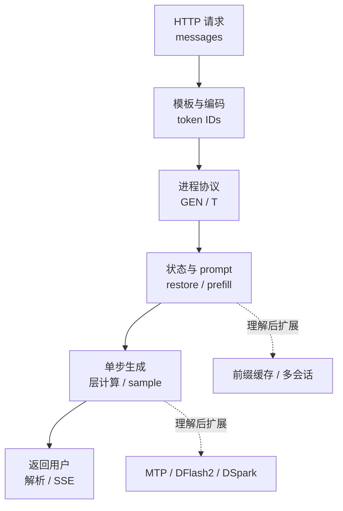

# 05｜源码阅读路线：从一句话走到一个 token

[上一章：推理流程](04-inference.md) · [目录](README.md) · [下一章：Basalt 专章](basalt/README.md)

源码阅读的第一项成果，应是能解释一次请求经过了哪些边界，而不是记住所有目录。建议先跟踪普通文本、一个请求、一个模型的路径，弄清数据的形状和归属，再加入缓存、投机、图像和多卡。

> 本章 Strata 链接固定在 `ffa80d73133ea5c548aefe57889a16e8085a938f`，Basalt 链接固定在 `4998eb3733ee83b7e7d6ff94854c399dd89cfebe`。行号只服务于这两个快照；若使用别的 checkout，请优先搜索符号。版本与归档关系见 [SOURCES](SOURCES.md)。

## 1. 先选一条主线

先给自己一个具体问题：**客户端发送“请介绍 MoE”后，第一段文字如何回来？** 暂时把“带图片”“多个模型轮换”等分支记在旁边，不必同时追踪。



第一遍只读入口函数、调用顺序和数据结构，不钻进每个 kernel。第二遍选择“专家不在主 GPU”这个分支，把 RAM、CPU 专家池和 peer GPU 加回来。第三遍再研究投机窗口及状态回滚。

## 2. 第一步：从 Python 看见输入与输出

打开 Strata 的 [`serve/server.py`][server]，按下表跳转。这个文件较长，从顶部逐行读到最后很容易失去请求主线。

| 阅读入口 | 在固定快照中的位置 | 要看懂什么 |
|---|---|---|
| `main` | 9485 行 | 配置怎样变成服务实例与启动参数 |
| `serve`、`Server` | 8854、8569 行 | 监听端口和处理连接属于哪一层 |
| `Service` | 4492 行 | 请求服务持有什么共享资源 |
| `encode_prompt` | 5489 行 | messages、tools 怎样变成 token IDs |
| `prepare` | 5559 行 | 长度、生成预算、采样与请求状态怎样准备 |
| `run`、`_run` | 5869、5881 行 | 如何把一次服务请求送入引擎并消费事件 |
| `StrataEngine` | 1055 行 | 子进程何时创建，stdin/stdout 怎样通信 |

在 [`serve/frontend.py`][frontend] 中补读 `ChatTemplate.render` 与 `OutputParser`。前者处理模型所需的对话格式；后者帮助把生成结果解释为外部 API 的输出。模板、tokenizer、输出解析是不同环节：格式化后的文本不是 token IDs，token IDs 也不是客户端可以直接展示的完整事件。

完成标志：用自己的话解释以下三个值，并各找出一个生产者和消费者：

- `messages`：带角色与内容的结构化请求。
- `ids`：模型词表中的整数序列。
- 引擎输出事件：token、结束信息和运行状态，不等于最终 HTTP JSON。

## 3. 第二步：跨过 Python → C++ 边界

先读 `StrataEngine` 创建子进程和写入生成命令的位置，再打开 [`src/program/generate.cpp`][generate]。该文件开头概括了单 token 主线：embedding → 多层计算 → lm head → sampling，并说明该原生路径不承担 tokenizer。

本基线的主要入口在 3181—3183 行附近：Windows/HIP 条件编译使用 `engine_main`，其他分支使用 `main`。文件尾部还有 Windows 入口，因此搜到多个 `main` 并不说明每次运行都会经过它们。[入口条件][generate-main]

接着搜索 `READY`、`GEN`、`DONE`。目标是找到：

1. 初始化何时结束，什么时候可以接收请求。
2. 一行协议怎样解析为 token、长度和采样参数。
3. 请求处理如何进入 prefill 与 decode。
4. 每个 token 和最终结束状态如何写回 stdout。

不要仅凭出现字符串就认定找到了主循环：相同关键字可能也在日志、测试和特殊模式里。顺着调用者继续向上看，确认当前 executable、条件编译宏和启动参数。

Strata 的 DeepSeek 还有独立 [`src/dsv41/ds4_main.cpp`][ds-main] 入口。Python 服务接口相近，并不表示 DeepSeek 内部执行 `generate.cpp` 中同一套模型算子。

## 4. 第三步：先认数据结构，再读长函数

建议依次打开以下三个头文件，把“模型是什么”和“这次生成到了哪里”分开。

| 文件 / 类型 | 先回答的问题 | 不能混淆的对象 |
|---|---|---|
| [`geometry.hpp` / `ModelGeometry`][geometry] | 隐藏维度、层数、专家数等形状来自哪里？ | 形状描述不是实际权重字节 |
| [`weights.hpp` / `WeightTable`][weights] | 如何从权重名或布局定位所需张量？ | 权重地址不是当前 token 的激活 |
| [`session.hpp` / `SessionState`][session] | 当前会话拥有哪些状态和缓冲区？ | 会话状态不能无条件跨请求混用 |

`SessionState` 包含模型执行需要的状态；同文件还描述 `SessionGraphs` 及不同回放入口。看到 `session_replay` 时，务必继续阅读合同：文件明确区分它与 `session_replay_full`，不能把一个局部回放函数的耗时当成完整 token 的成本。

下面是一张可以自己填的阅读记录表。第一次追踪一个变量时，填一行，比连续收藏几十个函数名更有帮助。

| 数据 | 形状或单位 | 当前在哪里 | 谁创建 / 更新 | 什么时候可复用或释放 |
|---|---|---|---|---|
| 输入 token IDs | token 数量 × 整数 | Python / 原生输入缓冲 | 模板编码与协议读取 | 请求处理完成后 |
| 层输入激活 | 依模型隐藏维度 | GPU，或 CPU 可访问副本 | 前一层 / 归一化 | 本层消费者完成后 |
| 专家结果 `parts` | `k × n_embd` | 依执行路径安排 | 选中的专家计算 | 合并完成后 |
| KV / 递归状态 | 依模型与历史长度 | 会话管理的设备/主机存储 | prefill / decode / restore | 会话回收或淘汰时 |

最后两行故意不用统一的固定容量：模型架构、上下文、并发和驻留策略都会改变真实布局。

## 5. 第四步：用一个专家请求理解异构计算

阅读 [`expert_source.hpp`][expert-source] 的接口合同，再看对应实现和 [`src/kernels/cpu/pool.cpp`][cpu-pool]。先追踪“需要哪个专家、数据在哪、谁来算”，之后才读量化内核的位操作。

为这一层记录五项内容：

1. 输入激活如何准备，什么时候 CPU 可以读取。
2. MoE router 给出了哪些专家 ID 与路由权重。
3. 每个专家落在 GPU 缓存、CPU/RAM 或其他后备路径中的哪一处。
4. 专家结果存在哪里，谁等待它们完成。
5. 合并阶段在哪里应用路由权重，后续层何时可以读取。

这个接口有一个很适合初学者练习的细节：**Strata 的 CPU 专家池不乘 router weight，设备端 `moe_combine` 才乘。** 如果读者只看到“专家计算完成”就跳到下一层，容易漏掉这项必要运算，也可能在修改代码时重复乘一次。[接口合同][expert-source]

再阅读 [`src/prefill/prefill.cpp`][prefill]，比较输入从单个 token 变成 token 块之后，工作排序、缓冲区和计算核为何改变。不能把 decode 的一次小矩阵向量计算简单复制多遍，就当作这里的优化 prefill。

## 6. 第五步：把普通解码扩展到投机解码

先回顾[推理流程](04-inference.md)，再分别查看 Strata 的 `include/strata/core/mtp.hpp`、`verify.hpp`、`dflash2.hpp` 及对应 `src/core/` 实现。

不要先纠结草稿模型的每层数学。先画出下面四种状态变化：

- **草稿前：** 目标模型已经确认到哪个位置。
- **草稿后：** 哪些 token 只是提议，哪些临时状态已经被写入。
- **校验后：** 接受了多长前缀，分歧处采用哪个目标结果。
- **下一轮前：** 哪些状态被保留、截断、恢复或重新计算。

然后检查“接受”具体由什么规则决定。Strata 还有受 `STRATA_SPEC_PROB` 控制的可选概率拒绝采样逻辑；不能仅看默认路径，就把所有模式都描述为“token ID 相等则接受”。[可选概率规则][spec-prob]

阅读 Basalt 时可以先看 [`Request::execute`][basalt-request]，其阶段顺序十分明确：`parse → prepare_prompt → restore → read_prompt → decode → complete`。再看 [`decode_loop.hpp`][basalt-loop]，跟踪校验、grammar 检查与提交的先后关系。grammar 检查通过前的候选，不应直接等同于最终已提交输出。

## 7. 第六步：沿接口比较 Basalt，而不是机械对齐文件名

Strata 的一些大文件在 Basalt 中被拆分。适合做比较的是“这项职责去了哪里”，而不是“同名文件还剩多少行”。

| 想比较的职责 | Strata 阅读入口 | Basalt 阅读入口 |
|---|---|---|
| API、请求准备、输出 | `serve/server.py`、`serve/frontend.py` | `serve/service.py`、`serve/router.py` |
| 一次原生请求的生命周期 | `src/program/generate.cpp` 的服务循环 | `src/program/serve/request.cpp` |
| 模型描述与接入 | geometry、各模型专用入口 | [`ModelAdapter`、`ModelSession`][basalt-adapter] |
| Qwen 模型计算 | `src/core/`、`src/prefill/` 相关路径 | `src/models/qwen4exp/` |
| DeepSeek 模型计算 | `src/dsv41/` | `src/models/deepseek41/` |
| GPU/CPU 专家协作 | expert source、cache、CPU pool | 公共专家设施与模型各自 dispatch/tier |

特别查看 `ModelAdapter::run`：接口允许模型拥有专用运行入口；未提供专用入口时才走共享服务器加载的 sessions。由此可以理解为什么“Basalt 有公共模型接口”不意味着 Qwen 与 DeepSeek 使用完全相同的内部调度。

最后再读 [Basalt 专章](basalt/README.md) 的 RTX 50 系列优化。每项优化都应能回答“作用于哪种数据、哪一阶段、哪个硬件条件”，而不只是记住 NVFP4、Graph 或 Blackwell 这些名称。

## 8. 可以直接使用的只读查找方式

在自己的终端中把目录改为实际源码路径。下面的命令只定位源码，不下载模型、不编译、不启动推理。

```bash
STRATA_SRC=/absolute/path/to/Strata
BASALT_SRC=/absolute/path/to/basalt

git -C "$STRATA_SRC" rev-parse HEAD
git -C "$BASALT_SRC" rev-parse HEAD
rg -n 'class (StrataEngine|Service)|def (prepare|encode_prompt)' "$STRATA_SRC/serve/server.py"
rg -n 'engine_main|int main|READY|DONE' "$STRATA_SRC/src/program/generate.cpp"
rg -n 'struct (ModelGeometry|SessionState)|class WeightTable' "$STRATA_SRC/include/strata/core"
rg -n 'Request::execute|prepare_prompt|read_prompt' "$BASALT_SRC/src/program/serve"
rg -n 'class (ModelAdapter|ModelSession)|virtual.*run' "$BASALT_SRC/include/basalt/model/adapter.hpp"
```

搜索结果只是入口，不是完整论证。例如，找到某个 `#if` 下的 kernel 只能证明代码存在，不能证明当前 build 编译了它、当前模型选择了它，或它在你的 GPU 上更快。

## 9. 原始六篇笔记应该怎么用

原稿适合第二遍阅读时查细节，保留在归档中。它们比本教程更密集，包含大量行号和特定模型常量；先阅读本章，再按问题进入相应原稿。

| 归档笔记 | 适合追问的问题 |
|---|---|
| [cli-launch.md](archive/strata-notes/cli-launch.md) | 启动、安装、配置、桌面与终端怎样配合？ |
| [server.md](archive/strata-notes/server.md) | HTTP 生命周期、协议、前缀缓存和输出适配在哪里？ |
| [engine-core.md](archive/strata-notes/engine-core.md) | 原生启动、服务循环、prefill、停止条件怎样串联？ |
| [memory-weights.md](archive/strata-notes/memory-weights.md) | 权重布局、量化、专家缓存和 RAM/磁盘路径怎样组织？ |
| [kernels-spec.md](archive/strata-notes/kernels-spec.md) | `qwen4exp` 的单层数学、采样和投机有哪些细节？ |
| [dsv41-split-ports.md](archive/strata-notes/dsv41-split-ports.md) | DeepSeek、专用 split 引擎与平台后端有哪些独立路径？ |

原 `cli-launch.md` 明确标注 Strata 0.2.12 / engine 0.1.58；本教程采用的本地固定快照说明为 0.2.10 / 0.1.56。因此原稿的行号、默认值和具体选项不能直接用于当前引用。例如原稿中 `Service` 的定位与本章的 4492 行不同，应搜索类名重新定位。

## 10. 如何判断自己已经读懂

可以选择源码中的一个测试作为最后的练习：Strata 的 `tests/core/expert_cache_slot_guard_test.cpp`、Basalt 的 `tests/core/protocol_test.cpp` 或 `tests/core/conversation_validation_test.cpp`。先看测试给了什么输入、期待什么结果、拒绝什么非法状态；不要只读测试名称。

本手册没有编译或执行 GPU 测试。阅读测试能帮助理解合同，不能替代在实际驱动、显卡和模型上的正确性与性能验证。

完成这一轮后，你应能对一段代码写出四句话：**它接收什么；修改什么；等待谁；把什么交给下一步。** 若还不能，回到变量的形状、所在设备与生命周期，而不是继续增加更多文件。

[server]: https://github.com/Niko1221/Strata/blob/ffa80d73133ea5c548aefe57889a16e8085a938f/serve/server.py#L4492
[frontend]: https://github.com/Niko1221/Strata/blob/ffa80d73133ea5c548aefe57889a16e8085a938f/serve/frontend.py#L40
[generate]: https://github.com/Niko1221/Strata/blob/ffa80d73133ea5c548aefe57889a16e8085a938f/src/program/generate.cpp#L1
[generate-main]: https://github.com/Niko1221/Strata/blob/ffa80d73133ea5c548aefe57889a16e8085a938f/src/program/generate.cpp#L3180
[ds-main]: https://github.com/Niko1221/Strata/blob/ffa80d73133ea5c548aefe57889a16e8085a938f/src/dsv41/ds4_main.cpp#L1
[geometry]: https://github.com/Niko1221/Strata/blob/ffa80d73133ea5c548aefe57889a16e8085a938f/include/strata/core/geometry.hpp#L23
[weights]: https://github.com/Niko1221/Strata/blob/ffa80d73133ea5c548aefe57889a16e8085a938f/include/strata/core/weights.hpp#L113
[session]: https://github.com/Niko1221/Strata/blob/ffa80d73133ea5c548aefe57889a16e8085a938f/include/strata/core/session.hpp#L31
[expert-source]: https://github.com/Niko1221/Strata/blob/ffa80d73133ea5c548aefe57889a16e8085a938f/include/strata/core/expert_source.hpp#L1
[cpu-pool]: https://github.com/Niko1221/Strata/blob/ffa80d73133ea5c548aefe57889a16e8085a938f/src/kernels/cpu/pool.cpp
[prefill]: https://github.com/Niko1221/Strata/blob/ffa80d73133ea5c548aefe57889a16e8085a938f/src/prefill/prefill.cpp
[spec-prob]: https://github.com/Niko1221/Strata/blob/ffa80d73133ea5c548aefe57889a16e8085a938f/include/strata/core/spec_prob.hpp#L1
[basalt-request]: https://github.com/jesdga95/basalt/blob/4998eb3733ee83b7e7d6ff94854c399dd89cfebe/src/program/serve/request.cpp#L6
[basalt-loop]: https://github.com/jesdga95/basalt/blob/4998eb3733ee83b7e7d6ff94854c399dd89cfebe/src/program/serve/decode_loop.hpp#L35
[basalt-adapter]: https://github.com/jesdga95/basalt/blob/4998eb3733ee83b7e7d6ff94854c399dd89cfebe/include/basalt/model/adapter.hpp#L129
