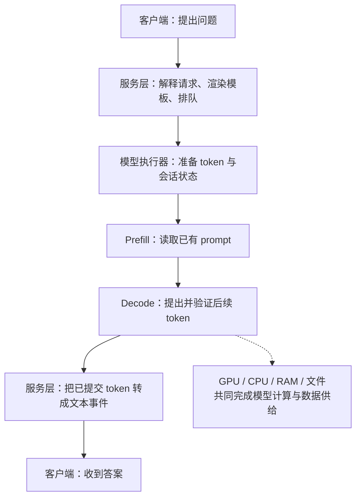

# Strata 与 Basalt：从请求到 token 的推理引擎学习手册

这套手册帮助初学者回答三个问题：**系统由哪些部分组成、数据在什么地方移动、一个 token 怎样被计算出来。** 先学两项目共享的原理，再看具体实现，最后理解 Basalt 为什么针对 RTX 50 系列所在的 Blackwell sm_120 做这些优化。

不需要先会写 CUDA。知道“程序调用函数、内存保存数据”就可以从第一章读起；源码章节可以等原理读懂后再看。

Basalt fork 自 Strata，但已形成独立的代码组织和硬件取舍。两者有共同基础，也各自继续演进。这里把知识整理在同一目录：共同概念只讲一次，项目差异放在明确的分支中。

需要连续阅读或保存时，可打开 [完整学习手册.md](完整学习手册.md)；分章版更适合按问题查找。

## 阅读地图

| 顺序 | 章节 | 读完应能回答 |
|---|---|---|
| 1 | [基础概念](01-foundations.md) | token、向量、专家、KV、logits、sampling 分别是什么？ |
| 2 | [整体架构](02-architecture.md) | CLI、Python server、C++ 引擎、GPU、CPU 各做什么？ |
| 3 | [数据流向](03-dataflow.md) | 请求、权重、运行状态走哪条链？哪些数据需要跨 PCIe？ |
| 4 | [完整推理流程](04-inference.md) | prefill、decode、draft、verify、commit 怎样衔接？ |
| 5 | [源码阅读路线](05-source-reading.md) | 应从哪些文件、符号和数据结构开始追踪？ |
| 6 | [Basalt 与 Strata 的关系](basalt/README.md) | 哪些能力是继承，哪些是专用化与后续重构？ |
| 7 | [Basalt 的 Blackwell 优化](basalt/01-blackwell-optimizations.md) | FP4、专家缓存、mapped 输入、Graph、draft 各减少哪种成本？ |
| 8 | [两项目的架构差异](basalt/02-architecture-differences.md) | 文件格式、服务、模型扩展、并发和多卡有哪些边界？ |

第一次阅读按 1 → 2 → 3 → 4 → 6 → 7 即可形成完整认识；第二次再读源码路线和架构差异。不要一开始就试图记住所有配置名和行号。

## 先建立一条主线



这里的箭头是阅读顺序，不是“每个阶段都新建一个进程”。常驻模型可以连续服务多个请求；一轮回复也要经历很多生成窗口。

把三个容易混淆的问题拆开：

- **架构图回答“谁负责”。** 服务层管理 API，引擎管理计算，设备执行各自的任务。
- **数据流图回答“传什么、存哪里”。** prompt、专家权重和 KV 的寿命不同，不应混成一条大箭头。
- **时序图回答“先做什么、等谁”。** 即使 GPU 很快，等待 CPU 专家、磁盘或队列也可能拉长回复时间。

## 文中图和例子的读法

- 图中的 `token IDs` 是整数编号；`hidden state` 是向量；`logits` 是词表分数，不是已经生成好的文字。
- 实线通常表示正常数据/调用关系；虚线表示可选或条件路径，具体以图旁文字为准。
- “共同原理图”省略了模型专属层；明确写了“Basalt”或“Strata Qwen”的图，只适用于对应实现。
- 演示用的专家数、token 编号和接受例子会明确标为教学假设，不能拿去当真实模型配置。
- Markdown 保留 Mermaid 源图；导出的 SVG 供不支持 Mermaid 的阅读器使用，见[图表目录](assets/README.md)。

## 学习时最重要的五个区分

| 容易混淆 | 应怎样区分 |
|---|---|
| 模型与引擎 | 模型定义参数和计算结构；引擎组织如何在设备上执行 |
| MoE routing top-k 与 sampling top-k | 前者选专家，后者选输出 token 候选 |
| 专家缓存与会话缓存 | 前者存可复用模型权重，后者存某段历史的运行状态 |
| Prefill 与 decode | 前者处理已知输入，后者逐轮生成未知后续；kernel 可以不同 |
| 多模型、多个请求槽与多 GPU | 分别是模型生命周期、请求调度和计算资源分工；一个能力不自动包含另一个 |

## 版本、材料与可信范围

这是一份固定版本的学习资料。Strata 使用本地可复核的 `ffa80d73` 学习基线；Basalt 使用前次报告的 `4998eb37`。旧笔记还有不同版本的内容，保留在归档中，正文已按明确范围重新组织。

所有项目性能数字都来自已注明的项目记录，本次整理没有进行 GPU 实测。代码阅读可解释机制，不能替代端到端基准测试。完整的版本、来源、材料映射和验证范围见[来源与版本说明](SOURCES.md)。

## 目录结构

```text
strata/
├── README.md
└── learning-guide/
    ├── README.md                       学习入口
    ├── 01-foundations.md               基础概念
    ├── 02-architecture.md              组件与职责
    ├── 03-dataflow.md                  数据与生命周期
    ├── 04-inference.md                 推理时序
    ├── 05-source-reading.md            源码阅读路线
    ├── basalt/                        专门讨论 Basalt 的延伸章节
    ├── assets/                        Mermaid 源图与 SVG
    ├── SOURCES.md                      版本与证据说明
    └── archive/                       原始笔记与原分析报告
```

开始阅读：[01｜基础概念](01-foundations.md)。
