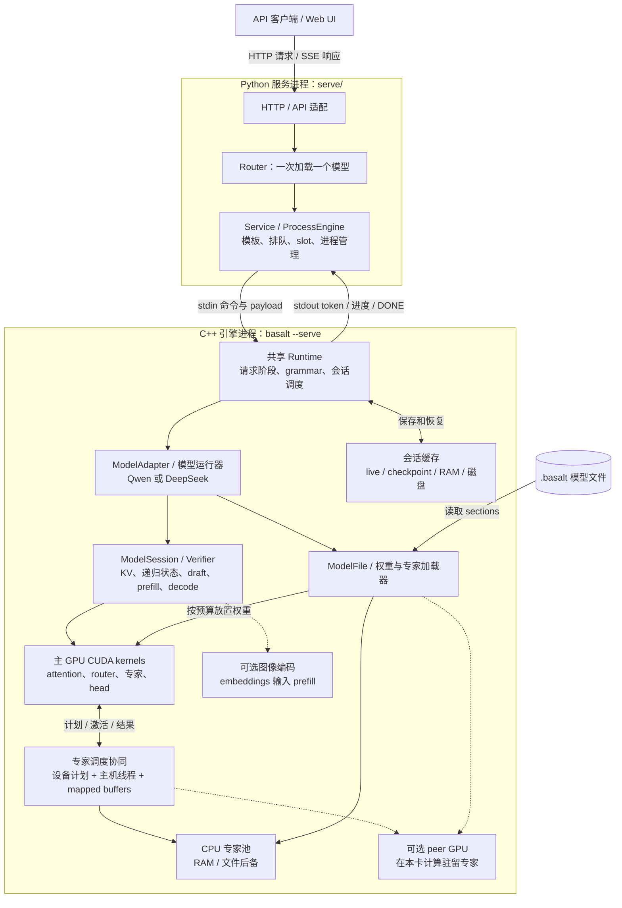
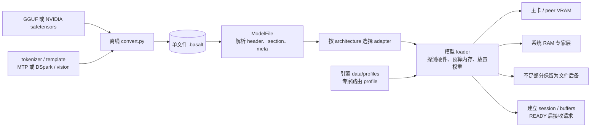
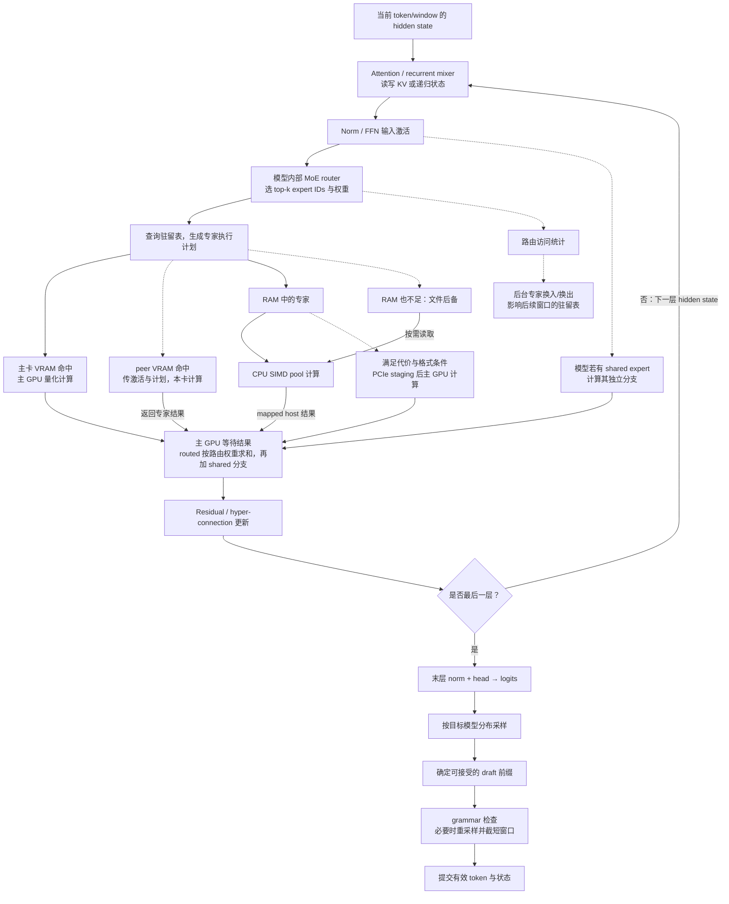
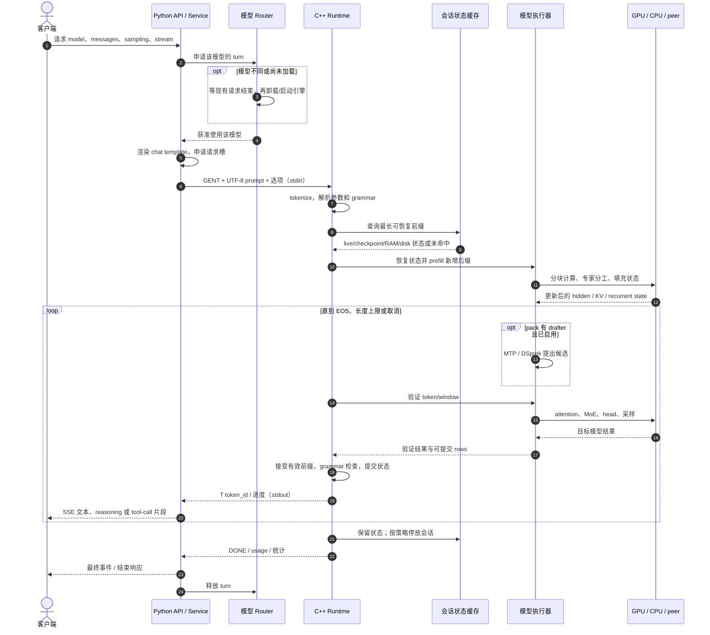

# Basalt 项目分析：相对 Strata 的改造、RTX 5090 优化与架构数据流

> 分析日期：2026-11-08，Asia/Shanghai。  
> 源码快照：`jesdga95/basalt`，`4998eb3733ee83b7e7d6ff94854c399dd89cfebe`，项目版本 `0.3.1`，工作区干净。  
> 方法：读取本地源码、Git 历史、项目测试/性能记录，并核对上游和 NVIDIA 官方资料。本报告没有运行 GPU 实测；文中性能数字均标明来源与适用条件。

**Basalt 的本质，是把 Strata 的异构 MoE 推理引擎收窄到 Blackwell `sm_120` GPU，围绕内存层级、量化计算、推测解码和服务状态管理持续优化。** 它不是简单改名，也不是单靠一个 FP4 kernel 获得全部收益。[项目定位][readme] [硬件约束][cmake]

最值得记住的五点：

1. **分层专家、MTP、CUDA Graph、并行槽、多卡专家层并非 Basalt 首创。** 分叉前的 Strata 已有这些基础，Basalt 主要做专用化、融合、调度和工程重构。
2. **5090 的 FP4 Tensor Core 主要用于 Qwen NVFP4 的较大 prefill chunk。** Decode 的量化矩阵乘使用 int8 激活，不能概括为“整个推理都是 W4A4”。
3. **32 GB 显存仍装不下完整模型。** 热专家放 GPU，其他专家放 RAM，由 CPU 或调度选中的 GPU 路径计算；多卡还能就地计算各自专家。
4. **Python 服务与 C++/CUDA 引擎是两个进程层次。** Router 可管理多个模型配置，但同一时刻只加载一个模型；同一模型可使用多个请求槽。
5. **目前不能据这些资料给出“Basalt 比最新 Strata 快 X 倍”。** 已有记录能支持具体优化和 Basalt 自身版本间的收益，缺少完整、可比的两项目受控 A/B。

本文件内含四张 Mermaid 图：组件架构图、模型制备流程图、MoE 数据流图、请求时序图。支持 Mermaid 的 Markdown 阅读器可直接渲染。另有可点击源码的[交互式架构图](.archify/architecture-basalt-20261108-143000/basalt-architecture.html)。

## 1. 比较的是哪两个版本

| 对象 | 本报告采用的范围 | 解释 |
|---|---|---|
| Basalt 当前实现 | `4998eb37`，版本 0.3.1 | 架构、默认行为和执行路径以该快照为准 |
| Strata 历史断面 | `e69c1fb6f129bf813e655b818b91414fb894c0a3` | 本地历史中进入 Basalt 作者连续改动前的可复核断面；CMake 标为 Strata 0.1.39 |
| 今日 Strata | 官方仓库当前公开内容 | 只用于确认上游也在继续发展；不是上述历史断面的同义词 |

`e69c1fb6` 后紧接的 `c7127829` 是 Linux 文件预读优化。这里将前者称为“历史比较断面”，**不宣称已经证明它是今日两仓库的严格 merge-base**。Basalt 后续也有移植 Strata 修复的记录。[历史 CMake][baseline-cmake] [首段改动][first-change]

当前 Strata 已继续扩展模型和桌面应用，也有 DeepSeek 与多种硬件后端。因此，“Basalt 后来新增 DeepSeek”描述的是这条分支的演进，不能推导成“现在 Strata 不支持 DeepSeek”。[Strata 当前仓库][strata]

### 1.1 从 Strata 继承了什么，后来改了什么

| 领域 | 历史 Strata 已有的基础 | Basalt 的主要改造 |
|---|---|---|
| 平台与 GPU | 多代 CUDA，以及 HIP、SYCL 等路径 | 收窄为 CUDA 13、`sm_120`；删除其他主后端和旧架构分支，集中维护经过测量的快速路径 |
| CPU/GPU/SSD 分层 | GPU 热专家、RAM 专家、CPU 计算、文件后备 | 更细的专家放置、RAM 补集管理、GPU 侧计划、异步换入与多层资源预算 |
| CUDA Graph | 已有图捕获与设备侧调度 | 更多阶段融合；PDL、下一层 L2 预取、peer persistent kernel，减少每层启动和同步开销 |
| 专家缓存 | 已有自适应专家驻留 | 改进初始 profile、访问计数和交换节奏，按运行时路由更新主卡/peer 驻留 |
| 推测解码 | 已有 MTP、prompt lookup、验证与提交 | 条件 draft graph、draft/head 筛选、窗口策略、调优 drafter；DeepSeek 接入 DSpark |
| NVFP4 | 历史断面尚无后来这套 NVFP4 路径 | 接入 CPU/GPU NVFP4 运算和布局，增加真正的 W4A4 FP4 Tensor Core prefill |
| 模型制品 | GGUF、native pack 和若干附属文件 | 统一 `.basalt` 分区容器；权重、tokenizer、template、drafter、vision 等可一起交付 |
| 多 GPU | 已有 peer expert tier、layer split | 统一 `gpu` 配置入口，按设备/成本自动选择；扩展 prompt 分工和共享 `PeerShare` |
| API 与生成控制 | OpenAI、Anthropic、Responses、流式与工具调用 | 更清晰的服务/模型边界；单流文本可由 C++ tokenize；生成阶段执行 grammar |
| 并发 | 已有 batch/parallel slots | 统一请求生命周期与 prompt/decode 调度；按模型接入专用或共享执行器 |
| 会话缓存 | RAM 停放、turn/system checkpoint | 增加磁盘停放、跨重启恢复、idle sleep/wake；与模型切换配合 |
| 模型扩展 | 历史断面主要围绕 Qwen | 模型 adapter/session/dialect 分层，Qwen 与 DeepSeek 代码独立，复用公共服务与内存组件 |
| Windows | Strata 原本已支持 | Basalt 曾移除，后经平台抽象层重建；当前支持 Linux 与 Windows x64 |
| 质量与性能验证 | 上游已有测试和 benchmark | 明确要求 kernel parity、CPU double reference、固定驻留布局、BF16 PPL/KLD、功耗与 ABBA 对照 |

继承关系可从历史版[执行原理][baseline-how]和[并发实现][baseline-batch]复核。平台收窄见[sm_120 提交][sm120-change]；后续演进见 [0.1.0][change01]、[0.2.0][change02]、[0.3.0][change03]、[0.3.1][change031]；质量要求见[贡献规则][contributing]。

**注意历史说明的时效性：** 早期 changelog 曾写 layer split 不再被选中，但当前代码已能按成本自动选择；0.3.0 时 DeepSeek 不接受 `--kv`，0.3.1 已支持 `fp8` 和 `fp16`。本报告采用当前代码，不能拿旧发布说明覆盖现状。

## 2. 它具体优化了 RTX 5090 的什么

### 2.1 目标是 sm_120，不是所有名字里带 Blackwell 的设备

主引擎 CMake 只接受 compute capability 12.0，要求 CUDA 13；FP4 prefill 库进一步使用 `120a-real`。这是编译和运行路径的明确边界。[构建约束][cmake] [FP4 编译目标][fp4-build]

该架构也包含 RTX PRO Blackwell 等专业卡，项目并不限于消费卡；本文重点讨论 5090。NVIDIA 将桌面 RTX 5090 列为 CC 12.0；DGX Spark/GB10 属于 12.1，不能仅因都叫 Blackwell 就认为本项目主引擎支持它们。[CUDA GPU 表][nvidia-cc]

| “5090 系列”中的区别 | 对本项目分析的意义 |
|---|---|
| 桌面 RTX 5090：32 GB GDDR7 | 仓库中有多条相关性能记录，是主要验证硬件之一 |
| RTX 5090 D v2：24 GB GDDR7、384-bit | 容量和接口不同，不能套用桌面 32 GB 5090 的专家缓存容量与速度 |
| RTX 5090 Laptop GPU | 社区表单独记录，样例为 24 GiB、175 W；不能与桌面卡视为同一性能档 |
| 5090 D / D v2 的专门优化 | 本次未找到专门 kernel 分支或独立实测；满足 CC12.0 的设备可共用能力驱动路径，是代码层推断，不是该 SKU 的实测保证 |

硬件规格来源：[桌面 5090][nvidia-5090]、[5090 D v2][nvidia-5090dv2]；Laptop 记录来自[社区数据][community-data]。视觉 sidecar 的独立硬件支持不应混同主推理引擎的 sm_120 边界。

### 2.2 FP4：减少权重字节，并在适合的阶段使用 Tensor Core

Qwen 官方默认包 `NVFP4-DQ6_K` 的含义是：**路由专家用 NVIDIA NVFP4，dense 投影用 Q6_K**；并非模型的每个 tensor 都用 4 bit。NVFP4 专家保留 E2M1 代码和 UE4M3 scale，计入比例信息约 4.5 bit/weight，另有 FP32 tail。它们从 NVIDIA checkpoint 按位搬入，dense 则从 BF16 量化。[模型文件][model-file] [计算精度][qwen-precision]

| 阶段 | 真实执行方式 | 为什么有利于 5090 |
|---|---|---|
| 专家权重存储 | 原生 NVFP4 / GGUF 量化块 | 减少 VRAM、RAM、PCIe 所需字节，让有限显存容纳更多专家 |
| Qwen decode | q8_1/int8 激活；量化点积、int32 子块累加与 FP32 scale | 小窗口重视权重带宽、低延迟，不必为追求 W4A4 而增加额外转换 |
| Qwen NVFP4 prefill | 满足格式条件且 chunk ≥1024 时，E2M1×E2M1 block-scaled MMA | 利用 5090 FP4 Tensor Core 处理较大的矩阵工作量 |
| Dense prefill | FP16 权重/激活，cuBLAS，FP32 累加 | 使用适合批量 prompt 的 GEMM 路径 |
| GDN prefill | 16-token chunked delta rule，BF16/TF32 Tensor Core | 将模型的递归运算改写为可批量计算的块路径 |

代码证据非常直接：`FP4_MIN_TOKENS=1024`；分发处检查 NVFP4 格式及 tail；FP4 kernel 中实际发出 `mma.sync.aligned.kind::mxf4nvf4.block_scale...e2m1.e2m1...ue4m3` 指令，并使用异步加载流水。[触发阈值][fp4-threshold] [分发条件][fp4-dispatch] [PTX 实现][fp4-kernel]

**这项优化不是完全无数值变化。** 项目报告在 2,049-token prompt、24 chunks 下，FP4 prefill 相对 MMQ 的 KLD 增量为 0.0018，top-1 下降 0.19 个百分点；更长 prompt 的少量样本未分辨出显著差别。这支持“小幅精度代价”，不支持“FP4 完全无损”。该 kernel 还标注了对 Infernix 代码的适配来源，不能算全部独立原创。[精度测量][qwen-prefill]

### 2.3 显存与 RAM：让热专家留在最快的地方

Qwen NVFP4 整个专家集合约 63.3 GiB，整个模型包约 122 GiB。桌面 5090 的 32 GB 还要容纳 dense、KV、drafter 和工作区，显然不能完整装下模型。[模型包说明][model-file] [社区配置记录][community-data]

Basalt 用几类不同资源承接数据：

- **主 GPU VRAM：** 常用权重、状态、工作区和热专家；命中后直接在主卡计算。
- **peer GPU VRAM：** 其他专家在该卡本地计算，主要交换激活、路由信息和结果。
- **系统 RAM：** 容纳 GPU 放不下的专家；CPU SIMD 线程池可以直接计算，一部分路径也按成本将专家暂存到 GPU。
- **模型文件/SSD：** RAM 也不足时的后备来源。它确实存在，但缺页或读取等待会拖慢推理。

这里的 RAM 不总是“全模型再完整复制一份”。专家补集管理允许 GPU 已持有的专家不重复常驻 RAM；交换时维护其归属和可用副本，prefill 借用显存槽也要协调回填。[专家来源接口与补集][expert-source]

Qwen 的 adaptive tier 根据近期路由计数换入热专家，默认 server 每个 window 发起一轮、最多 96 次 swap，计数衰减 0.85；一个交换周期跨 copy-out、side-stream copy-in、use 三个 window。DeepSeek 则有自己的 homes/copies 与按访问更新的 tier 实现，不能把 Qwen 的所有参数原样套过去。[Qwen 自适应缓存][adaptive] [DeepSeek tier][deep-tier]

**缓存命中率不是唯一目标。** 频繁换入也消耗 PCIe；CPU/GPU 路径的激活量化与归约不同，改变专家放置可能改变最后几位数值，进而改变生成文本。性能与输出一致性测试都需要固定专家层级。[专家精度差异][qwen-precision]

### 2.4 PCIe 与多卡：减少搬运，避免互相排队

pinned/mapped memory 使 GPU 可以访问主机缓冲区，但它不会把 RAM 变成 VRAM 速度，也不会消除 PCIe 传输。Basalt 的意义在于选择合适的搬运方式、缩小传输内容，并与计算重叠。

当前多卡有三种需要区分的情况：

| 模式 | 当前行为 |
|---|---|
| Expert tier | 主卡跑模型主干，其他卡就地计算驻留专家；异构卡走此路径。Qwen 最多三个 peer tiers，DeepSeek 当前最多一个 |
| Decode layer split | Qwen 对显存容量与带宽各相差不超过 10% 的卡估价；比 expert tier 估计至少便宜 5% 才可能选用 |
| Tensor parallel | 成本模型会显示其估价，但 `runs=false`，当前没有实现 |

此外，Qwen 的**长 prompt 临时分层流水**与 decode layer split 是两回事：它可在没有其他槽 decode、RAM/VRAM 等条件满足时借用 peer 缓存槽执行 prompt，完成后归还。0.3.1 共用的 `PeerShare` 还允许第二卡在 prefill 中计算本卡专家及部分 RAM 专家，利用各自的 PCIe 链路。[多卡决策代码][multi-gpu] [实际选路][qwen-run] [GPU 文档][gpus] [0.3.1 变化][change031]

**当前 HEAD 的具体例子：** DeepSeek 第二卡原来先用两次 `cudaMemcpyAsync` 传激活和 plan；专家槽换入的 7–10 MB copy 也使用 copy engine，二者会排队。`4998eb37` 改成量化 kernel 直接读取 pinned、portable、mapped 激活，并由额外 blocks 把 mapped plan 复制到 device buffer，绕开这段 copy-engine 排队。权重仍在 peer 上计算，PCIe 字节仍然需要传输。[当前提交][head-change] [实现][peer-code]

作者记录：5090 400 W + 5060 Ti 180 W，发生 slot copy 时，首个专家 kernel 的启动等待从 81.4 μs 降到 41.8 μs；冷 prose 从 87.4 到 88.9 tok/s，verify+draft 从 19.77 到 19.44 ms/window。该实验使用 UD-IQ1_M、seed 42、`--diag-tier-ram 316`，即每层固定 316 个 RAM-tier 专家。它是有限的 A1/B1 与 trace 证据，不是本报告复测，也不是整个 fork 相对 Strata 的增益。

### 2.5 Decode：减少小 kernel、同步和无效权重读取

单 token/小窗口 decode 常受权重带宽及调度延迟影响。Basalt 在这条路径上做了多种相互配合的优化：

- **CUDA Graph：** 缓存不同窗口宽度的执行图，复用 launch 序列。
- **Device plan 与融合专家链：** GPU 根据路由和驻留表分类专家，融合或分组执行 gate/up/down/combine。
- **PDL 与重叠：** 条件允许时提前启动依赖 kernel；无法启用时有普通 graph 路径。
- **Persistent peer kernel：** 一个 window 内跨层通过 mapped ring/序列字接收任务，减少每层从 host 单独启动的成本。
- **利用等待间隙：** 在等待 CPU/peer 结果时执行可重叠的状态提交，或预取下一层投影权重到 L2。

这些机制的基础部分来自 Strata，Basalt 在当前执行链中进一步融合和调度。[图捕获][capture] [MoE 执行链][record-moe] [peer window][peer-execution]

输出 head 也会读大量词表权重。Qwen NVFP4 包的 **Q8_0 two-stage head** 先用 bit-plane 和误差区间筛候选，再精确评分可能进入 top-K 的行；K≤64 的路径有精确界限，其他情况回到全精确评分。项目记录从 439 到 350 μs/window。另一个 **Q6_K head** 的 tail 是近似的，不能把两种实现都称作无损。[两阶段 head][head-precision]

### 2.6 Drafting 与 KV：一次权重读取产出更多有效 token

Qwen 使用 MTP，默认窗口 8 表示“最后一个已接受 token + 最多 7 个 draft”；DeepSeek 使用 DSpark，默认窗口 3 表示“anchor + 最多 2 个 draft”。主模型验证后才提交有效输出，草稿不会直接作为最终答案发送。[Qwen 模型说明][qwen-model] [DeepSeek 模型说明][deep-model]

粗略理解吞吐可用：

```text
tok/s ≈ 一个验证窗口实际产出的有效 token 数 ÷ 该窗口墙钟耗时
```

因此应同时看 tok/s、ms/window、passes/s 和接受情况。高重复的结构化内容通常更利于 draft；较难预测的 prose 或长对话不保证同等增益。

DeepSeek 默认只保留 drafter 每阶段最常用的 32 个专家，显存约 2.41 GiB；保留全部 128 个约 7.47 GiB。更多 draft 专家不一定更快，因为它会挤掉目标模型专家，让文件层或 RAM 压力增大。[DSpark 记录][deep-model]

KV 则影响能留给专家多少显存：

| 模型 | 当前格式与边界 |
|---|---|
| Qwen | 默认 `fp16`，可选 `int8`、`q4_0`、`k8v4`；社区 preset 用 `int8`，不能把社区设置当成引擎默认 |
| DeepSeek | 0.3.1 默认 `fp8`，内部结合 FP8/FP4 的不同缓存；920 B/position 对比旧 fp16 的 3200 B，文档给出 1M context 约 0.97 GiB 对比 3.20 GiB |

减少 KV 占用可间接增加专家驻留空间，但长上下文仍有计算、状态和内存成本。DeepSeek packed cache 的布局来源标注为 Project Maya；不能把所有相关设计归为 Basalt 原创。[配置][configuration] [DeepSeek 精度][deep-precision] [0.3.1 致谢][change031]

## 3. 性能数据能说明什么

### 3.1 有明确比较对象的局部证据

以下均为仓库作者报告，不是本次实测；除单卡行外，硬件为 RTX 5090 400 W + RTX 5060 Ti 180 W。

| 比较 | 条件 | 记录的结果 | 可以得出的结论 |
|---|---|---|---|
| FP4 对 MMQ prefill | Qwen NVFP4，int8 KV，cold | 16K：6456→7807；64K：8201→10126 tok/s | 该 prefill 路径约 +21% / +23%；存在数值变化，不能称 decode 也提升同样比例 |
| Q8_0 two-stage head | NVFP4，cold prose | 439→350 μs/window | 降低 head 时间，不能据此说整个模型快约 20% |
| 默认 adaptive 对每 64 window 才交换 | **单 5090 400 W**，NVFP4，一臂一次会话 | cold：160.0→241.8；whole session：143.7→204.8 tok/s | 此工作负载里及时适应比长交换间隔有效；不是与 Strata 对比 |
| Basalt 0.2.0 对 0.1.0 附近 main | 双卡、NVFP4、cold | 发布摘要约 +13%；单独 prose 297→330–337；完整 bench 顺序 prose 277→296 | 是 Basalt 内部版本比较；不同运行顺序不能混成一组数字 |
| HEAD peer mapped 输入优化 | DeepSeek IQ1_M，固定 RAM tier，A1/B1 | prose 87.4→88.9 tok/s；19.77→19.44 ms/window | 证据支持约 1.7% 的该轮端到端改善，样本有限 |

来源：[prefill/head 测量][qwen-precision]、[adaptive 测量][adaptive]、[0.2.0 发布记录][change02]、[HEAD 提交记录][head-change]。百分比是依据表中数字计算，未外推到其他机器。

### 3.2 5090 社区运行样例

| 日期 / commit | 模型与量化 / KV | GPU、功耗、RAM、系统 | Prefill 16K | Prefill 64K | Decode |
|---|---|---|---:|---:|---:|
| 2026-10-25 / `a57fade43e` | Qwen NVFP4 / int8 | 单 5090 400 W，121 GiB RAM，9950X，Linux | 7732.5 | 9229.4 | 317.2 |
| 2026-11-05 / `1b3f69641c` | Qwen NVFP4 / int8 | 单 5090 575 W，125 GiB RAM，9700X，Windows | 7922.8 | 9865.8 | 369.3 |
| 2026-11-01 / `9175e7a321` | Qwen NVFP4 / int8 | 双 5090 各 400 W，90 GiB RAM，9900X，Linux | 8233.0 | 12741.9 | 553.6 |
| 2026-11-06 / `13a42fd0d1` | DeepSeek IQ1_M / fp16 | 单 5090 475 W，247 GiB RAM，285K，Linux | 2476.5 | 3223.4 | 87.4 |

单位均为 tok/s，数据来自[固定快照中的社区记录][community-data]。这些行的模型、版本、CPU、RAM、功耗和运行环境不同，**只能作为实际运行样例，不能用于计算双卡缩放率、Windows/Linux 优劣或 Basalt/Strata 倍数**。

社区 decode 指标按 conversation、structured、prose fixtures 的总输出 token / 总 decode 时间汇总，默认 drafting 开启；不是某一条日常聊天的保证速度。preset 也拒绝生成有专家 SSD spill 的有效行，所以内存不足机器不能直接套用。[社区方法][community-method] [preset 代码][community-preset]

## 4. 项目整体架构

### 4.1 代码分层

| 目录 / 接口 | 职责 |
|---|---|
| `tools/convert/`、`tools/model_file.py` | 离线模型转换、组装 `.basalt`，不是逐 token 热路径 |
| `serve/handler.py`、`api/` | Python HTTP、OpenAI/Anthropic/Responses 协议转换和 SSE |
| `serve/router.py`、`service.py`、`engine/` | 模型切换、请求队列、槽位准入、prompt 渲染、进程与管道管理、输出解析 |
| `serve/models/` | 各模型的模板、特殊 token、工具调用形式及输出 dialect |
| `src/program/serve/` | C++ 共享持久 Runtime、请求阶段、grammar、调度、缓存恢复、输出事件 |
| `include/basalt/model/adapter.hpp`、`src/model/` | 模型注册、描述、加载及 session 能力接口 |
| `src/models/qwen4exp/` | Qwen 的加载、GDN/QSA、PLE、MTP、专用 verifier 和 serving 实现；目录名不等同产品展示名 |
| `src/models/deepseek41/` | DeepSeek 的 attention/compressor/indexer、Engram、tier、DSpark、ModelSession |
| `src/core/`、`src/prefill/` | 模型文件、专家来源/缓存、pinned memory、CUDA Graph、会话存储、公共 prompt 运输等 |
| `src/kernels/` 与各模型 `kernels/` | 共享或模型专属的 CUDA 运算，以及 CPU SIMD 专家运算 |
| `src/platform/` | Linux/Windows 文件、内存、进程等差异 |
| `basalt-bench`、`basalt-probe`、`tests/` | 性能/质量测试、硬件探测和验证；不在正常 HTTP 逐 token 数据链上 |

模型扩展的接口是 `ModelAdapter → LoadedModel → ModelSession`。`ModelSession` 提供 `prefill_chunk`、`decode_window`、draft 和状态存取；Qwen 还能通过 `adapter.run()` 接入自身专用运行路径，DeepSeek 使用共享 SessionRuntime。因此“接口统一”不代表所有模型内部都是相同调度器。[接口定义][adapter] [注册模型][builtin] [添加模型][adding-model] [共享服务][serve-runtime]

### 4.2 组件架构图

图中展示常见 expert-tier 模式。实线表示主要调用或数据关系，虚线表示可选/条件路径；返回结果按相反方向流动。CPU 侧 C++ 对象与真正 GPU kernel 分开表示。



Python HTTP 使用 `ThreadingHTTPServer`；`ProcessEngine` 通过 stdin/stdout 启动并保持 C++ 子进程。用户命令 `basalt serve` 先启动 Python，内部推理进程则是 `basalt --serve`。不是每个 HTTP 请求都重新加载模型。[HTTP 服务][http-code] [进程启动][process-code]

### 4.3 并发和多模型不是一回事

- Router 为每个模型配置维护 Service，但一次只让一个模型驻留；换模型前等待已运行请求结束，退出旧引擎、启动新引擎。
- 默认同模型单流请求排队；`--parallel` 可打开多个槽，Qwen 文档上限为 8。
- HTTP 线程数、槽位数、GPU 内部并行度是三个不同概念。DeepSeek 的共享 SessionRuntime 在主机控制循环中逐 slot 执行 decode window，每个 Session 有自己的 CUDA stream；Qwen 有专门的 batch verify。
- 专家权重缓存保存“模型参数”；会话缓存保存“某段历史的 KV/递归状态/checkpoint”。两者目的、生命周期、命中条件都不同。

这些结论来自 [Router 的公平排队与 swap][router-code]、[slot 调度][slot-code]、[Session 初始化][deep-session]及[前缀恢复][restore-code]。

## 5. 数据从哪里来，最后到哪里去

### 5.1 离线制备与启动加载流程



`.basalt` 是**容器格式**，不是新的通用量化算法：64 KiB header、`BASALTMF` magic、版本 2、最多 511 个 section、section 按 2 MiB 对齐。它记录各区 offset、size、SHA-256；不能只因有 hash 字段就断言每次启动都会完整验证所有大权重。[格式定义][format-code]

Qwen 可含 dense、experts、gguf、tokenizer、MTP、hc8、vision；DeepSeek 另有 Engram 和可选 DSpark GGUF。图捕获时机因模型不同：可在启动时预捕获，也可在首次使用时惰性捕获。当前 v2 的专家 profile 随引擎 `data/profiles` 分发，**不在模型包内**。0.3.1 从 section 原地读取，也不再为 tokenizer/vision 先展开一套缓存文件。[文件说明][model-file] [当前加载入口][qwen-run]

### 5.2 一层 MoE 的在线数据流

这张图描述 expert-tier 下的共同逻辑，不表示每个 token 必然经过所有分支；各模型和设备条件决定采用哪些路径。



必须区分两个 router：Python Router 选择“哪个模型”，MoE router 选择“本层哪些专家”，它们位于完全不同的数据链。图中的 RAM 分支也说明 CPU 不是仅负责启动与加载，而是推理计算的一部分。[Qwen 专家分发][expert-dispatch] [MoE 合并][record-moe] [DeepSeek tier][deep-tier]

Prefill 处理的是一批已知 prompt token，能做较大的矩阵计算，并填充 KV/递归状态；decode 处理的是小 token/window，主要压低每轮权重读取、启动和同步成本。两者可能借用不同工作区和专家槽，不能把 prefill 的 FP4 提升直接算成 decode 提升。

### 5.3 一次单流纯文本请求的时序

适用条件：无图片、非 batch，且引擎声明支持文本 prompt。这条常用路径由 Python 渲染模板、C++ tokenize。



共享请求阶段在源码中明确排列为 `parse → prepare_prompt → restore → read_prompt → decode → complete`。恢复时会比较 live、checkpoint、其他 slot、RAM 和磁盘里的可用前缀，图片 key 和状态约束也参与匹配；不是只找一段相同聊天文本。[请求阶段][request-code] [恢复实现][restore-code] [decode loop][decode-loop]

**Tokenizer 的例外很重要：** `serve/service.py` 当前只有“无图片 + `takes_text` + 非 batch”才走 `_prepare_text()`；batch 或图片路径仍在 Python `encode_prompt()`，再用 GEN/BGEN/GENI 等 token-ID 协议发送。服务中还有 token-count API，因此“Python 完全不碰 tokenizer”不符合代码。[条件分支][tokenize-code] [管道协议][process-protocol]

图像请求另外经过编码，产出 embedding rows 再进入模型 prefill；中止请求则经 STOP/BSTOP，在可安全停止的 chunk/window 边界结束。草稿验证失败还需要管理 KV 与递归状态，不能简单理解为删掉几条文本输出。

## 6. 对这个项目的技术判断

**它主要解决的是“有限显存下，怎样让大 MoE 每个生成窗口更快完成”。** 5090 的价值不只在峰值算力：更少权重字节、更多热专家命中、更少 PCIe 排队、更少 host launch 空隙，以及每窗口更多有效 token，会共同决定最终速度。

从代码结构看，它已从围绕单模型的引擎发展为“公共服务/资源层 + 模型 adapter 与专用执行层”。公共层复用协议、会话管理、部分专家运输和平台抽象；模型特性仍留在模型目录，避免把 GDN/QSA/PLE 与 DeepSeek compressor/Engram 等差异硬塞进同一条算子链。

这个取舍也带来明确边界：

- **硬件面窄：** 主路径限定 sm_120，不能当作通用跨 GPU 推理框架。
- **整机配置重要：** RAM 容量/带宽、CPU SIMD、PCIe 拓扑、功耗限制、KV 与上下文会改变效果；5090 型号本身不足以预测速度。
- **服务是本地推理定位：** 多连接、多槽与多模型轮换都已存在，但不等同多个模型同时驻留，也不能等同所有后端都有统一的融合 continuous batching。
- **数值等价需要条件：** 固定 placement 的某项 kernel 替换可以 bitwise 相同；FP4 prefill、近似 head、KV 量化或 CPU/GPU 放置改变不自动满足该结论。
- **性能证据以具体机制最可信：** 例如当前 mapped-input 改动能解释等待时间为什么下降；泛化的“比 Strata 快几倍”缺少足够证据。

如果从“为什么它适合 5090”来理解，最准确的概括是：**它把 Strata 已有的异构 MoE 方案，继续压缩成针对 Blackwell sm_120 的计算与内存执行路径；FP4 是其中一环，专家放置和窗口调度同样关键。**

## 7. 图表与验证说明

- Markdown 中的四张 Mermaid 图与当前源码路径相对应；它们是架构抽象，不代表逐函数调用图或精确 profiler 时间线。
- 交互式架构图使用本地 **archify 3.0.1** 生成。未找到用户提到的 `diagram-design` skill，因此用该现有技能替代。
- 架构图的源码范围校验、showcase 9/9 检查、制品检查和真实 Chrome 自动浏览器检查通过；零错误、零警告。
- 未进行人工截图视觉验收；浏览器自动检查通过不等同人工审美评价。
- 验证回执：[finalize summary](.archify/architecture-basalt-20261108-143000/basalt-architecture.finalize-summary.json)。报告未编译/运行 CUDA 引擎，未复测文中吞吐数字。

[readme]: https://github.com/jesdga95/basalt/blob/4998eb3733ee83b7e7d6ff94854c399dd89cfebe/README.md
[cmake]: https://github.com/jesdga95/basalt/blob/4998eb3733ee83b7e7d6ff94854c399dd89cfebe/CMakeLists.txt#L39
[fp4-build]: https://github.com/jesdga95/basalt/blob/4998eb3733ee83b7e7d6ff94854c399dd89cfebe/CMakeLists.txt#L1329
[change01]: https://github.com/jesdga95/basalt/blob/4998eb3733ee83b7e7d6ff94854c399dd89cfebe/docs/changelog/0.1.0.md
[change02]: https://github.com/jesdga95/basalt/blob/4998eb3733ee83b7e7d6ff94854c399dd89cfebe/docs/changelog/0.2.0.md#L8
[change03]: https://github.com/jesdga95/basalt/blob/4998eb3733ee83b7e7d6ff94854c399dd89cfebe/docs/changelog/0.3.0.md
[change031]: https://github.com/jesdga95/basalt/blob/4998eb3733ee83b7e7d6ff94854c399dd89cfebe/docs/changelog/0.3.1.md
[contributing]: https://github.com/jesdga95/basalt/blob/4998eb3733ee83b7e7d6ff94854c399dd89cfebe/CONTRIBUTING.md#L31
[model-file]: https://github.com/jesdga95/basalt/blob/4998eb3733ee83b7e7d6ff94854c399dd89cfebe/docs/model-file.md
[qwen-precision]: https://github.com/jesdga95/basalt/blob/4998eb3733ee83b7e7d6ff94854c399dd89cfebe/docs/precision/qwen38-flash-next.md#L21
[qwen-prefill]: https://github.com/jesdga95/basalt/blob/4998eb3733ee83b7e7d6ff94854c399dd89cfebe/docs/precision/qwen38-flash-next.md#L44
[fp4-threshold]: https://github.com/jesdga95/basalt/blob/4998eb3733ee83b7e7d6ff94854c399dd89cfebe/src/models/qwen4exp/prefill/layout.hpp#L62
[fp4-dispatch]: https://github.com/jesdga95/basalt/blob/4998eb3733ee83b7e7d6ff94854c399dd89cfebe/src/models/qwen4exp/prefill/experts.hpp#L94
[fp4-kernel]: https://github.com/jesdga95/basalt/blob/4998eb3733ee83b7e7d6ff94854c399dd89cfebe/src/models/qwen4exp/prefill/fp4/moe_fp4.cu#L47
[expert-source]: https://github.com/jesdga95/basalt/blob/4998eb3733ee83b7e7d6ff94854c399dd89cfebe/include/basalt/core/expert_source.hpp#L86
[adaptive]: https://github.com/jesdga95/basalt/blob/4998eb3733ee83b7e7d6ff94854c399dd89cfebe/docs/configuration/adaptive.md
[deep-tier]: https://github.com/jesdga95/basalt/blob/4998eb3733ee83b7e7d6ff94854c399dd89cfebe/src/models/deepseek41/tier.hpp#L3
[multi-gpu]: https://github.com/jesdga95/basalt/blob/4998eb3733ee83b7e7d6ff94854c399dd89cfebe/src/program/multi_gpu_plan.cpp#L46
[qwen-run]: https://github.com/jesdga95/basalt/blob/4998eb3733ee83b7e7d6ff94854c399dd89cfebe/src/models/qwen4exp/load/qfn_run.cpp#L15
[gpus]: https://github.com/jesdga95/basalt/blob/4998eb3733ee83b7e7d6ff94854c399dd89cfebe/docs/configuration/gpus.md
[peer-code]: https://github.com/jesdga95/basalt/blob/4998eb3733ee83b7e7d6ff94854c399dd89cfebe/src/core/peer_experts.cpp#L338
[capture]: https://github.com/jesdga95/basalt/blob/4998eb3733ee83b7e7d6ff94854c399dd89cfebe/src/models/qwen4exp/decode/verify/capture.cpp#L30
[record-moe]: https://github.com/jesdga95/basalt/blob/4998eb3733ee83b7e7d6ff94854c399dd89cfebe/src/models/qwen4exp/decode/verify/record_moe.cpp#L43
[peer-execution]: https://github.com/jesdga95/basalt/blob/4998eb3733ee83b7e7d6ff94854c399dd89cfebe/src/models/qwen4exp/decode/verify/expert_execution.cpp#L17
[head-precision]: https://github.com/jesdga95/basalt/blob/4998eb3733ee83b7e7d6ff94854c399dd89cfebe/docs/precision/qwen38-flash-next.md#L168
[qwen-model]: https://github.com/jesdga95/basalt/blob/4998eb3733ee83b7e7d6ff94854c399dd89cfebe/docs/models/qwen38-flash-next.md
[deep-model]: https://github.com/jesdga95/basalt/blob/4998eb3733ee83b7e7d6ff94854c399dd89cfebe/docs/models/deepseek41.md
[configuration]: https://github.com/jesdga95/basalt/blob/4998eb3733ee83b7e7d6ff94854c399dd89cfebe/docs/configuration/index.md#L87
[deep-precision]: https://github.com/jesdga95/basalt/blob/4998eb3733ee83b7e7d6ff94854c399dd89cfebe/docs/precision/deepseek41.md
[community-data]: https://github.com/jesdga95/basalt/blob/4998eb3733ee83b7e7d6ff94854c399dd89cfebe/docs/community/benchmarks.json
[community-method]: https://github.com/jesdga95/basalt/blob/4998eb3733ee83b7e7d6ff94854c399dd89cfebe/docs/community.md
[community-preset]: https://github.com/jesdga95/basalt/blob/4998eb3733ee83b7e7d6ff94854c399dd89cfebe/src/program/bench_main.cpp#L271
[adapter]: https://github.com/jesdga95/basalt/blob/4998eb3733ee83b7e7d6ff94854c399dd89cfebe/include/basalt/model/adapter.hpp#L128
[builtin]: https://github.com/jesdga95/basalt/blob/4998eb3733ee83b7e7d6ff94854c399dd89cfebe/src/models/builtin.cpp#L9
[adding-model]: https://github.com/jesdga95/basalt/blob/4998eb3733ee83b7e7d6ff94854c399dd89cfebe/docs/adding-a-model.md
[serve-runtime]: https://github.com/jesdga95/basalt/blob/4998eb3733ee83b7e7d6ff94854c399dd89cfebe/src/program/serve/README.md
[http-code]: https://github.com/jesdga95/basalt/blob/4998eb3733ee83b7e7d6ff94854c399dd89cfebe/serve/handler.py#L828
[process-code]: https://github.com/jesdga95/basalt/blob/4998eb3733ee83b7e7d6ff94854c399dd89cfebe/serve/engine/process.py#L270
[router-code]: https://github.com/jesdga95/basalt/blob/4998eb3733ee83b7e7d6ff94854c399dd89cfebe/serve/router.py#L195
[slot-code]: https://github.com/jesdga95/basalt/blob/4998eb3733ee83b7e7d6ff94854c399dd89cfebe/src/program/serve/session_engine.cpp#L535
[restore-code]: https://github.com/jesdga95/basalt/blob/4998eb3733ee83b7e7d6ff94854c399dd89cfebe/src/program/serve/request_restore.cpp#L79
[format-code]: https://github.com/jesdga95/basalt/blob/4998eb3733ee83b7e7d6ff94854c399dd89cfebe/include/basalt/core/model_format.hpp#L1
[expert-dispatch]: https://github.com/jesdga95/basalt/blob/4998eb3733ee83b7e7d6ff94854c399dd89cfebe/src/models/qwen4exp/decode/expert_dispatch.cpp#L84
[request-code]: https://github.com/jesdga95/basalt/blob/4998eb3733ee83b7e7d6ff94854c399dd89cfebe/src/program/serve/request.cpp#L6
[decode-loop]: https://github.com/jesdga95/basalt/blob/4998eb3733ee83b7e7d6ff94854c399dd89cfebe/src/program/serve/decode_loop.hpp#L35
[tokenize-code]: https://github.com/jesdga95/basalt/blob/4998eb3733ee83b7e7d6ff94854c399dd89cfebe/serve/service.py#L791
[process-protocol]: https://github.com/jesdga95/basalt/blob/4998eb3733ee83b7e7d6ff94854c399dd89cfebe/serve/engine/process.py#L1
[baseline-cmake]: https://github.com/jesdga95/basalt/blob/e69c1fb6f129bf813e655b818b91414fb894c0a3/CMakeLists.txt#L12
[baseline-how]: https://github.com/jesdga95/basalt/blob/e69c1fb6f129bf813e655b818b91414fb894c0a3/docs/HOW_IT_WORKS.md#L20
[baseline-batch]: https://github.com/jesdga95/basalt/blob/e69c1fb6f129bf813e655b818b91414fb894c0a3/docs/BATCHING.md#L55
[first-change]: https://github.com/jesdga95/basalt/commit/c712782915a71195c973607d851d09a3a9072abe
[sm120-change]: https://github.com/jesdga95/basalt/commit/ab28b7e227844f11bcfd2b1bd72ed3343c37f3f6
[head-change]: https://github.com/jesdga95/basalt/commit/4998eb3733ee83b7e7d6ff94854c399dd89cfebe
[strata]: https://github.com/Niko1221/Strata
[nvidia-cc]: https://developer.nvidia.com/cuda/gpus
[nvidia-5090]: https://www.nvidia.com/en-us/geforce/graphics-cards/50-series/rtx-5090/
[nvidia-5090dv2]: https://www.nvidia.cn/geforce/graphics-cards/50-series/rtx-5090-d-v2/

[deep-session]: https://github.com/jesdga95/basalt/blob/4998eb3733ee83b7e7d6ff94854c399dd89cfebe/src/models/deepseek41/session.cpp#L72
