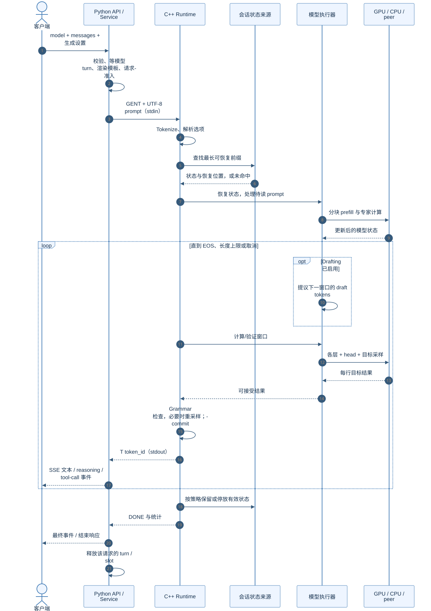

# 图表目录

[返回学习手册](../README.md)

本手册有 18 张新绘图表。分章正文保留 Mermaid，单文件阅读版嵌入 SVG；两者来自相同源图。SVG 可以放大查看，独立 `.mmd` 便于后续修改。

| 章节 | 图的用途 | SVG | Mermaid 源图 |
|---|---|---|---|
| [README.md](../README.md) | 先建立一条主线 | [查看](svg/readme-01.svg) | [源码](mermaid/readme-01.mmd) |
| [01-foundations.md](../01-foundations.md) | 3. Token ID、embedding 和 hidden state | [查看](svg/01-foundations-01.svg) | [源码](mermaid/01-foundations-01.mmd) |
| [01-foundations.md](../01-foundations.md) | 5. Dense 与 MoE：每个 token 是否要用所有专家 | [查看](svg/01-foundations-02.svg) | [源码](mermaid/01-foundations-02.mmd) |
| [01-foundations.md](../01-foundations.md) | 7. Prefill 与 decode 是两个计算阶段 | [查看](svg/01-foundations-03.svg) | [源码](mermaid/01-foundations-03.mmd) |
| [02-architecture.md](../02-architecture.md) | 2. Strata：启动入口与推理主链 | [查看](svg/02-architecture-01.svg) | [源码](mermaid/02-architecture-01.mmd) |
| [02-architecture.md](../02-architecture.md) | 6. Basalt：沿用分层思路，重新整理服务与模型接口 | [查看](svg/02-architecture-02.svg) | [源码](mermaid/02-architecture-02.mmd) |
| [03-dataflow.md](../03-dataflow.md) | 2. 启动时：文件如何成为可以计算的权重 | [查看](svg/03-dataflow-01.svg) | [源码](mermaid/03-dataflow-01.mmd) |
| [03-dataflow.md](../03-dataflow.md) | 4. 两条通信链不能混在一起 | [查看](svg/03-dataflow-02.svg) | [源码](mermaid/03-dataflow-02.mmd) |
| [03-dataflow.md](../03-dataflow.md) | 5. 一层 MoE：移动的是哪些东西 | [查看](svg/03-dataflow-03.svg) | [源码](mermaid/03-dataflow-03.mmd) |
| [04-inference.md](../04-inference.md) | 5. 普通 decode：一轮新产生一个 token | [查看](svg/04-inference-01.svg) | [源码](mermaid/04-inference-01.mmd) |
| [04-inference.md](../04-inference.md) | 6.2 Basalt 的 grammar 检查发生在哪一步 | [查看](svg/04-inference-02.svg) | [源码](mermaid/04-inference-02.mmd) |
| [04-inference.md](../04-inference.md) | 8. 一次请求的时序图 | [查看](svg/04-inference-03.svg) | [源码](mermaid/04-inference-03.mmd) |
| [05-source-reading.md](../05-source-reading.md) | 1. 先选一条主线 | [查看](svg/05-source-reading-01.svg) | [源码](mermaid/05-source-reading-01.mmd) |
| [basalt/README.md](../basalt/README.md) | 3. 在总学习路线中放在哪里 | [查看](svg/basalt-readme-01.svg) | [源码](mermaid/basalt-readme-01.mmd) |
| [basalt/01-blackwell-optimizations.md](../basalt/01-blackwell-optimizations.md) | 4. 专家缓存：把快存储留给近期会用的权重 | [查看](svg/basalt-01-blackwell-optimizations-01.svg) | [源码](mermaid/basalt-01-blackwell-optimizations-01.mmd) |
| [basalt/01-blackwell-optimizations.md](../basalt/01-blackwell-optimizations.md) | 7. 输出 head 和草稿窗口：避免每轮做过多无效工作 | [查看](svg/basalt-01-blackwell-optimizations-02.svg) | [源码](mermaid/basalt-01-blackwell-optimizations-02.mmd) |
| [basalt/02-architecture-differences.md](../basalt/02-architecture-differences.md) | 2. `.basalt` 是一个资源包，不是把 GGUF 换个后缀 | [查看](svg/basalt-02-architecture-differences-01.svg) | [源码](mermaid/basalt-02-architecture-differences-01.mmd) |
| [basalt/02-architecture-differences.md](../basalt/02-architecture-differences.md) | 5.2 Strata 的 split serving 是另一层机制 | [查看](svg/basalt-02-architecture-differences-02.svg) | [源码](mermaid/basalt-02-architecture-differences-02.mmd) |

## 三张主图

### 组件架构：谁负责什么

### 数据流：专家参数和输出怎样分工

### 时序：一个请求怎样完成

渲染信息与检查结果见 [validation.json](../validation.json)。原材料图表位于 archive，不计入以上新图数量。
