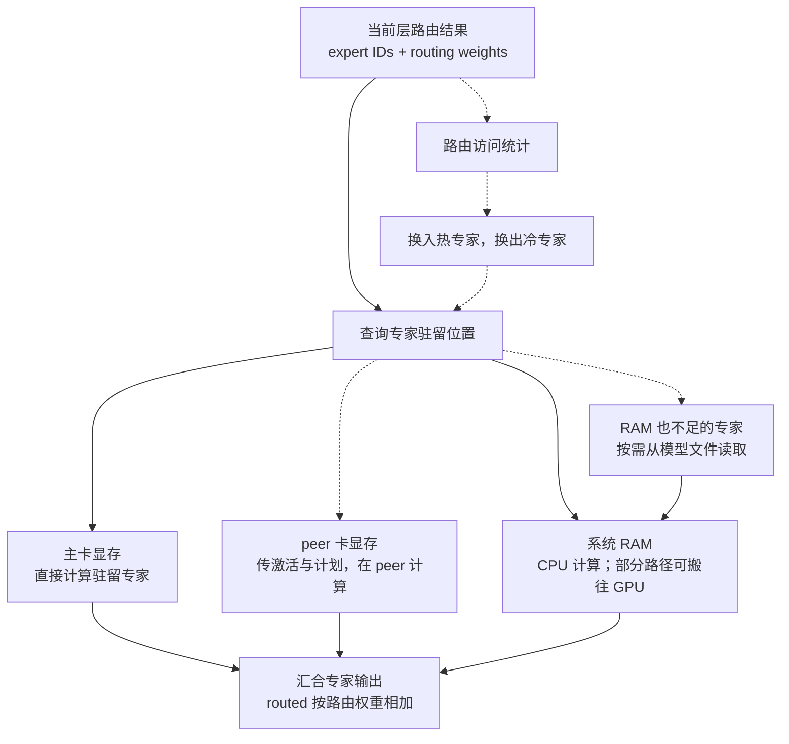
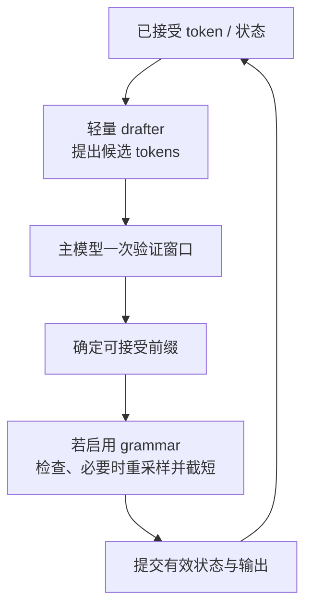

# Basalt 如何利用 RTX 50 系列：先找瓶颈，再看优化

[返回学习手册](../README.md) · [Basalt 专章入口](README.md) · [下一篇：架构差异](02-architecture-differences.md)

> 具体实现固定到 Basalt `4998eb3733ee83b7e7d6ff94854c399dd89cfebe`。本章不是硬件实测或调参教程；性能数字均来自该快照的源码记录。

## 1. 一次生成为什么会等待

可以把一次 decode window 理解成“一轮主模型验证”。这一轮要读权重、做矩阵运算、等待其他计算分支、得到 logits，再决定能提交哪些 token。

| 可能的限制 | 发生的事情 | Basalt 对应的优化方向 |
|---|---|---|
| 显存容量 | 热专家放不下，更多工作落到 RAM 或文件层 | 量化、专家缓存、RAM 补集、KV 内存管理 |
| 数据带宽 | 计算单元等权重或激活到达 | 原生量化块、就地计算、异步搬运、下一层预取 |
| 启动与同步延迟 | 大量很短的 kernel 之间有等待空隙 | CUDA Graph、融合、设备侧计划、persistent peer kernel |
| 一轮有效产出少 | 主模型做了一轮工作，只产出很少 token | MTP/DSpark 提案与批量验证 |
| 计算吞吐 | Prefill 的大矩阵运算本身耗时 | 合适条件下使用 FP4 Tensor Core |

这些限制可能同时存在。例如，FP4 算子很快，但专家权重在 SSD 上，它仍可能等文件读取。优化必须放到整条数据链里理解。

## 2. 支持边界：看架构标识，而不只看产品名称

Basalt 主引擎要求 CUDA 13、计算能力 12.0，也就是 `sm_120`；NVFP4 prefill 的独立库还使用 `120a-real` 编译目标。RTX 5090 是这一范围中的典型设备，其他满足条件的 50 系列和 RTX PRO Blackwell 卡也可能使用相同路径。[CMake 约束][build]

同为 Blackwell 名称的其他架构不能自动套用这个结论。显存容量、内存带宽、功耗和 PCIe 链路也会影响实际速度：桌面 5090、Laptop 与 D 系列型号不应当成一张完全相同的卡。本章不将某个 SKU 的样例推广为整个系列的保证。

## 3. 量化先解决“要读多少字节”

**权重**是模型训练后的参数；**激活**是当前输入经过网络产生的中间数值。两者可以使用不同格式，所以文件名里的“4 bit”通常只说明一部分权重存储，不能推导全部运算都是 4 bit。

Qwen 官方 `NVFP4-DQ6_K` 包中，路由专家采用 NVIDIA NVFP4，dense 投影采用 Q6_K。专家的 E2M1 代码与比例因子一起保留，计入 scale 后约 4.5 bit/weight；计算时还要应用 FP32 tail。`D` 表示 dense 的格式。[模型文件说明][model-file]

少读权重有三方面收益：显存能装更多专家、RAM 能容纳更多模型参数、需要搬运时占用更少 PCIe 字节。它们都可能帮助 decode，即使没有使用 FP4 Tensor Core。

### 3.1 “W4A4”与“W4A8”是什么意思

`W` 指权重，`A` 指激活。W4A4 表示二者使用 4-bit 表达参与对应计算；W4A8 则是 4-bit 权重搭配 8-bit 激活的简写。实际实现还包括 scale、累加精度和特定块布局，因此不能只用两个数字描述全部数值行为。

| Basalt Qwen 路径 | 实际做法 | 适合它的原因 |
|---|---|---|
| NVFP4 decode | q8_1/int8 激活，子块 int32 点积，FP32 scale | 小 token/window 更看重低延迟与少读权重 |
| NVFP4 prefill | 满足格式条件且 chunk ≥1024 时，E2M1 激活与专家权重做 block-scaled FP4 MMA | 较多 prompt token 能形成适合 Tensor Core 的矩阵工作量 |
| 其他量化专家 prefill | 可走 int8 MMQ 等路径 | 数据布局和格式不同，不会因显卡叫 5090 就全部进入 FP4 分支 |
| Dense prefill | FP16 权重/激活与 cuBLAS，FP32 累加 | 批量矩阵计算使用另一套适合的实现 |

`chunk` 是引擎一次读取的提示词片段，**不是请求总长度的同义词**。一个总长超过 1024 的请求，最后不足阈值的小片段仍可能走其他路径。分发还检查专家格式和 tail，不能只看 token 数。[阈值][fp4-threshold] [选择条件][fp4-dispatch] [PTX kernel][fp4-kernel]

### 3.2 性能与数值变化一起看

项目记录中，Qwen NVFP4、int8 KV、冷运行、5090 400 W + 5060 Ti 180 W：

| Prefill 工作量 | MMQ | FP4 | 以 MMQ 为基准的变化 |
|---|---:|---:|---:|
| 16K prompt | 6456 tok/s | 7807 tok/s | 约 +21% |
| 64K prompt | 8201 tok/s | 10126 tok/s | 约 +23% |

这是 prefill 的对照，不能改写为 decode 或整体聊天也快同样比例。项目还报告 2,049-token prompt、24 chunks 时，FP4 对 MMQ 的 KLD 增加 0.0018、top-1 下降 0.19 个百分点。KLD 在这里用于衡量输出概率分布相对参考的差别，top-1 指最可能 token 的一致情况。[测量及精度][precision]

因此应理解为“在特定阶段以小幅数值变化换取吞吐”，而不是给 FP4 贴上绝对无损标签。

## 4. 专家缓存：把快存储留给近期会用的权重

默认 Qwen NVFP4 包约 122 GiB，专家集合约 63.3 GiB。32 GB 显存除专家外还要装 dense、KV、drafter 和工作区，无法完整容纳这些内容。[模型包说明][model-file] [记录中的资源占用][community]

这里有两类容易混淆的“缓存”：

- **专家缓存**保存模型权重，多个请求可以用到同一份专家。
- **会话缓存**保存某段输入对应的 KV、递归状态和 checkpoint，用来接着该对话计算。

实线是本轮查找与计算，虚线中的 peer、文件后备和后台交换是条件路径。图中的 RAM → 汇合传的是**计算结果**，并不表示每次都把完整专家权重传回 GPU。

Qwen adaptive tier 按近期路由频次更新专家放置，默认 server 每 window 发起一轮，最多 96 次 swap，计数衰减 0.85。交换跨 copy-out、side-stream copy-in、use 三个 window，尽量把搬运与计算重叠。DeepSeek 使用自己的 homes/copies 与按访问更新的 tier，不能照搬 Qwen 参数。[Qwen adaptive][adaptive] [DeepSeek tier][deep-tier]

RAM 还可能只保留 GPU 专家的“补集”及必要副本，而非始终再复制一份完整模型。这样省 RAM，但换入、换出和 prefill 借显存槽时，需要维护权重的新旧位置。[专家来源与补集][expert-source]

## 5. PCIe：能寻址主机内存，不代表没有传输成本

**Pinned memory** 是被固定、不随意换出的主机内存；**mapped memory** 则使 CUDA 设备可以通过映射地址访问这段内存。两者帮助组织异步传输和通信，但数据仍需经过实际硬件链路，RAM 的速度也不会变成 VRAM 的速度。

Peer 卡最重要的作用是“权重留在它的显存，并在它上面计算”。若每轮都把 peer 的完整专家再搬回主卡，会抵消相当一部分价值。通常跨卡通道传的是较小的激活、路由计划与结果。[peer 实现][peer]

当前快照最后一个提交有一个具体例子：DeepSeek peer 的激活和 plan 原来先通过两次 `cudaMemcpyAsync` 传入；7–10 MB 的专家槽换入也占用 copy engine，短消息因此排队。改动后，量化 kernel 直接读 mapped 激活，额外 blocks 将 mapped plan 拷到 device buffer，避开这段队列。[提交说明][head-commit]

作者记录的 5090 400 W + 5060 Ti 180 W 上，slot copy 在飞时首个专家 kernel 的等待从 81.4 μs 降到 41.8 μs。相应冷 prose 为 87.4→88.9 tok/s，verify+draft 为 19.77→19.44 ms/window。

这里使用 UD-IQ1_M、seed 42、`--diag-tier-ram 316`。**316 是每层 RAM-tier 专家数量，不是 316 GiB RAM。** 结果来自有限 A1/B1 和 trace，而非本章复测；它说明减少排队可以有端到端收益，不代表所有负载都提高相同比例。

## 6. CUDA Graph 与融合：减少计算之间的空隙

一个 **kernel** 是 GPU 执行的一段并行计算。单独的 kernel 可能很快，但 CPU 逐个提交、设备等待依赖和反复读写中间结果也需要时间。

| 技术 | 初学者可以怎样理解 | 作用边界 |
|---|---|---|
| CUDA Graph | 记录并复用一组依赖明确的 GPU 工作 | 减少重复 launch 开销，不会让数学运算消失 |
| 融合 | 将相邻运算组织在更紧密的执行链中 | 可少写中间数据、少启动 kernel，仍需保持正确依赖 |
| Device plan | GPU 根据路由和驻留表生成专家工作计划 | 少让每层计划都往返 CPU |
| Persistent peer kernel | 一个 window 内保持 peer 执行循环，通过 ring/序列字接任务 | 减少逐层单独启动，必须正确同步结果 |
| PDL | 让满足条件的依赖 kernel 更早进入执行过程 | 需硬件和路径支持，存在普通 graph 回退 |
| L2 预取 | 提前把下一步可能读取的权重带到 GPU 缓存 | 隐藏部分等待，不保证每次都命中或完全隐藏延迟 |

当前 Qwen 验证链会利用等待 CPU/peer 的空隙做部分延迟状态提交，并预取下一层投影。它优化的是整条关键路径，不只是某个矩阵乘的峰值。[Graph 捕获][capture] [专家执行链][record-moe] [peer 执行][peer-execution]

## 7. 输出 head 和草稿窗口：避免每轮做过多无效工作

**输出 head** 把最后的 hidden state 变成词表里每个 token 的分数。词表很大时，这一步也会读大量权重。

Qwen NVFP4 包的 Q8_0 two-stage head 先用 bit-plane 和误差区间筛候选，再精确计算仍可能进入 top-K 的行；K≤64 的路径有精确界限，超出适用范围会全精确评分。记录的耗时是 439→350 μs/window。Q6_K head 的 tail 则是近似的，不能把它与前者一起称为无损。[两阶段 head][head-precision]

**推测解码**先用较便宜的 drafter 提议多个后续 token，再由主模型验证。Qwen 使用 MTP，默认窗口 8 是 anchor 加最多 7 个 draft；DeepSeek 使用 DSpark，默认窗口 3 是 anchor 加最多 2 个 draft。有效输出数由主模型验证决定。[Qwen drafting][qwen-model] [DeepSeek drafting][deep-model]

这张图描述 Basalt 当前请求循环中的逻辑顺序，不表示这些步骤在 profiler 上完全串行。部分草稿计算、状态管理和输出可以重叠。

判断快慢时看两个量：**一轮花多久，以及一轮实际产出多少有效 token**。只看 tok/s，可能把“某篇文章更容易被 draft 猜中”误认成底层 kernel 更快。项目要求同时给出 ms/window、passes/s 和功耗等信息。[验证规则][contributing]

## 8. 为 KV 节省显存，也是在给专家留空间

Qwen 默认 KV 为 fp16，也支持 int8、q4_0、k8v4；社区 preset 使用 int8，不能当成引擎默认。DeepSeek 0.3.1 默认 `fp8`，内部不同缓存使用 FP8/FP4：文档记录 920 B/position，而 fp16 路径为 3200 B/position。[配置][configuration] [DeepSeek 精度][deep-precision]

KV 占用减少，可把显存留给更多专家或更长上下文；但上下文越长仍有额外计算与状态管理成本。专家迁移、KV 量化、FP4 激活都会涉及数值行为，固定 placement 的 kernel 等价测试不能替代全部模型质量评估。

## 9. 如何读性能数字而不被误导

把一项速度结果和以下条件一起读：模型、量化、上下文、prompt 类型、draft 设置、GPU 数量/功耗、CPU/RAM、PCIe、版本和是否发生 SSD spill。

Basalt 0.2.0 的“约 +13%”是它对自身 0.1.0 附近版本、5090 400 W + 5060 Ti 180 W 的比较。它既不是单卡结论，也不是相对最新 Strata 的统一优势。[原始发布记录][change02]

学习本章后，可以用一句带原因的话解释每项优化，例如：“peer 就地计算主要减少整块专家的回传”，“FP4 prefill 主要利用大矩阵吞吐”，“及时更新驻留减少冷专家尾部”。能解释作用阶段和瓶颈，比记住某个 tok/s 数字更有用。

[返回学习手册](../README.md) · [上一页：Basalt 入口](README.md) · [下一篇：架构与行为差异](02-architecture-differences.md)

[build]: https://github.com/jesdga95/basalt/blob/4998eb3733ee83b7e7d6ff94854c399dd89cfebe/CMakeLists.txt#L39
[model-file]: https://github.com/jesdga95/basalt/blob/4998eb3733ee83b7e7d6ff94854c399dd89cfebe/docs/model-file.md
[fp4-threshold]: https://github.com/jesdga95/basalt/blob/4998eb3733ee83b7e7d6ff94854c399dd89cfebe/src/models/qwen4exp/prefill/layout.hpp#L62
[fp4-dispatch]: https://github.com/jesdga95/basalt/blob/4998eb3733ee83b7e7d6ff94854c399dd89cfebe/src/models/qwen4exp/prefill/experts.hpp#L94
[fp4-kernel]: https://github.com/jesdga95/basalt/blob/4998eb3733ee83b7e7d6ff94854c399dd89cfebe/src/models/qwen4exp/prefill/fp4/moe_fp4.cu#L47
[precision]: https://github.com/jesdga95/basalt/blob/4998eb3733ee83b7e7d6ff94854c399dd89cfebe/docs/precision/qwen38-flash-next.md#L21
[community]: https://github.com/jesdga95/basalt/blob/4998eb3733ee83b7e7d6ff94854c399dd89cfebe/docs/community/benchmarks.json
[adaptive]: https://github.com/jesdga95/basalt/blob/4998eb3733ee83b7e7d6ff94854c399dd89cfebe/docs/configuration/adaptive.md
[deep-tier]: https://github.com/jesdga95/basalt/blob/4998eb3733ee83b7e7d6ff94854c399dd89cfebe/src/models/deepseek41/tier.hpp#L3
[expert-source]: https://github.com/jesdga95/basalt/blob/4998eb3733ee83b7e7d6ff94854c399dd89cfebe/include/basalt/core/expert_source.hpp#L86
[peer]: https://github.com/jesdga95/basalt/blob/4998eb3733ee83b7e7d6ff94854c399dd89cfebe/src/core/peer_experts.cpp#L338
[head-commit]: https://github.com/jesdga95/basalt/commit/4998eb3733ee83b7e7d6ff94854c399dd89cfebe
[capture]: https://github.com/jesdga95/basalt/blob/4998eb3733ee83b7e7d6ff94854c399dd89cfebe/src/models/qwen4exp/decode/verify/capture.cpp#L30
[record-moe]: https://github.com/jesdga95/basalt/blob/4998eb3733ee83b7e7d6ff94854c399dd89cfebe/src/models/qwen4exp/decode/verify/record_moe.cpp#L43
[peer-execution]: https://github.com/jesdga95/basalt/blob/4998eb3733ee83b7e7d6ff94854c399dd89cfebe/src/models/qwen4exp/decode/verify/expert_execution.cpp#L17
[head-precision]: https://github.com/jesdga95/basalt/blob/4998eb3733ee83b7e7d6ff94854c399dd89cfebe/docs/precision/qwen38-flash-next.md#L168
[qwen-model]: https://github.com/jesdga95/basalt/blob/4998eb3733ee83b7e7d6ff94854c399dd89cfebe/docs/models/qwen38-flash-next.md
[deep-model]: https://github.com/jesdga95/basalt/blob/4998eb3733ee83b7e7d6ff94854c399dd89cfebe/docs/models/deepseek41.md
[contributing]: https://github.com/jesdga95/basalt/blob/4998eb3733ee83b7e7d6ff94854c399dd89cfebe/CONTRIBUTING.md#L31
[configuration]: https://github.com/jesdga95/basalt/blob/4998eb3733ee83b7e7d6ff94854c399dd89cfebe/docs/configuration/index.md#L87
[deep-precision]: https://github.com/jesdga95/basalt/blob/4998eb3733ee83b7e7d6ff94854c399dd89cfebe/docs/precision/deepseek41.md
[change02]: https://github.com/jesdga95/basalt/blob/4998eb3733ee83b7e7d6ff94854c399dd89cfebe/docs/changelog/0.2.0.md#L8
