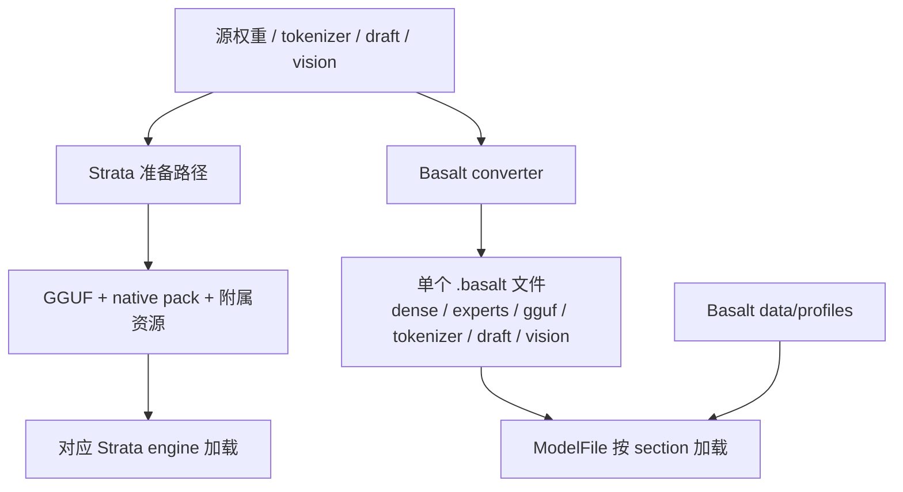
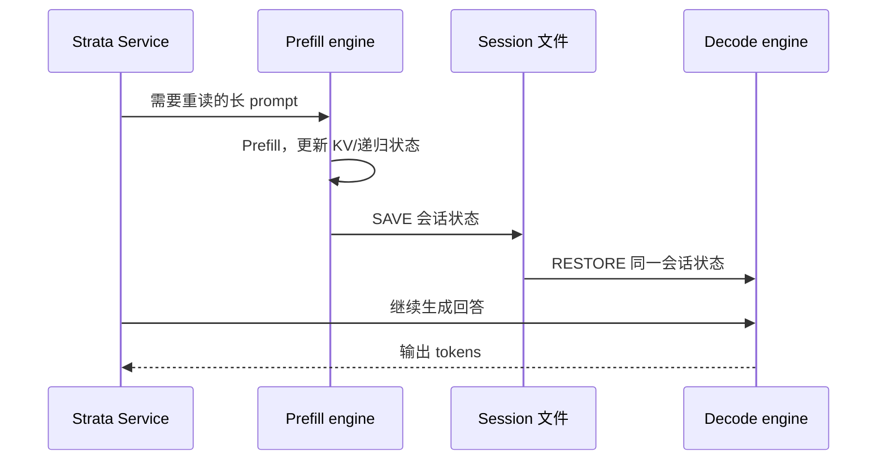

# Strata 与 Basalt：相同术语背后的架构差异

[返回学习手册](../README.md) · [Basalt 入口](README.md) · [上一篇：Blackwell 优化](01-blackwell-optimizations.md)

> Strata 基线：`ffa80d73133ea5c548aefe57889a16e8085a938f`；Basalt 基线：`4998eb3733ee83b7e7d6ff94854c399dd89cfebe`。以下是固定版本的静态源码分析，不宣称覆盖两个项目之后的所有变化。

共同原理可以一起学，落到配置、进程和函数调用时则必须区分项目。本章从六个问题比较两者：如何启动、文件如何组织、谁处理请求、如何并发、多卡怎样分工，以及生成结果如何受到约束。

## 1. 两个项目各自把什么放在中心

| 层次 | Strata 基线 | Basalt 基线 |
|---|---|---|
| 用户入口 | 桌面应用、Terminal/Control、源码启动路径并存 | `basalt serve`、bench、probe 等可执行入口 |
| 硬件实现 | CUDA/HIP/SYCL/Metal 等路径，具体模型的可用组合需单独检查 | 主引擎限定 CUDA 13、sm_120；Linux/Windows 平台层 |
| Python 服务 | `serve/server.py` 承接主要 HTTP、Service、引擎协议；另有 replicas/split 等包装器 | `handler.py`、`service.py`、`router.py`、`engine/`、`api/`、`models/` 分工 |
| 模型执行 | 主引擎与 DeepSeek、all-cards split 等独立引擎路径并存 | 以 adapter/session/dialect 连接公共层和模型专属代码 |
| 模型制品 | GGUF、native pack、tokenizer、draft 等资源按准备路径组合 | `.basalt` 容器组合多个命名 section；profile 随引擎分发 |

这不是简单的“一个更先进、一个更旧”。Strata 基线保留更广的入口与硬件/执行模式；Basalt 在更窄的主硬件范围内统一部分组织方式。**某个模式没有在 Basalt 中出现，不代表它不能在 Strata 中出现，反过来也一样。**[Strata 总览][strata-agents] [Basalt 模型扩展接口][adding-model]

## 2. `.basalt` 是一个资源包，不是把 GGUF 换个后缀

GGUF 可以描述模型 tensor 和元数据，但引擎运行时还可能需要重排的专家块、tokenizer、模板、draft 权重、视觉 projector 等。Strata 的准备路径会把这些资源组合起来。例如 NVFP4 转换先生成 GGUF，再生成 native expert pack，专家 scale tail 位于 `experts.bin`。[Strata NVFP4 准备][strata-nvfp4]

Basalt 用单文件容器组织这些资源：64 KiB header，最多 511 个 section，section 按 2 MiB 对齐；每个 section 记录名称、offset、size 和 hash。内部仍可有原有量化编码和 GGUF metadata，因此容器格式与量化格式是两个不同层次。[容器定义][format]



图里的上下两条路径不是两步串联转换，也不表示所有 Strata 模型都有完全相同的文件集合。实际转换要服从模型与后端要求。

Basalt v2 **不把专家 profile 放在 pack 里**；它从引擎 `data/profiles` 找模型相应 profile。0.3.1 直接读取 tokenizer/vision 等 section，不再先解包一份到缓存目录。[模型文件说明][model-file] [加载入口][qwen-run]

## 3. Python 与 C++ 的边界：接口相似，分工不完全相同

两者都能看到“Python HTTP 服务 → 常驻 C++ 引擎 → token 返回 → API 输出”的结构。常驻意味着模型不会在每个请求到来时重新加载。

Basalt 的用户命令 `basalt serve` 进入 Python 服务；Python `ProcessEngine` 再启动内部的 `basalt --serve`，用 stdin/stdout 交换命令与事件。两条命令形似，但一个是用户启动入口，一个是内部引擎模式。[Basalt 进程启动][process]

Basalt 内部共享请求阶段是：

```text
parse → prepare_prompt → restore → read_prompt → decode → complete
```

这是“解析 → 准备输入 → 恢复前缀状态 → 读取新 prompt → 生成 → 收尾”的代码表达。负责这一生命周期的是 `src/program/serve/`，不要与 Python `serve/` 目录混为一谈。[请求阶段][request]

### 3.1 Tokenizer 到底在哪里

Strata 基线的服务端路径会渲染模板并编码 token IDs，然后调用引擎。Basalt 进一步支持发送 UTF-8 文本给 C++ tokenizer，但**只在无图片、engine 支持 `takes_text`、且非 batch 时走这条路径**。

| Basalt 请求条件 | Python → C++ 传输的主要内容 |
|---|---|
| 单流纯文本、支持文本 prompt | `GENT` + UTF-8 文本，由 C++ tokenize |
| Batch 或图片路径 | Python 编码后的 token IDs，以及图片所需数据/引用，使用 GEN/BGEN/GENI 等路径 |

因此，“Python 只做 HTTP，完全不处理 tokenizer”不符合当前实现。API 中的 token-count 功能也需要编码能力。[条件分支][prepare] [协议][protocol]

### 3.2 ModelSession 不是一个 GPU 进程

Basalt 的 `ModelAdapter` 负责模型识别、描述、加载和能力；`LoadedModel` 表示加载好的模型；`ModelSession` 持有一条会话的状态并提供 prefill/decode/draft/save/restore 方法。

这些都是**主机侧 C++ 对象**。它们可以提交 CUDA 工作，管理 GPU/RAM 资源，但不应该整个画进“GPU 硬件”边界。Qwen 可通过 adapter 的专用运行入口走自己的 Verifier/Runtime；DeepSeek 使用共享 SessionRuntime 与自身 Session。接口相同不代表内部每个 kernel 和调度方法相同。[模型接口][adapter]

## 4. 并发至少有四种不同含义

| 名词 | 代表什么 | 与其他名词的区别 |
|---|---|---|
| 多 HTTP 连接 | 服务同时接收多个客户端连接 | 不意味着 GPU 同时处理所有请求 |
| 多 slot | 一个模型执行器维护多份会话状态 | 可能融合计算，也可能轮转执行窗口 |
| Replica | 多个独立引擎实例，各有设备组 | 多一份执行能力，也可能增加模型/状态内存 |
| 多模型 Router | 按请求选择模型或安排模型切换 | 是否同时驻留多个模型由实现决定 |

**Basalt Router 一次只加载一个模型。** 切换前等待现有运行请求结束，然后停止旧引擎、加载新引擎；同一模型仍可有多个 slot。这个规则属于 Basalt 当前 Router，不能泛化到所有推理服务。[Router][router]

Basalt Qwen 有专用 batch verify；DeepSeek 的共享 SessionRuntime 在主机控制循环中逐 slot 执行 decode window，各 Session 自己建立 CUDA stream。不要把 `--parallel` 统一解释成“所有请求总被融合成一次 GPU 矩阵乘”。[Slot 循环][slots] [Session stream][ds-session]

Strata 基线有显式 opt-in 的 `ReplicaEngine`：一个 HTTP 前端背后启动多个引擎，每个使用自己的设备组；路由考虑需要重读的 prompt token 与已有请求负载。它是请求级数据并行，不是把一条请求的每一层切到多个副本。[Strata replicas][replicas]

## 5. 三种“split”不要混为一谈

| 机制 | 怎样分工 | 交接的数据 |
|---|---|---|
| Layer split | GPU A 跑前一段层，GPU B 跑后一段层 | 层间 hidden state，以及必要状态/控制 |
| All-cards split / tensor 并行类机制 | 各卡分担同一层的一部分计算，再汇合 | 层内分块结果或归约数据 |
| Prefill/decode split serving | 一个引擎读 prompt，另一个引擎生成回答 | 可恢复的 session 状态 |

### 5.1 Basalt 的多 GPU 选择

Qwen 可用主卡加最多三个 peer expert tiers；DeepSeek 当前最多一张 peer。Expert tier 中，主卡执行主干，peer 在本卡显存计算专家，主要交换激活、计划与结果。

Qwen 的成本模型只有在卡的显存容量、带宽各相差不超过 10%，且 layer split 估价比 expert tier 至少低 5% 时，才可能选 layer split。异构卡选择 expert tier。**该模型中的 TensorParallel 仅估价，`runs=false`，不是已实现路径。**[成本模型][multi-gpu] [应用选择][qwen-run]

这句话只描述 Basalt。Strata 基线另有 `strata-split` all-cards split 引擎，每张卡承担每一层的一部分计算；它有自己的模型、显存、系统和设备条件，不能因为 Basalt 的 TP 未实现就说 Strata 也没有。[Strata split engine][split-engine]

Basalt 还有长 prompt 的临时流水：满足资源和空闲槽条件时，借用 peer 专家缓存槽放 prompt 所需资源，结束再归还。它不等于 decode 永久采用同一套分层方案。[Basalt GPU 说明][gpus]

### 5.2 Strata 的 split serving 是另一层机制



这里传的是可恢复会话状态，不是把模型权重每次从 prefill 引擎复制到 decode 引擎。两个引擎要使用兼容的模型、版本、KV 与 session 设置。

该 Strata 基线实现是 opt-in，默认只在 decode 端需要重读至少 2048 个新 token 时考虑交接；当前这条路径限制为一次一个请求，不支持其中的 batch slot、layer split；图片请求由 decode 引擎单独处理，交接失败也回退到它读取 prompt。不能把这幅图当成无条件、高并发的分离服务集群。[Split serving 源码与限制][split-serve]

## 6. Structured output：提示后校验与生成中约束

用户要求 JSON 时，至少可以在两个位置保证结构：

1. 把格式要求写进 prompt，生成后解析并验证结果。
2. 在生成过程中，根据语法状态屏蔽不允许的 token。

Strata 该基线的 `serve/structured.py` 明确是“prompt once, validate before delivery”，原生引擎没有该模块所需的 grammar decoder；失败结果会作为结构化输出错误处理。可选 `jsonschema` 是否可用也影响验证强度。[Strata structured output][structured]

Basalt 把 grammar 接进 C++ 请求/采样循环。当前顺序是主模型产生验证结果、确定可接受的 draft 前缀，再扫描 grammar；遇到不符合的 token 时，在 mask 下重采样，并截短本轮有效窗口，随后提交状态。[Basalt decode loop][decode-loop]

这不是“草稿模型说了算”，也不是“服务端收到错误 JSON 后随便修一下”。它说明**相同 API 字段不保证两个引擎采用相同约束机制**。实现比较应限定到上述版本和原生路径，不能推测未来版本或其他引擎的能力。

## 7. 面向源码阅读的对照表

| 想回答的问题 | Strata 基线起点 | Basalt 基线起点 |
|---|---|---|
| 谁启动引擎、命令怎样传递 | `serve/server.py` 的 StrataEngine | `serve/engine/process.py` |
| 请求怎样渲染与排队 | `serve/server.py` 的 Service | `serve/service.py`、`serve/router.py` |
| 多实例与 prefill/decode 分离 | `serve/replicas.py`、`serve/split.py` | 先查 Router/slot，不能套用同名配置 |
| 请求内部阶段 | 对应引擎的 serve 路径 | `src/program/serve/request.cpp` |
| 模型如何接入公共层 | 不同 engine/adapter 路径分别追踪 | `include/basalt/model/adapter.hpp`、`src/models/` |
| 专家算在哪里 | 当前模型/backend 的 dispatch/cache | Qwen `decode/expert_dispatch.cpp`；DeepSeek `tier.*` |
| 多卡到底是哪种 split | `docs/SPLIT_ENGINE.md`、`serve/split.py` 分开看 | `multi_gpu_plan.cpp` 与模型 load/prefill 分开看 |

读源码时先确定“项目 → 模型 → 后端 → 运行模式 → 请求阶段”，再跟函数调用。缺少其中一项，极容易拿一条可选路径去解释所有请求。

[返回学习手册](../README.md) · [上一篇：Blackwell 优化](01-blackwell-optimizations.md) · [完整原始分析](../archive/basalt-analysis-2026-11-08/Basalt项目分析.md)

[strata-agents]: https://github.com/Niko1221/Strata/blob/ffa80d73133ea5c548aefe57889a16e8085a938f/AGENTS.md
[strata-nvfp4]: https://github.com/Niko1221/Strata/blob/ffa80d73133ea5c548aefe57889a16e8085a938f/docs/NVFP4.md
[replicas]: https://github.com/Niko1221/Strata/blob/ffa80d73133ea5c548aefe57889a16e8085a938f/serve/replicas.py#L1
[split-engine]: https://github.com/Niko1221/Strata/blob/ffa80d73133ea5c548aefe57889a16e8085a938f/docs/SPLIT_ENGINE.md
[split-serve]: https://github.com/Niko1221/Strata/blob/ffa80d73133ea5c548aefe57889a16e8085a938f/serve/split.py#L1
[structured]: https://github.com/Niko1221/Strata/blob/ffa80d73133ea5c548aefe57889a16e8085a938f/serve/structured.py#L1
[adding-model]: https://github.com/jesdga95/basalt/blob/4998eb3733ee83b7e7d6ff94854c399dd89cfebe/docs/adding-a-model.md
[format]: https://github.com/jesdga95/basalt/blob/4998eb3733ee83b7e7d6ff94854c399dd89cfebe/include/basalt/core/model_format.hpp
[model-file]: https://github.com/jesdga95/basalt/blob/4998eb3733ee83b7e7d6ff94854c399dd89cfebe/docs/model-file.md
[qwen-run]: https://github.com/jesdga95/basalt/blob/4998eb3733ee83b7e7d6ff94854c399dd89cfebe/src/models/qwen4exp/load/qfn_run.cpp#L15
[process]: https://github.com/jesdga95/basalt/blob/4998eb3733ee83b7e7d6ff94854c399dd89cfebe/serve/engine/process.py#L270
[request]: https://github.com/jesdga95/basalt/blob/4998eb3733ee83b7e7d6ff94854c399dd89cfebe/src/program/serve/request.cpp#L6
[prepare]: https://github.com/jesdga95/basalt/blob/4998eb3733ee83b7e7d6ff94854c399dd89cfebe/serve/service.py#L791
[protocol]: https://github.com/jesdga95/basalt/blob/4998eb3733ee83b7e7d6ff94854c399dd89cfebe/serve/engine/process.py#L1
[adapter]: https://github.com/jesdga95/basalt/blob/4998eb3733ee83b7e7d6ff94854c399dd89cfebe/include/basalt/model/adapter.hpp#L128
[router]: https://github.com/jesdga95/basalt/blob/4998eb3733ee83b7e7d6ff94854c399dd89cfebe/serve/router.py#L195
[slots]: https://github.com/jesdga95/basalt/blob/4998eb3733ee83b7e7d6ff94854c399dd89cfebe/src/program/serve/session_engine.cpp#L533
[ds-session]: https://github.com/jesdga95/basalt/blob/4998eb3733ee83b7e7d6ff94854c399dd89cfebe/src/models/deepseek41/session.cpp#L72
[multi-gpu]: https://github.com/jesdga95/basalt/blob/4998eb3733ee83b7e7d6ff94854c399dd89cfebe/src/program/multi_gpu_plan.cpp#L46
[gpus]: https://github.com/jesdga95/basalt/blob/4998eb3733ee83b7e7d6ff94854c399dd89cfebe/docs/configuration/gpus.md
[decode-loop]: https://github.com/jesdga95/basalt/blob/4998eb3733ee83b7e7d6ff94854c399dd89cfebe/src/program/serve/decode_loop.hpp#L79
