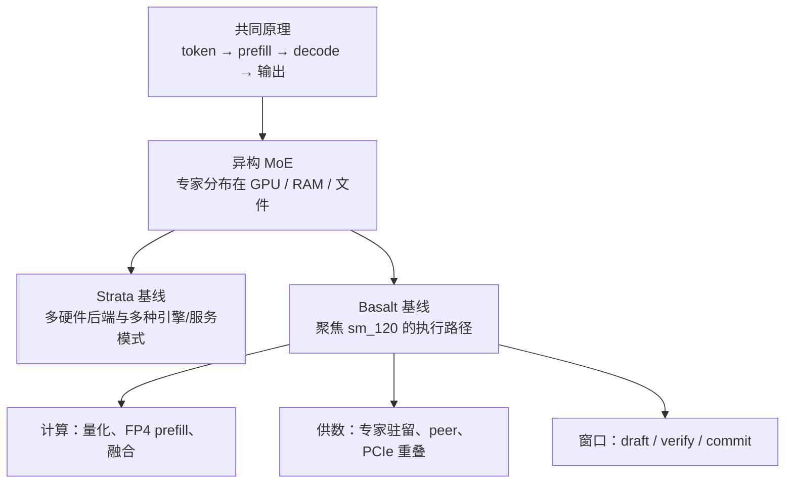

# Basalt 专章：沿着 Strata 的思路理解 Blackwell 优化

[返回学习手册](../README.md) · [先读基础概念](../01-foundations.md) · [阅读优化机制](01-blackwell-optimizations.md)

本专章接在共同架构与推理流程之后。这里的“融合”是把两项目放进同一条学习路线：先理解 Strata 奠定的异构 MoE 思路，再观察 Basalt 如何围绕特定 GPU 深化实现。**两者仍是独立的软件项目，不能把源码、配置和模型文件直接互换。**

本文使用固定源码快照，避免一边读旧笔记、一边把新版本行为混进来：

| 用途 | 版本断面 |
|---|---|
| Strata 学习基线 | `ffa80d73133ea5c548aefe57889a16e8085a938f` |
| Basalt 学习基线 | `4998eb3733ee83b7e7d6ff94854c399dd89cfebe`，项目版本 0.3.1 |
| 观察继承关系的历史断面 | `e69c1fb6f129bf813e655b818b91414fb894c0a3`，当时 CMake 标为 Strata 0.1.39 |

历史断面只用于判断哪些能力早已存在，不等同于今日 Strata，也没有在这里被证明为今日两仓库的严格 merge-base。[历史基线][historical]

## 1. 为什么会出现这样一条分支

一个 MoE 模型可以有大量专家权重，但每个 token 只调用其中一部分。问题是：下一层将调用哪些专家，要等 router 算完才能知道，而显存不够容纳所有专家。

Strata 的重要思路是把资源组合起来：GPU 显存放常用专家，系统 RAM 放其他专家，CPU 参与计算；资源不足时还有文件后备。这样才能在显存小于模型体积的机器上推理。每次生成到底快不快，取决于算力，也取决于权重在哪里、搬运多少、等待多久。[历史执行说明][historical-how]

Basalt 继承了这个问题和大部分基础机制，将主引擎的硬件范围收窄到 **Blackwell `sm_120` + CUDA 13**，再围绕这个范围优化。`sm_120` 是 CUDA 对计算架构的标识；RTX 50 系列是主要使用场景，但满足该架构的 RTX PRO 等专业卡也在目标范围内。Linux 与 Windows x64 均受支持。[构建约束][build] [平台说明][platforms]

“只支持一种主要 GPU 架构”可以减少需要同时维护的兼容路径，使融合算子、指令选择与调度规则更集中。不过，这不自动证明它在每种工作负载下都比 Strata 快。

## 2. 哪些是继承，哪些是深化

| 读到的能力 | 正确理解 |
|---|---|
| VRAM / RAM / 文件分层 | 历史 Strata 已有；Basalt 继续优化专家放置、补集和搬运 |
| CPU 专家池 | 历史 Strata 已有；Basalt 改进任务粒度及与 GPU/peer 的重叠 |
| MTP 与 draft 验证 | 历史 Strata 已有；Basalt 改进窗口、草稿执行、head 筛选等 |
| CUDA Graph | 历史 Strata 已有；Basalt 扩大融合与重叠，减少执行间隙 |
| 多卡专家层、layer split、并行槽 | 已有基础；当前两分支的选择规则和可用模式不同 |
| `.basalt` 文件 | Basalt 的单文件分区容器，将权重和附属资源一起组织 |
| sm_120 专用路径 | Basalt 的明确工程取向，主推理后端不覆盖其他 GPU 架构 |
| NVFP4 | 应比较具体实现。当前 Strata 基线也已支持 NVFP4，不能写成 Basalt 独有 |
| 多模型与服务结构 | Basalt 有 adapter/session/dialect 分层和单驻留模型 Router；Strata 基线还存在独立引擎、replicas、split serving 等分支 |

对应证据：[历史执行原理][historical-how]、[Strata NVFP4][strata-nvfp4]、[Basalt 模型接口][adapter]、[Strata 服务副本][strata-replicas]。

## 3. 在总学习路线中放在哪里

这张图的上半部是两项目可以共同理解的概念，下半部是工程取向。它不是 Git 提交图：两个项目此后都在继续演进，不能将分叉后的每项功能按名称简单归给某一方。

建议按下面的顺序阅读：

1. [Blackwell 优化机制](01-blackwell-optimizations.md)：先找瓶颈，再看代码如何改善它。
2. [架构与行为差异](02-architecture-differences.md)：避免把同名术语、参数或接口混用。
3. [原始 Basalt 分析报告](../archive/basalt-analysis-2026-11-08/Basalt项目分析.md)：需要完整性能样例、历史对照和更多源码定位时再读。

## 4. 本专章的四条阅读约定

- **说清阶段。** Prefill 是读提示词，decode 是生成后续 token；它们可能使用不同精度与不同 kernel。
- **说清数据。** 权重、激活、路由信息、KV/递归状态是不同东西；一个箭头写“传数据”还不够，后文会注明传什么。
- **说清模式。** 多个 HTTP 连接、多请求槽、模型切换、多引擎副本、多 GPU 分工不等价。
- **说清证据。** 数字来自仓库记录，本文没有进行 GPU 复测。局部优化的增益不能自动推导成整个项目的速度倍数。

读完后，你应能解释：为什么有 5090 还需要 CPU，为什么 FP4 能节省权重却不意味着全程 W4A4，以及为什么一个很快的显卡 kernel 仍可能被专家搬运拖住。

[返回学习手册](../README.md) · [下一篇：Blackwell 优化机制](01-blackwell-optimizations.md)

[historical]: https://github.com/jesdga95/basalt/blob/e69c1fb6f129bf813e655b818b91414fb894c0a3/CMakeLists.txt#L12
[historical-how]: https://github.com/jesdga95/basalt/blob/e69c1fb6f129bf813e655b818b91414fb894c0a3/docs/HOW_IT_WORKS.md
[build]: https://github.com/jesdga95/basalt/blob/4998eb3733ee83b7e7d6ff94854c399dd89cfebe/CMakeLists.txt#L39
[platforms]: https://github.com/jesdga95/basalt/blob/4998eb3733ee83b7e7d6ff94854c399dd89cfebe/docs/platforms.md
[adapter]: https://github.com/jesdga95/basalt/blob/4998eb3733ee83b7e7d6ff94854c399dd89cfebe/include/basalt/model/adapter.hpp
[strata-nvfp4]: https://github.com/Niko1221/Strata/blob/ffa80d73133ea5c548aefe57889a16e8085a938f/docs/NVFP4.md
[strata-replicas]: https://github.com/Niko1221/Strata/blob/ffa80d73133ea5c548aefe57889a16e8085a938f/serve/replicas.py#L1
