# Strata 与 Basalt 完整学习手册

面向初学者，按“基础概念 → 架构 → 数据流 → 推理 → 源码 → Basalt 优化与差异”展开。

> 生成日期：2026-11-08。本文件由分章正文汇编；内容更新以分章版为准。Strata 基线 `ffa80d73`，Basalt 基线 `4998eb37`。性能数据来自项目记录，本次未执行 GPU 实测。

[分章阅读入口](README.md) · [图表目录](assets/README.md) · [原始材料](archive/README.md)

本文嵌入 SVG，请连同 `assets/` 文件夹保存；需要编辑或在 Obsidian 中渲染 Mermaid，可阅读各分章正文及独立 `.mmd`。

## 阅读顺序

1. [01 · 先建立概念：一句话怎样变成模型计算](01-foundations.md)
2. [02｜整体架构：谁接收请求，谁真正计算](02-architecture.md)
3. [03｜数据流：请求、模型权重和会话状态分别怎样移动](03-dataflow.md)
4. [04 · 完整推理流程：从一次请求到最后一个 token](04-inference.md)
5. [05｜源码阅读路线：从一句话走到一个 token](05-source-reading.md)
6. [Basalt 专章：沿着 Strata 的思路理解 Blackwell 优化](basalt/README.md)
7. [Basalt 如何利用 RTX 50 系列：先找瓶颈，再看优化](basalt/01-blackwell-optimizations.md)
8. [Strata 与 Basalt：相同术语背后的架构差异](basalt/02-architecture-differences.md)
9. [来源、版本与整理范围](SOURCES.md)

---

## 01 · 先建立概念：一句话怎样变成模型计算

[返回学习地图](README.md) · [下一章：项目架构](02-architecture.md)

这一章先解释后续图中会出现的数据和动作。读完后，你应该能够区分“模型参数”“一次请求的数据”和“为加速保留的状态”，再去看 CPU、GPU、RAM 之间的分工。

> **阅读范围**：概念图描述共同原理，不是某个文件逐行执行的顺序。具体实现以 Strata `ffa80d73133ea5c548aefe57889a16e8085a938f`、Basalt `4998eb3733ee83b7e7d6ff94854c399dd89cfebe` 两个源码快照为例。下面的玩具模型和 token ID 均为教学虚构，不代表真实 tokenizer 或 benchmark。

### 1. 模型、推理引擎和服务程序分别是什么

| 名词 | 它保存或处理什么 | 在这里对应什么 |
|---|---|---|
| 模型 | 网络结构、训练好的权重，以及与之配套的词表等资料 | Qwen、DeepSeek 模型及其量化版本 |
| 推理引擎 | 把输入转换为模型计算，安排权重、状态、CPU/GPU 运算，选出输出 token | Strata/Basalt 的 C++ 与计算内核 |
| API 服务 | 接收 HTTP 请求、渲染消息模板、排队、管理引擎进程、返回结果 | 两项目的 Python `serve/` |
| 使用入口 | 安装、配置、启动或交互 | Strata 桌面/Terminal；Basalt CLI/Web UI 等 |

下载了模型文件，不代表 GPU 已经载入它；服务端口能连接，也不代表模型已经准备好。模型加载与 HTTP 服务有各自的生命周期。

推理引擎通常常驻并复用权重。一条请求到来时，主要建立或恢复这次会话的状态，不是把整个程序重新启动一遍。[Strata 进程协议](https://github.com/Niko1221/Strata/blob/ffa80d73133ea5c548aefe57889a16e8085a938f/serve/server.py#L1056) [Basalt 进程协议](https://github.com/jesdga95/basalt/blob/4998eb3733ee83b7e7d6ff94854c399dd89cfebe/serve/engine/process.py#L1)

### 2. 从字符到数字：token 与 tokenizer

人看到的是文本，模型处理的是整数编号序列。**Tokenizer** 根据配套词表及分词规则，把文本编码成 **token IDs**；生成结束后再把 ID 解码成文本。

Token 不等于一个汉字、一个英文单词或一个字节。它可能表示一个词、词的一部分、标点或字节片段。不同模型的 tokenizer 可以不同，同一句话得到的 token 数也会不同。

下面只演示数据形状：

```text
输入文本：          今天的天气如何？
假设的编码结果：    [17, 83, 204, 9]
类型：              四个整数，不是四个浮点向量
```

真实请求通常先把 `system/user/assistant` 消息按 **chat template** 拼成模型训练时使用的对话格式，再 tokenize。模板还可能加入角色、轮次、思考或工具调用相关标记。因此只对用户可见文本数 token，不一定等于请求实际占用的 token 数。

Tokenizer 放在哪一层是实现选择：Strata 这个快照的 Python 服务有 `encode_prompt()`；Basalt 的单流无图片路径可把 UTF-8 prompt 交给 C++ tokenize，batch 或图片路径仍由 Python 处理。[Strata 编码入口](https://github.com/Niko1221/Strata/blob/ffa80d73133ea5c548aefe57889a16e8085a938f/serve/server.py#L5489) [Basalt 条件分支](https://github.com/jesdga95/basalt/blob/4998eb3733ee83b7e7d6ff94854c399dd89cfebe/serve/service.py#L791)

### 3. Token ID、embedding 和 hidden state

**Embedding** 是把一个整数 ID 映射成向量。可以先把 embedding 权重看作一张很大的表：第 17 行就是 token 17 的初始表示。

假设玩具词表大小为 1000，向量宽度为 4：embedding 表形状就是 `1000 × 4`。输入 `[17,83,204,9]` 后得到四行向量，形状是 `4 × 4`。真实模型的宽度要大得多。

**Hidden state（隐藏表示）** 是 token 经过模型各层后产生的中间向量。它与输入内容、历史上下文、所在层和位置有关。Embedding 是初始表示，hidden state 是不断变化的计算结果，两者不是同一张静态表。


[放大查看 SVG](assets/svg/01-foundations-01.svg) · [Mermaid 源图](assets/mermaid/01-foundations-01.mmd)

图中有两次类型变化：`IDs → Hidden` 从整数索引变成向量；`Logits → Next` 从一整个词表的分数变回一个整数。真正的大量矩阵运算发生在两者之间。

流式响应中的一个文本片段不一定对应一个 token。服务端还需要处理 UTF-8、特殊标记、reasoning 或 tool-call 结构，可能累积多个 token 后才发出可见片段。

### 4. 权重、激活和状态：三个容易混淆的对象

| 对象 | 是否随当前请求内容变化 | 例子 | 生命周期 |
|---|---|---|---|
| 权重 `weights` | 普通推理时不更新 | embedding 表、投影矩阵、专家 gate/up/down 矩阵 | 模型加载后复用 |
| 激活 `activations` | 会变化 | 当前层 hidden、router 输入、某个专家的输出 | 一层或一个窗口内流动 |
| 会话状态 `state` | 会随已处理前缀增长或更新 | KV、递归矩阵、卷积历史、位置及 token history | 跨 decode 步保留，可能保存/恢复 |

“把专家换进 GPU”搬的是权重；“把当前 token 交给第二张 GPU”主要搬的是激活和任务信息；“恢复上次对话”恢复的是状态。它们有不同大小、访问频率和正确性条件。

模型学习发生在训练阶段。这里的专家缓存适应访问频率，是改变参数放在哪里，并非在线训练或改变模型权重。

### 5. Dense 与 MoE：每个 token 是否要用所有专家

在常见的 dense 前馈层里，token 经过同一组前馈网络参数。**MoE（Mixture of Experts）** 把前馈计算分成多组专家参数，再由一个小的路由器挑选其中一部分。

路由器输入当前 hidden state，输出各专家分数。它选出 top-k 专家，并给选中的结果分配合并权重。不同 token、不同层可能选到不同专家。

用一个**四专家选二**的虚构例子：路由器为当前 token 选中 E1、E3，权重分别为 0.7、0.3。这一层的 routed 结果可写为：

```text
routed_output = 0.7 × E1(hidden) + 0.3 × E3(hidden)
```

E0、E2 的权重还存在于模型中，但这个 token 的这次前向不需要执行它们。这里的 E1/E3 是前馈参数块，不是分别运行两个聊天模型。


[放大查看 SVG](assets/svg/01-foundations-02.svg) · [Mermaid 源图](assets/mermaid/01-foundations-02.mmd)

两类箭头携带不同数据：router 发的是“专家编号与系数”；输入箭头发的是要计算的向量。具体执行时它们可以合并成一个任务描述。

有些模型还包含 **shared expert**，它不占 routed top-k 的名额。其输出按模型定义加入结果，可能有自己的 gate；不能把它也自动乘上上面的 0.7 或 0.3。

具体到 Strata 快照中的标准 Qwen3.8-Flash-Next 几何，代码记录每层 512 个 routed experts、使用 10 个；这个数字只属于对应模型形状，不是所有 MoE 的定义，裁剪版本也可能不同。[模型几何](https://github.com/Niko1221/Strata/blob/ffa80d73133ea5c548aefe57889a16e8085a938f/include/strata/core/geometry.hpp#L23)

#### 同名 top-k，含义完全不同

| 名称 | 选什么 | 在哪里发生 | 参数影响 |
|---|---|---|---|
| MoE 路由 top-k | 这一层的专家 | 模型中间的 MoE 层 | 决定该层使用哪些专家参数，通常由模型结构规定 |
| 生成采样 `top_k` | 词表中的候选 token | 输出 head 之后 | 限制下一 token 的候选集合，属于生成策略 |
| Attention 检索 top-k | 历史位置或块 | 特定注意力/indexer 实现 | 决定读哪些历史状态，不是在选专家或新 token |

### 6. Logits、概率和采样

**Logits** 是模型给词表候选打出的原始分数，不是已经归一化的概率。例如虚构词表只有三项时，logits 可能是 `[2.0, 1.0, -1.0]`。

**Softmax** 把分数转换为和为 1 的非负数，可理解为候选概率分布。**Sampler** 再按生成设置选出下一 token。常见设置如下：

- **Greedy**：取最高分候选；不需要按概率随机抽取。
- **Temperature**：改变分布的尖锐程度；较低通常更集中，较高通常更分散。
- **Top-k**：只在最高分的 k 个候选中选择。
- **Top-p**：保留累积概率达到阈值的一组高概率候选。
- **惩罚与 logit bias**：按历史或请求调整分数，再参与选择。

实际内核可以融合这些操作，不一定先生成一份完整 softmax 概率数组。采样、约束、数值精度、随机种子和状态都可能影响最终文本，不能仅看到“同一模型”就期待每次输出逐字一致。[Strata sampler 接口](https://github.com/Niko1221/Strata/blob/ffa80d73133ea5c548aefe57889a16e8085a938f/include/strata/kernels/sampler.hpp#L1) [Basalt sampling 说明](https://github.com/jesdga95/basalt/blob/4998eb3733ee83b7e7d6ff94854c399dd89cfebe/docs/configuration/sampling.md)

### 7. Prefill 与 decode 是两个计算阶段

**Prefill** 读取已知的 prompt，计算可供后续生成使用的状态。因为这段输入已经知道，能把多个位置放进一个 chunk，用较大的矩阵运算处理；自回归的因果约束仍然保留，不能让一个位置读取未来输入。

**Decode** 根据已有前缀生成新 token。普通路径每轮选一个新 token，再把它作为后续输入；推测解码可以让一轮处理一个验证窗口。它们仍然要逐步扩展同一条生成序列。


[放大查看 SVG](assets/svg/01-foundations-03.svg) · [Mermaid 源图](assets/mermaid/01-foundations-03.mmd)

循环箭头传的是下一轮输入 token、位置以及更新后的状态，通常不是整段 prompt 再从头算一遍。是否可直接复用旧状态，需要检查前缀和会话条件。

工程中还可能把很短的 prompt 尾部送进 decode/verify 形式的窗口。`prefill` 是“处理已知输入”的任务角色，不表示它必须调用唯一一个名为 prefill 的 kernel。[Strata verify 状态说明](https://github.com/Niko1221/Strata/blob/ffa80d73133ea5c548aefe57889a16e8085a938f/include/strata/core/verify.hpp#L1) [Basalt 请求阶段](https://github.com/jesdga95/basalt/blob/4998eb3733ee83b7e7d6ff94854c399dd89cfebe/src/program/serve/request.cpp#L6)

### 8. 四种“缓存”要分开理解

| 缓存或状态 | 保存的内容 | 为什么保留 | 容易误解的地方 |
|---|---|---|---|
| 专家权重缓存 | 模型专家参数 | 热专家留在 VRAM，减少慢层读取或运算 | 不保存对话语义，也不是 KV |
| KV cache | 已处理位置的 key/value 或相应压缩表示 | 后续注意力复用历史计算结果 | 不等于整句文本；格式和布局依模型而异 |
| 递归/卷积状态 | GDN 等结构的递推状态、历史窗口 | 下一步继续递推 | 不能只靠截掉几个 KV 位置来恢复 |
| 会话 checkpoint/停放缓存 | token 前缀与可恢复的多类模型状态 | 跨请求、槽位或重启复用前缀 | 必须匹配模型、位置、图片等条件；不能随意拼接 |

标准 Transformer 的“每层保存 K/V”只是入门图景。这里的 Qwen 混合 QSA 与 GDN，还带 hyper-connection/PLE 等结构；DeepSeek 有自己的压缩、indexer、Engram 等路径。学习缓存时应先问“这个模型需要延续哪些状态”，而不是预设全部状态都是 KV。[Strata 几何](https://github.com/Niko1221/Strata/blob/ffa80d73133ea5c548aefe57889a16e8085a938f/include/strata/core/geometry.hpp#L23) [Basalt session 接口](https://github.com/jesdga95/basalt/blob/4998eb3733ee83b7e7d6ff94854c399dd89cfebe/include/basalt/model/adapter.hpp#L128)

### 9. RAM、VRAM、PCIe 和量化

**RAM** 是主机内存，**VRAM** 是 GPU 本地显存。CPU 和 GPU 的计算路径都可以参与 MoE 推理。专家放在 RAM，不代表 CPU 只负责保存它，也不代表 GPU 总会先把整个专家复制进显存。

**PCIe** 是主机与 GPU、以及相关中转数据经过的总线之一。Pinned/mapped memory 能帮助异步传输或让设备寻址主机数据，但数据访问仍有带宽与延迟，不能理解成“零字节传输”。

**量化** 用较少 bit 表示权重或激活，并配合 scale 等信息完成计算。它可以减少存储和搬运，也可能改变数值。W4A8 表示权重约 4 bit、激活约 8 bit；不表示累加器也是 4 或 8 bit。实际总大小还包括 scale、索引、对齐和其他 tensor。

**GGUF 或 `.basalt` 是文件/容器概念**，NVFP4、Q6_K、INT8 是其中数据表示或计算路径的概念。一个容器可以装多种精度；文件名称里的 FP4 不代表全部 tensor、KV 和所有阶段都用 FP4。[Basalt 模型文件](https://github.com/jesdga95/basalt/blob/4998eb3733ee83b7e7d6ff94854c399dd89cfebe/docs/model-file.md) [Basalt 精度表](https://github.com/jesdga95/basalt/blob/4998eb3733ee83b7e7d6ff94854c399dd89cfebe/docs/precision/qwen38-flash-next.md#L21)

### 10. 读下一章前，检查自己是否能回答

1. 一个整数 token ID 如何变成向量，又如何变回下一个整数 ID？
2. “选择两个专家”和“采样 top_k=2”分别在哪一步发生？
3. 专家换入显存与会话恢复分别搬运什么？
4. 为什么 prefill 可以利用更大的矩阵运算，而生成仍然是自回归的？
5. 为什么 GDN 等递归结构使回滚不能只处理 KV？

如果这些问题已清楚，下一章就可以把概念对应到真实模块、进程和硬件。

[返回学习地图](README.md) · [下一章：项目架构](02-architecture.md)

---

## 02｜整体架构：谁接收请求，谁真正计算

[上一章：基础概念](01-foundations.md) · [目录](README.md) · [下一章：数据流向](03-dataflow.md)

读完这一章，你应能沿着“用户发出一句话”的路径，区分桌面界面、启动控制、HTTP 服务、模型引擎和计算设备，并知道它们之间传递什么。

> 核对基线：Strata `ffa80d73133ea5c548aefe57889a16e8085a938f`，Basalt `4998eb3733ee83b7e7d6ff94854c399dd89cfebe`。这是固定源码的静态阅读，不代表所有历史或未来版本。下图是职责图，不是进程数量或硬件容量的保证。

### 1. 先把系统分成三件事

**把模型启动起来、接待一次请求、算出下一个 token，是三种不同工作。**

| 工作 | 典型输入 | 典型输出 | 主要承担者 |
|---|---|---|---|
| 启动控制 | 模型选择、硬件信息、配置文件 | 可运行的服务进程、状态与日志 | Strata CLI / Control；Basalt CLI / server 启动逻辑 |
| 请求服务 | HTTP JSON：messages、model、采样参数 | HTTP JSON 或逐段 SSE 响应 | Python 服务 |
| 数值推理 | token IDs、当前位置、权重、会话状态 | logits、生成 token、更新后的状态 | C++ 主机编排与 GPU/CPU kernels |

例如，下载权重需要联网和文件管理，但不会决定某一层选中哪个专家；HTTP 验证请求里的 `max_tokens`，也不等于它亲自完成矩阵乘法。区分这些职责后，代码中的同名“启动”“路由”“缓存”就容易理解了。

### 2. Strata：启动入口与推理主链


[放大查看 SVG](assets/svg/02-architecture-01.svg) · [Mermaid 源图](assets/mermaid/02-architecture-01.mmd)

按图读一次：

1. 桌面窗口把操作交给 App Host；终端则直接进入 CLI。它们是两种使用入口。
2. Control 负责选择组件、准备配置和管理服务。其 runtime 启动 `python -m serve.server`。
3. API 服务接收具体聊天请求，渲染模板并把消息变成 token IDs。
4. `StrataEngine` 启动常驻原生子进程，通过管道交给它推理任务。
5. C++ 运行器安排 GPU kernels 和 CPU 专家池工作，返回 token IDs。
6. Python 把 token IDs 还原、解析成文本、思考或工具调用，再发回客户端。

桌面 shell 自己的头部注释明确：它主要启动 App Host、打开同源 WebView 并处理退出；App Host 调用 Control，而非在 JavaScript 中运行大模型。[桌面壳](https://github.com/Niko1221/Strata/blob/ffa80d73133ea5c548aefe57889a16e8085a938f/apps/desktop/src-tauri/src/main.rs#L1) [App Host 桥接](https://github.com/Niko1221/Strata/blob/ffa80d73133ea5c548aefe57889a16e8085a938f/apps/host/server/control-runtime.mjs#L1) [服务进程启动](https://github.com/Niko1221/Strata/blob/ffa80d73133ea5c548aefe57889a16e8085a938f/strata_control/runtime.py#L908)

图没有要求每次请求都经过 Terminal。服务启动后，外部客户端可直接向 API 发请求，权重和引擎进程也不会为每句话重新创建。

### 3. Python 与 C++ 之间的边界

Strata 的常用文本请求主链可以写成：

```text
HTTP messages
  → Python：应用 chat template、tokenize、检查长度
  → stdin：GEN max_new 参数 token_ids
  → C++：恢复状态、prefill、decode
  → stdout：T token_id ... DONE
  → Python：detokenize、解析输出、形成 API 事件
  → HTTP/SSE
```

这里的 **IPC** 是“进程间通信”。普通文本生成协议主要走 stdin/stdout 管道；`T` 后面是 token ID，不是完整 JSON 聊天响应。stdout 属于机器协议，stderr/日志承担诊断信息。[StrataEngine 与进程创建](https://github.com/Niko1221/Strata/blob/ffa80d73133ea5c548aefe57889a16e8085a938f/serve/server.py#L1055) [生成器入口](https://github.com/Niko1221/Strata/blob/ffa80d73133ea5c548aefe57889a16e8085a938f/src/program/generate.cpp#L1)

但不能把“管道 IPC”推广为整个系统“没有共享内存”：引擎内的 CPU/GPU 协作使用 pinned/mapped 缓冲区，某些副本模式也会共享专家存储。**进程间的请求协议与设备间的数据运输，是两层不同机制。**

图像、批处理、会话存档会扩展这条协议，例如传图片 embedding 的描述或文件位置、携带 slot ID。学习时先走普通文本，再看这些条件分支。

### 4. 引擎并不等于 GPU

“原生引擎”包含两类代码：

- **主机代码：** 在 CPU 上运行的 C++，负责分配内存、建立 session、选择路径、启动 kernels、等待结果、处理停止请求。
- **设备代码：** 在 GPU 上运行的 CUDA/HIP/SYCL/Metal kernels，负责矩阵乘法、归约、路由、合并等计算。

CPU 专家线程池又是另一种 CPU 工作：它直接读取 RAM 中的量化专家权重并计算结果，不只是管理 GPU。CPU 控制线程、CPU 专家计算线程和 GPU 计算可以有重叠，但某一层合并结果前仍需要满足依赖。

Strata 的 `ExpertDispatch` 合同明确要求专家池返回各专家结果，由设备上的 `moe_combine` 再乘路由权重；如果 CPU 池也乘一次，就会重复加权。这是“看清数据由谁负责”比只记函数名更重要的例子。[专家接口合同](https://github.com/Niko1221/Strata/blob/ffa80d73133ea5c548aefe57889a16e8085a938f/include/strata/core/expert_source.hpp#L1)

### 5. 模型参数与会话状态分别属于谁

| 对象 | 生命周期 | 作用 |
|---|---|---|
| 模型权重 | 通常随模型加载，多个请求可复用 | 保存模型学到的参数 |
| 专家驻留表与缓存 | 随模型运行，可能动态更新 | 记录专家位于主卡、peer、RAM 还是文件后备 |
| KV / 递归状态 | 随具体会话或请求槽变化 | 保存该段历史参与后续计算所需的信息 |
| Checkpoint | 在可恢复位置建立 | 保存一个前缀位置及必要运行状态 |
| HTTP 请求对象 | 一次请求 | 持有参数、取消标记、输出缓冲等 |

所以，“两个人问同一个模型”可以共享权重，但不能把两个人的 KV 或递归状态混在一起；“专家缓存命中”省的是参数读取/执行成本，“前缀命中”省的是重新处理历史 prompt 的工作。下一章会进一步跟踪这些字节如何移动。

### 6. Basalt：沿用分层思路，重新整理服务与模型接口

Basalt 同样保留 Python 服务与原生引擎两个层次，但模型接入和服务代码进行了更明确的拆分。


[放大查看 SVG](assets/svg/02-architecture-02.svg) · [Mermaid 源图](assets/mermaid/02-architecture-02.mmd)

`ModelAdapter` 描述和加载模型；`ModelSession` 暴露 `prefill_chunk`、`decode_window`、draft 与状态存取等能力。Qwen 可以通过 adapter 的专用运行入口接入其优化路径，DeepSeek 接到共享 SessionRuntime。接口一致不代表模型内部算子或 batch 调度完全一样。[Basalt 接口](https://github.com/jesdga95/basalt/blob/4998eb3733ee83b7e7d6ff94854c399dd89cfebe/include/basalt/model/adapter.hpp#L128) [共享请求阶段](https://github.com/jesdga95/basalt/blob/4998eb3733ee83b7e7d6ff94854c399dd89cfebe/src/program/serve/request.cpp#L6)

Basalt 还有三个需要单独标出的行为：

- Python Router 等当前模型的活动请求结束后才切换模型，退出旧引擎并加载新引擎。配置列表里有两个模型，不等于两个模型同时驻留。[模型 Router](https://github.com/jesdga95/basalt/blob/4998eb3733ee83b7e7d6ff94854c399dd89cfebe/serve/router.py#L195)
- 无图片、非 batch 且引擎支持文本输入时，Python 可发 `GENT` 文本，由 C++ tokenize；batch 或图像等路径仍会在 Python 编码。[tokenizer 条件](https://github.com/jesdga95/basalt/blob/4998eb3733ee83b7e7d6ff94854c399dd89cfebe/serve/service.py#L791)
- Grammar 是生成过程的一部分。作为对照，本章 Strata 基线的结构化输出路径标记为 `prompt_and_validate`，不能把 Basalt 的约束解码流程直接套到 Strata。[Strata 结构化输出](https://github.com/Niko1221/Strata/blob/ffa80d73133ea5c548aefe57889a16e8085a938f/serve/structured.py#L1) [Basalt decode loop](https://github.com/jesdga95/basalt/blob/4998eb3733ee83b7e7d6ff94854c399dd89cfebe/src/program/serve/decode_loop.hpp#L35)

### 7. 多种“并行”和“路由”不要混在一起

| 名称 | 解决的问题 | 是否等于其他模式 |
|---|---|---|
| 多 HTTP 连接 | 同时接待客户端 | 不保证 GPU 同时计算所有请求 |
| 多请求 slot | 保存并调度多个会话状态 | 不等于多个独立模型 |
| Strata replicas | 在多个引擎副本中选择前缀复用和负载代价较低者 | 不等于 Basalt 的不同模型轮换 |
| Strata `serve/split.py` | 先让 prefill 引擎处理 prompt，再通过会话文件交给 decode 引擎 | 是两个阶段的服务编排，不等于每层张量切分 |
| Layer split | 不同设备负责连续的不同层 | 不等于每个设备都算每一层 |
| Strata `strata-split-N` | 每层在多卡运行，切分 heads、专家 FF 宽度和词表 | 是独立引擎路径；不能照搬它的参数给普通引擎 |
| Basalt expert tier | peer 卡保存并就地计算部分专家 | 主要交换激活、计划、结果，不是统一显存 |
| 模型内部 MoE router | 为这一层的 token 选专家及路由权重 | 与 HTTP 服务选择模型/副本的 Router 完全不同 |

Strata replica 选择器直接计算“需要重读的 prompt token 数 + 正在运行请求的负载代价”；服务级 prefill/decode split 明确执行 save/restore 会话文件；`strata-split-N` 则在模型定义中说明每层都分到多卡。[副本选择](https://github.com/Niko1221/Strata/blob/ffa80d73133ea5c548aefe57889a16e8085a938f/serve/replicas.py#L506) [阶段交接](https://github.com/Niko1221/Strata/blob/ffa80d73133ea5c548aefe57889a16e8085a938f/serve/split.py#L378) [每层切分](https://github.com/Niko1221/Strata/blob/ffa80d73133ea5c548aefe57889a16e8085a938f/src/split/src/model.hpp#L1)

Basalt 的 Tensor Parallel 在所分析快照中只是成本估算项、尚未实现；它仍有条件可选的 layer split。因此“Strata 有 split”和“Basalt 某个 TP 路径未实现”并不矛盾，必须先说清具体模式和版本。[多卡机制估算与可运行标记](https://github.com/jesdga95/basalt/blob/4998eb3733ee83b7e7d6ff94854c399dd89cfebe/src/program/multi_gpu_plan.cpp#L98)

### 8. 读完后应能回答

1. 关闭 HTTP 连接时，哪个层发现断连，哪个层真正停止计算？
2. 一条 `T 123` 为什么还不能直接当成用户看到的一段文字？
3. GPU 没有某个专家时，为什么不一定需要读 SSD？
4. 权重可以被多个请求共享，为什么 session 状态必须分开？
5. 看到函数名 `Router` 或配置名 `split` 时，还需要确认哪种作用域？

若你能回答前四题，就可以继续看[数据流向](03-dataflow.md)。最后一题将在[源码阅读路线](05-source-reading.md)中变成实际查找方法。

---

## 03｜数据流：请求、模型权重和会话状态分别怎样移动

[返回学习地图](README.md) · [上一章：整体架构](02-architecture.md) · [下一章：推理流程](04-inference.md)

读完本章，你应能在图上指出：一句输入什么时候变成 token，GPU/CPU 收到的究竟是什么，以及一次聊天结束后哪些数据还保留着。

本章先画两项目共同的数据关系，再注明具体实现差异。图是教学抽象：不表示所有后端采用同一个 kernel，也不表示每次请求都会触发每条支路。

### 1. 先区分三类数据

“数据从 CPU 到 GPU”太笼统。真正分析性能时，至少要拆成下面三类。

| 数据 | 例子 | 从哪里产生 | 更新频率与寿命 |
|---|---|---|---|
| 模型参数 | attention 投影权重、专家 gate/up/down、输出 head | 下载/转换后的模型文件 | 推理时通常只读；模型加载后可被很多请求共用 |
| 请求内容与中间结果 | messages、token IDs、hidden state、路由 IDs、logits | 客户端输入及每层计算 | 每个请求或每个生成窗口都变化 |
| 会话运行状态 | KV、GDN 递归状态、位置、已接受 token 历史、checkpoint | prefill 和 decode | 随会话增长或推进；需要时可停放、恢复或丢弃 |

**专家缓存保存参数，会话缓存保存运行状态。** 同一个专家可服务很多请求；一个会话的 KV 则不能随意拿给完全不同的 prompt 使用。

还有一类较小的控制数据：配置、采样参数、取消信号、完成事件、错误信息。它们决定执行什么，通常不是最大的内存流量来源。

### 2. 启动时：文件如何成为可以计算的权重

启动的任务是建立可执行的内存布局。不能把“模型文件下载完”当成“模型已经可以回答”。


[放大查看 SVG](assets/svg/03-dataflow-01.svg) · [Mermaid 源图](assets/mermaid/03-dataflow-01.mmd)

图中前三条分支传的是**权重字节**；到 `Tables` 的关系表示加载器登记地址与位置，不是再把所有权重复制一遍。

在 Strata 的 Qwen 路径中，GGUF 可以先被准备成引擎使用的 pack、索引和专家文件。Basalt 将许多制品组合成一个 `.basalt` 分区文件，再按 section 读取。两者最终都需要把“文件里的 tensor”变成“kernel 能识别的地址、形状与量化布局”。[Strata 权重接口](https://github.com/Niko1221/Strata/blob/ffa80d73133ea5c548aefe57889a16e8085a938f/include/strata/core/weights.hpp) [Basalt 容器](https://github.com/jesdga95/basalt/blob/4998eb3733ee83b7e7d6ff94854c399dd89cfebe/include/basalt/core/model_format.hpp)

模型加载还可能准备图、临时缓冲区和 drafter。**CUDA Graph 不要求一律在 READY 前全部捕获**：某些路径预捕获，某些路径首次使用时才惰性捕获。例如 Basalt 的通用会话服务在 `prepare()` 成功后报告 READY，而 DeepSeek 的 `run_graph()` 仍可在首次执行对应图时捕获它。[READY 位置](https://github.com/jesdga95/basalt/blob/4998eb3733ee83b7e7d6ff94854c399dd89cfebe/src/program/serve/session_engine.cpp#L109) [惰性构图](https://github.com/jesdga95/basalt/blob/4998eb3733ee83b7e7d6ff94854c399dd89cfebe/src/models/deepseek41/session.cpp#L784)

#### 显存为什么不能全部用来存专家

可以用下面的预算关系理解，不必记某一版本的固定 MiB 数：

```text
可用于专家的显存
≈ 当前可用显存
  − 主干等必要权重
  − KV / 递归状态
  − drafter（如启用）
  − prefill 与 decode 工作区
  − 运行时及预留空间
```

因此增加上下文、并发槽或 drafter 可能缩小专家缓存。计算 kernel 没变，速度也可能变化，因为更多专家需要从 RAM 计算或搬运。

### 3. 请求时：从 JSON 到 token，再变回文本

以下表格按一次文本请求的顺序阅读。左右两端常常都是字符串，但中间大部分阶段不是字符串处理。

| 阶段 | 输入 | 输出 | 谁负责 |
|---|---|---|---|
| API 适配 | HTTP JSON：messages、model、参数 | 统一的对话结构和生成选项 | Python 服务 |
| 模板渲染 | 角色、内容、工具定义、特殊标记 | 符合模型 chat template 的完整 prompt | 服务的模板/dialect 层 |
| Tokenization | prompt 文本 | 整数 token ID 序列 | 取决于项目和请求路径 |
| Embedding | token IDs | 每个位置的向量 | 推理引擎 / 设备 kernel |
| Prefill | prompt 向量及已有状态 | 更新后的 KV/递归状态、生成起点 | 模型执行器 |
| Decode | 当前 token/window、历史状态 | 目标词表分数和候选 token | 模型执行器与 sampler |
| 增量解码与解析 | 已提交 token IDs | 文本片段、reasoning、tool-call 字段 | 服务层 |
| 响应封装 | 统一事件 | OpenAI/Anthropic/Responses 的 JSON 或 SSE | API 适配层 |

Strata 学习基线的常规 Qwen 服务路径在 Python 编码 prompt，再用 `GEN` 等协议发送 token IDs。Basalt 的单流纯文本路径可通过 `GENT` 发 UTF-8 文本，由 C++ tokenizer 编码；batch 或图片路径仍可能由 Python 编码。不要把 tokenizer 的位置当成两项目永远相同的事实。[Strata 服务](https://github.com/Niko1221/Strata/blob/ffa80d73133ea5c548aefe57889a16e8085a938f/serve/server.py) [Basalt 选择条件](https://github.com/jesdga95/basalt/blob/4998eb3733ee83b7e7d6ff94854c399dd89cfebe/serve/service.py#L791)

SSE 的一小段文本也未必对应一个 token：UTF-8 字节可能需要拼接，工具调用和特殊标记可能需要等更多内容才能解析。

### 4. 两条通信链不能混在一起


[放大查看 SVG](assets/svg/03-dataflow-02.svg) · [Mermaid 源图](assets/mermaid/03-dataflow-02.mmd)

**第一条链是服务与引擎的进程通信。** 传的是请求描述、prompt/token、生成结果、取消与状态事件。常驻引擎可以处理很多请求，不必每条 HTTP 请求重启一次。

**第二条链是引擎内部的计算协同。** 这里才涉及大权重、激活、CUDA stream、CPU 线程池及设备同步。Python stdout 管道不是传送全部专家权重的通道。

图中设备调用以 CUDA 后端为例；Strata 的其他后端使用各自的设备接口。

图中的 `Host → GPU` 也不意味着主机亲自逐条算乘法。主机侧负责组织资源与发起计算，GPU kernel 才执行设备上的运算；某些专家计划还可在 GPU 侧形成。

### 5. 一层 MoE：移动的是哪些东西

先用一个明确的教学例子：**假设**某层只有 4 个专家，每个 token 选 2 个；真实模型的专家数和 top-k 从模型配置读取，不按这个例子推断。

某个 token 的 router 选中了专家 1 和专家 3。若专家 1 在 GPU、专家 3 在 RAM，执行关系可以是：


[放大查看 SVG](assets/svg/03-dataflow-03.svg) · [Mermaid 源图](assets/mermaid/03-dataflow-03.mmd)

这里有三组不同的数据：

1. **IDs 与路由权重：** 告诉执行器要用哪几个专家、结果如何加权，体积相对较小。
2. **输入向量 x：** 选中的专家都要读取它；需要送到相应计算位置。
3. **专家矩阵：** 体积较大；已经驻留在哪个设备，就尽量在那里计算，避免重复搬走整块权重。

专家内部一般有 gate/up/down 投影及激活组合，但具体格式与 kernel 随模型、量化包、prefill/decode 阶段变化。shared expert 若存在，是另一条模型分支，可有自己的 gate；它不自动使用 top-k router 的那组权重。

图中的 CPU 路径返回每个专家的输出向量 `y3`，路由权重在主 GPU 的 combine 阶段应用；不应在 CPU 返回前先乘一次、合并时又乘一次。两个学习基线的 Qwen 验证路径都能找到“读取 CPU 结果行，再带路由权重合并”的实现。[Strata 合并](https://github.com/Niko1221/Strata/blob/ffa80d73133ea5c548aefe57889a16e8085a938f/src/core/verify.cpp#L2421) [Basalt 合并](https://github.com/jesdga95/basalt/blob/4998eb3733ee83b7e7d6ff94854c399dd89cfebe/src/models/qwen4exp/decode/verify/record_moe.cpp#L162)

#### 放不进主显存的专家不只有一种处理方式

| 当前位置/路径 | 计算在哪里发生 | 通常要跨越什么边界 |
|---|---|---|
| 主卡 VRAM 命中 | 主卡 | 设备内部读权重 |
| peer VRAM 命中 | peer 卡 | 激活、路由、输出经过相应通信路径 |
| RAM CPU 路径 | CPU | 主卡/主机之间交换激活和结果 |
| RAM staging 路径 | 搬入或暂存后在 GPU | 权重经 PCIe 传输，还需等待 staging 完成 |
| 文件后备 | 读入后再进入适用计算路径 | 文件读取或缺页，再加后续计算/传输 |

这些是可选分支。**不能画成每个 token 都依次经过“SSD → RAM → GPU”**；也不能把所有 RAM 专家都描述为 GPU 直接读取。[Strata 专家来源](https://github.com/Niko1221/Strata/blob/ffa80d73133ea5c548aefe57889a16e8085a938f/include/strata/core/expert_source.hpp) [Basalt 专家分发](https://github.com/jesdga95/basalt/blob/4998eb3733ee83b7e7d6ff94854c399dd89cfebe/src/models/qwen4exp/decode/expert_dispatch.cpp)

### 6. Pinned、mapped、doorbell 到底是什么

这几个词描述的是通信机制，不是新的模型算法。

- **Pinned memory：** 页锁定的主机内存，便于设备传输和稳定寻址，但会占用系统可用 RAM。
- **Mapped host memory：** 把某段主机内存映射为 GPU 可寻址区域。GPU 能访问它，不代表访问速度等于显存。
- **Doorbell：** 一小段通知状态。可以把它理解成“任务已就绪/结果已完成”的序号，而不是传输整个任务的容器。
- **Stream / event：** 描述设备任务的顺序与完成依赖；创建多个 stream 不自动保证有足够硬件资源并行运行。

Pinned 与 mapped 是不同属性：页锁定本身不等于已经取得 GPU 可用的映射地址；具体分配/注册标志与设备指针获取过程仍要看实现。

典型协同是：GPU 完成 router → 写入激活/IDs 和就绪信号 → host/peer 读取任务 → CPU/peer 计算 → 写结果与完成信号 → 主 GPU 合并。具体实现可以使用预捕获图、persistent kernel 或不同缓冲区，不能仅凭上述抽象推断每层有多少次 memcpy。

本手册固定的 Basalt `4998eb37` 提交正好说明这个区别：DeepSeek 的 plain-tier peer 路径由量化 kernel 直接从 mapped 输入读激活，并从 mapped staging 复制计划，减少与专家换入争用 copy engine 的排队。它减少的是一段调度等待，不是让 PCIe 流量变为零；也不能据此认为所有 peer 路径都已采用同一实现。[具体提交](https://github.com/jesdga95/basalt/commit/4998eb3733ee83b7e7d6ff94854c399dd89cfebe)

### 7. 会话状态从哪里恢复

用户每轮可能重发整个 messages 列表，但引擎不必重算全部历史。

```text
本次完整 prompt tokens
   │
   ├─ 与已有 live 状态匹配？
   ├─ 与可用 checkpoint 匹配？
   ├─ 与其他 slot / RAM 停放状态匹配？
   └─ 配置允许时，与磁盘保存状态匹配？
          ↓
选择可安全恢复的前缀 → 恢复对应状态 → 只 prefill 新增后缀
```

上述候选是否存在取决于项目、模型与配置。复用的前提是 token 前缀及相关身份一致，还可能包括图片、模型/量化、KV 形式、位置与其他状态条件。只找到一段相同文字，不足以证明可以复用内部状态。

对含递归层的模型，checkpoint 不只包含 KV，还必须考虑 GDN 等运行状态；推测解码拒绝某些候选后，也要保证下一个窗口看到的是正确状态。[Strata 会话快照](https://github.com/Niko1221/Strata/blob/ffa80d73133ea5c548aefe57889a16e8085a938f/include/strata/core/conversation_snapshot.hpp) [Basalt 恢复路径](https://github.com/jesdga95/basalt/blob/4998eb3733ee83b7e7d6ff94854c399dd89cfebe/src/program/serve/request_restore.cpp)

#### 聊天结束时，不同数据去向不同

| 数据 | 一次回复完成后的典型处理 |
|---|---|
| 模型权重 | 引擎仍驻留时继续保留，供下一请求使用 |
| 专家热度/驻留表 | 可继续适应后续请求，不等同用户对话内容 |
| 本次临时工作区 | 可复用、回收或在下一窗口覆盖 |
| 当前会话 KV/递归状态 | 可保留在 slot，或按策略停放 RAM/磁盘 |
| 已发出的文本 | 客户端保留；它与引擎内部运行状态是两份不同表示 |

### 8. 怎样从数据流判断慢在哪里

本节是读日志和源码的思考方法，不是未经测试的调参建议。

- **启动慢：** 先辨认下载、转换、文件读取、权重上传、构图和首次使用各占多少时间。
- **首 token 慢：** 先辨认排队、模型加载/切换、状态恢复、prefill、首次 decode；它不只等于“prompt 算得慢”。
- **后续 token 慢：** 看有效 token/window、权重读取、CPU 专家尾部、PCIe 等待、peer 与主卡汇合点。
- **长上下文才慢：** 除 attention 计算，还要看 KV 增长是否挤占专家槽、是否出现状态搬运。
- **显存仍有空闲却慢：** 空闲容量不等于有效带宽，也不能排除 CPU、RAM、磁盘或调度等待。

检查自己是否理解：若主 GPU 已算完本层驻留专家，而 CPU 专家还没返回，下一层能否马上使用完整 MoE 结果？通常必须等合并依赖满足；因此只看 GPU 峰值 TFLOPS 无法预测整个窗口的耗时。

下一章会把这些数据关系按时间排起来，跟着一个请求从 prefill 走到最后一个已提交 token。

### 源码定位

- Strata 学习基线的 `serve/server.py`、`ExpertSource`、`WeightTable`、会话快照接口用于理解服务输入与数据生命周期。
- Basalt 的 `expert_dispatch.cpp`、`request_restore.cpp` 和 `peer_experts.cpp` 用于追踪具体的分工、恢复和 mapped 输入优化。
- 源码修订版本统一见[来源与版本说明](SOURCES.md)；旧笔记的行号不能直接套到另一提交。

---

## 04 · 完整推理流程：从一次请求到最后一个 token

[返回学习地图](README.md) · [上一章：数据流](03-dataflow.md) · [下一章：源码阅读路线](05-source-reading.md)

本章沿着一条请求解释“先做什么、为什么需要这一步、下一步拿到什么”。先掌握普通生成，再理解推测解码；后者只是把多次目标模型计算合并成验证窗口，最终输出仍由目标模型验证。

> **版本与适用范围**：Strata 对照快照为 `ffa80d73133ea5c548aefe57889a16e8085a938f`，Basalt 为 `4998eb3733ee83b7e7d6ff94854c399dd89cfebe`。概念步骤不等同每个后端完全相同的函数顺序。涉及 grammar、tokenizer 或具体窗口默认值时，会明确项目与路径。以下是静态源码讲解，没有运行模型或性能实验。

### 1. 先把“启动一次”和“执行一次请求”分开

在请求之前，系统要选择模型与后端、打开模型文件、读取元数据、安排权重到 VRAM/RAM/文件层、创建工作区及会话对象，并让服务确认引擎可用。

权重可以跨请求复用；会话状态则需要按请求选择、恢复或重置。CUDA Graph 也可能预先捕获或在首次执行时惰性捕获，不能把所有后端都理解成“READY 之前已经执行过全部计算”。

下表从已经可接收请求的服务开始：

| 阶段 | 输入 | 核心动作 | 输出 |
|---|---|---|---|
| 请求接纳 | HTTP JSON、model、messages、生成设置 | 校验请求，选择模型，排队或申请 slot | 获准运行的请求 |
| 提示词准备 | messages、tools、template | 渲染模板并 tokenize，或传文本给引擎 tokenize | token IDs、位置与选项 |
| 状态恢复 | 输入 token 前缀、缓存键 | 找可恢复前缀，绑定会话状态 | 已处理的位置与待读后缀 |
| Prefill | 尚未处理的 prompt 部分 | 按 chunk 计算，更新 KV/递归状态 | 可继续生成的状态 |
| Decode/verify | anchor token、状态、可选草稿 | 目标模型前向、采样、接受与提交 | 一个或多个有效输出 token |
| 返回与结束 | token IDs、进度、统计 | 解码文本、转换 API 事件、完成或取消 | 客户端响应与可复用状态 |

Basalt 共享请求代码清楚地写成 `parse → prepare_prompt → restore → read_prompt → decode → complete`。这是理解生命周期的好入口，但不能据此要求 Strata 的源文件也按同样结构拆分。[Basalt 请求阶段](https://github.com/jesdga95/basalt/blob/4998eb3733ee83b7e7d6ff94854c399dd89cfebe/src/program/serve/request.cpp#L6)

### 2. 接纳、模板与 tokenization

HTTP 请求通常带 `model`、`messages`、生成长度和采样设置。服务层检查参数并渲染 chat template，把角色、工具定义、历史消息和生成起始标记组成模型能理解的 prompt。

随后需要产生 token IDs，两个快照的正常路径有差异：

| 路径 | 谁 tokenize | 进程管道中主要传什么 |
|---|---|---|
| Strata 此快照的 Python `encode_prompt()` 路径 | Python 服务 | `GEN`/相关命令中的 token IDs |
| Basalt：无图、非 batch、引擎支持 `takes_text` | C++ 输入处理 | `GENT` 加 UTF-8 文本 payload |
| Basalt：batch 或图片等其他准备路径 | Python 服务 | token IDs；图片还要经过对应编码/embedding 路径 |

这些是实际条件分支，不是“Python 一定 tokenize”或“C++ 一定 tokenize”的普遍规则。[Strata 编码](https://github.com/Niko1221/Strata/blob/ffa80d73133ea5c548aefe57889a16e8085a938f/serve/server.py#L5489) [Basalt 准备分支](https://github.com/jesdga95/basalt/blob/4998eb3733ee83b7e7d6ff94854c399dd89cfebe/serve/service.py#L791) [Basalt 协议](https://github.com/jesdga95/basalt/blob/4998eb3733ee83b7e7d6ff94854c399dd89cfebe/serve/engine/process.py#L1)

Basalt Router 还会管理不同模型的 turn：若需要切换模型，等待现有请求结束再换引擎；一次只加载一个模型。这个 Python 模型 Router 与每层挑专家的 MoE router 是两种不同的组件。[Basalt Router](https://github.com/jesdga95/basalt/blob/4998eb3733ee83b7e7d6ff94854c399dd89cfebe/serve/router.py#L1)

### 3. 恢复前缀：为什么第二轮聊天可能更快

假设第一次请求处理了某段系统提示和对话，第二次请求把相同前缀带来，只在后面加了一条新消息。若模型、token 前缀及相关状态条件匹配，引擎可以恢复已计算部分，只处理新后缀。

缓存复用依赖的是**一致的模型输入与有效状态**。文本看起来相似并不充分：模板改动可能改变 token；图片输入、控制选项、位置或状态格式变化也可能使已有状态不能直接复用。

Basalt 会在 live session、checkpoint、其他 slot、RAM 停放和磁盘缓存中寻找合适的最长前缀。恢复的不仅是聊天记录，还有 KV、递归状态等继续计算所必需的数据。[前缀匹配](https://github.com/jesdga95/basalt/blob/4998eb3733ee83b7e7d6ff94854c399dd89cfebe/src/program/serve/request_restore.cpp#L79)

可以用两个问题判断当前工作量：

1. 已有多少位置的状态可继续使用？
2. 从哪个位置起必须重新计算？

多轮对话仍可能需要大量 prefill：例如前面的 system prompt 被改了，或者缓存已被淘汰。“聊天历史仍在客户端”与“引擎仍持有可复用状态”是不同的事实。

### 4. Prefill：把已知输入变成可延续的状态

Prefill 接收一段已知 token，查 embedding，再逐层执行模型主干和 MoE。它需要保留用于后续生成的状态，也可能在系统提示或轮次边界保存 checkpoint。

长输入通常按 chunk 处理：一个 chunk 经过需要的模型层，再处理下一个 chunk。chunk 大小受显存工作区、专家搬运、上下文、设备模式及模型实现限制，不是越大越好。

“批量计算多个位置”不等于去掉自回归约束。注意力仍使用模型规定的因果关系，递归层仍需要保证状态更新顺序；计算内核只是采用并行或分块方法实现这些数学关系。

#### 一层里发生什么

以下是阅读代码的概念顺序，具体模型可能用融合 kernel 或 hyper-connection 改写它：

1. 从上一层表示生成这一层的混合器输入。
2. 运行 attention 或 GDN 等 recurrent mixer，读写各自的状态。
3. 准备 MoE 输入，router 选出本层需要的专家。
4. 按专家驻留位置分给主 GPU、CPU 或 peer GPU，必要时经过文件/RAM 搬运。
5. 按路由系数合并 routed 输出，再按模型规则加入 shared expert 分支。
6. 更新 residual/hyper-connection，进入下一层。

Qwen3.8-Flash-Next 在这些项目中不是“48 层完全一样的普通 attention”：其标准几何混合 QSA 和 GDN，状态也相应不同。DeepSeek 另有压缩、indexer、Engram 等路径。[Strata 几何](https://github.com/Niko1221/Strata/blob/ffa80d73133ea5c548aefe57889a16e8085a938f/include/strata/core/geometry.hpp#L23) [Basalt 模型接口](https://github.com/jesdga95/basalt/blob/4998eb3733ee83b7e7d6ff94854c399dd89cfebe/include/basalt/model/adapter.hpp#L128)

工程上最后一个 prompt token 常被留作第一个 decode window 的 anchor；这只是计算边界安排。不能把它理解成最后一个用户 token 被丢弃。[Basalt prompt 阶段](https://github.com/jesdga95/basalt/blob/4998eb3733ee83b7e7d6ff94854c399dd89cfebe/src/program/serve/request_prefill.cpp#L29)

### 5. 普通 decode：一轮新产生一个 token

关闭 drafting 后，可以先把 decode 理解成下面的循环：


[放大查看 SVG](assets/svg/04-inference-01.svg) · [Mermaid 源图](assets/mermaid/04-inference-01.mmd)

`Anchor → Embed` 传整数 token 与位置；`Layers → Head` 传最终 hidden 表示；`Head → Pick` 传词表分数；回到 Anchor 的箭头传新 token 及已提交状态。模型不是在循环箭头中重新 tokenize 全部聊天文本。

普通 decode 的输出一旦提交，Python 服务可以把 token ID 解码并转换成文本、reasoning 或 tool-call 的流式事件。一个网络事件不保证只含一个 token，也不保证每个 token 都立刻产生可见字符。

Prefill 与 decode 的性能瓶颈也可能不同。Prefill 更容易用较大矩阵运算复用权重；小窗口 decode 往往更在意权重读取、专家未命中、CPU/GPU 交接与 kernel 启动开销。应分别看首 token 等待与后续生成速度。

### 6. 推测解码：先提案，再由目标模型验证

Drafting 用一个更便宜的预测器先提议几个 token，再把这些候选放进目标模型的一个验证窗口。目标模型仍决定哪些结果有效。可选预测器不只有小模型，也可能利用上下文中重复的 token 片段。

这里的 **MTP** 和 **DSpark** 是模型相关的 drafter。Basalt 的 Qwen 路径使用 MTP，默认窗口 8；DeepSeek 使用 DSpark，默认窗口 3。窗口宽度包含 anchor，所以分别是“最多 7 个草稿”和“最多 2 个草稿”，而不是一次保证输出 8 或 3 个草稿。[Qwen drafting](https://github.com/jesdga95/basalt/blob/4998eb3733ee83b7e7d6ff94854c399dd89cfebe/docs/models/qwen38-flash-next.md) [DeepSeek drafting](https://github.com/jesdga95/basalt/blob/4998eb3733ee83b7e7d6ff94854c399dd89cfebe/docs/models/deepseek41.md)

Strata 快照还包含自己的 drafter 选择及窗口策略，不能直接套用 Basalt 默认值；阅读其 `Verifier` 时，可以先抓住“anchor + drafts → 目标验证 → commit”这个共同结构。[Strata Verifier](https://github.com/Niko1221/Strata/blob/ffa80d73133ea5c548aefe57889a16e8085a938f/include/strata/core/verify.hpp#L1)

#### 6.1 一个贪心验证的虚构例子

下表使用符号 token A/B/C/D/X，不代表任何真实分词。为排除随机采样细节，假设是 greedy，未启用有损 relaxed 策略，且没有触发停止条件。

已知 anchor 是 A，drafter 提议 B、C、D，构成输入窗口 `[A,B,C,D]`。目标模型给各行预测的“下一个 token”如下：

| 行 | 本行输入 | 目标模型预测下一 token | 和草稿的比较 | 处理 |
|---|---|---|---|---|
| 0 | A | B | 预测 B 等于第一条草稿 B | 接受 B |
| 1 | B | X | 预测 X 不等于第二条草稿 C | 从这里停止接受，采用目标结果 X |
| 2 | C | 任意结果 | 输入已包含被拒的 C | 不作为有效输出 |
| 3 | D | 任意结果 | 前缀已不成立 | 不作为有效输出 |

这一轮可以输出 `[B,X]`。接受 B 后，X 是目标模型给出的后续 token；不是把错误的 C 修个字符再继续使用 D。

**输入状态与输出 token 存在一位偏移：** 这一轮需要保留对输入 `[A,B]` 的有效状态推进；X 虽已选出并可输出，但它作为模型输入的前向通常在下一窗口进行。下一轮 anchor 变为 X。这也是理解 `commit(n_keep)` 时很有用的检查点。

若草稿全部接受，目标模型还可给出窗口末行预测的额外 token；若第一条草稿就被拒，普通情况下仍能采用 anchor 后的一个目标 token。实际输出数量还受 EOS、长度限制、grammar 和取消影响。

该例说明 greedy 前缀比较。带随机采样的正确验证可能涉及独立随机状态、提案概率和拒绝采样；不能把上面的符号相等演示当作所有采样算法的完整证明。[Strata 接受/提交代码](https://github.com/Niko1221/Strata/blob/ffa80d73133ea5c548aefe57889a16e8085a938f/src/program/generate.cpp#L18489) [Basalt 接受接口所在循环](https://github.com/jesdga95/basalt/blob/4998eb3733ee83b7e7d6ff94854c399dd89cfebe/src/program/serve/decode_loop.hpp#L71)

#### 6.2 Basalt 的 grammar 检查发生在哪一步


[放大查看 SVG](assets/svg/04-inference-02.svg) · [Mermaid 源图](assets/mermaid/04-inference-02.mmd)

这张图明确对应 **Basalt 的共享 decode loop**：先验证与接受，再检查 grammar；若某行不符合约束，用 mask 重采样，并截短窗口，然后提交。实际实现会把下一轮 drafting、commit、缓存适应和输出尽量重叠，图中展示的是依赖关系，不是各阶段必须完全串行。[Basalt decode loop](https://github.com/jesdga95/basalt/blob/4998eb3733ee83b7e7d6ff94854c399dd89cfebe/src/program/serve/decode_loop.hpp#L71)

**Strata 此快照不同：** 服务能力标记为 `prompt_and_validate`，结构化输出依靠服务端的提示与结果校验；不能把上图的 engine grammar 直接画到 Strata 路径上，也不能假设两个项目的结构化输出失败行为相同。[Strata 结构化输出声明](https://github.com/Niko1221/Strata/blob/ffa80d73133ea5c548aefe57889a16e8085a938f/serve/server.py#L5445)

Grammar 限制输出结构或合法 token 组合，并不保证回答内容事实正确。它与 sampling、tokenizer、工具调用结果校验也不是同一个组件。

### 7. 为什么 commit 和回滚是必要的

目标模型为了验证多条草稿，可能提前计算了最终不会接受的位置。若继续使用这些位置产生的状态，后续生成就会受到错误前缀污染。

不同状态有不同处理方法：

| 状态种类 | 被拒窗口带来的问题 | 恢复思路 |
|---|---|---|
| 位置化 KV | 多写了拒绝前缀的若干位置 | 保留有效范围；后续在使用前覆盖无效位置，具体由模型保证 |
| 递归状态/卷积历史 | 状态被多步递推，不能只减一个长度 | 保存必要输入或快照，仅推进被接受部分，或执行对应恢复 |
| Indexer/PLE 等状态 | 被拒数据可能覆盖后续仍需的槽位 | 按模型规则恢复尾部、重追加或恢复历史 |
| Grammar/采样历史 | 提前接受了最终没输出的 token | 使约束和历史与真实提交的输出一致 |

Strata 的 `Verifier` 注释直接解释了 GDN 重放、indexer 恢复、PLE 历史和 KV 覆盖的区别；Basalt 的 ModelSession 则暴露 running state、cells、history 等接口。因此不能把推测解码的回滚只叫作“清理几个 KV token”。[Strata 状态合同](https://github.com/Niko1221/Strata/blob/ffa80d73133ea5c548aefe57889a16e8085a938f/include/strata/core/verify.hpp#L1) [Basalt session 状态接口](https://github.com/jesdga95/basalt/blob/4998eb3733ee83b7e7d6ff94854c399dd89cfebe/include/basalt/model/adapter.hpp#L128)

### 8. 一次请求的时序图

下面选择 **Basalt 无图片、非 batch、支持文本 prompt** 的常见路径。它把上面的概念对应到进程和状态边界，避免一张图混入两项目互不相同的协议。

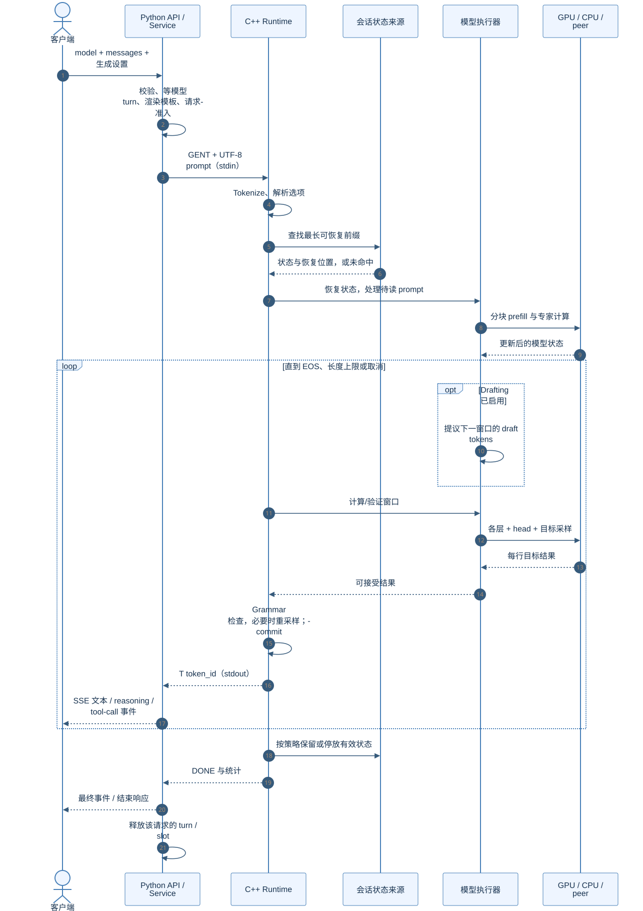

[放大查看 SVG](assets/svg/04-inference-03.svg) · [Mermaid 源图](assets/mermaid/04-inference-03.mmd)

进程之间的箭头是 stdin/stdout 协议事件；模型到 Compute 的箭头则是内存与算子调度。两者不是同一条共享内存通道，图中的 CPU/peer 分支也不是网络推理服务。

### 9. 停止、取消和多请求

常见结束原因有模型 EOS、`max_new/max_tokens` 长度上限、用户取消或客户端断连，以及执行错误。它们对客户端的结束状态和引擎是否可继续复用有不同含义。

取消通常经 STOP/BSTOP 等控制命令通知引擎。CPU 输入线程可先接收通知，正在运行的 prompt chunk 或验证窗口在安全边界检查并结束；“用户按下停止”不意味着立即强行销毁 GPU 上的一切状态。[Strata STOP 入口](https://github.com/Niko1221/Strata/blob/ffa80d73133ea5c548aefe57889a16e8085a938f/src/program/generate.cpp#L13108) [Basalt 协议](https://github.com/jesdga95/basalt/blob/4998eb3733ee83b7e7d6ff94854c399dd89cfebe/serve/engine/process.py#L1)

多请求槽位让多个会话各自持有状态并被调度。它不表示所有 HTTP 请求同时执行，也不表示每个后端都把不同请求融合为同一次矩阵运算。理解并发时，应分别查看“接纳队列”“slot 状态”“计算窗口怎样轮转或组批”。

### 10. 怎样用这套流程解释速度变化

观察一次请求时，至少把三段时间分开：排队/加载等待、prompt 读取、生成窗口。首 token 慢不一定是 decode kernel 慢，也可能在等模型、恢复状态或读取长 prompt。

窗口吞吐可粗略理解为：

```text
生成速度 ≈ 窗口实际提交的输出 token 数 / 窗口墙钟耗时
```

草稿接受率提高、权重读取减少、专家更常命中 VRAM、CPU/peer 等待缩短，都可能改变结果。草稿模型也会占显存和运行时间，因此不能只看“草稿更多”就判断更快。

读性能日志时，把 tok/s 与 ms/window、prompt 长度、有效输出数量、专家层级和功耗放在一起看。先确定哪一段变了，再去对应第 5 章的源码入口和 Basalt 专章中的具体优化。

[返回学习地图](README.md) · [上一章：数据流](03-dataflow.md) · [下一章：源码阅读路线](05-source-reading.md)

---

## 05｜源码阅读路线：从一句话走到一个 token

[上一章：推理流程](04-inference.md) · [目录](README.md) · [下一章：Basalt 专章](basalt/README.md)

源码阅读的第一项成果，应是能解释一次请求经过了哪些边界，而不是记住所有目录。建议先跟踪普通文本、一个请求、一个模型的路径，弄清数据的形状和归属，再加入缓存、投机、图像和多卡。

> 本章 Strata 链接固定在 `ffa80d73133ea5c548aefe57889a16e8085a938f`，Basalt 链接固定在 `4998eb3733ee83b7e7d6ff94854c399dd89cfebe`。行号只服务于这两个快照；若使用别的 checkout，请优先搜索符号。版本与归档关系见 [SOURCES](SOURCES.md)。

### 1. 先选一条主线

先给自己一个具体问题：**客户端发送“请介绍 MoE”后，第一段文字如何回来？** 暂时把“带图片”“多个模型轮换”等分支记在旁边，不必同时追踪。


[放大查看 SVG](assets/svg/05-source-reading-01.svg) · [Mermaid 源图](assets/mermaid/05-source-reading-01.mmd)

第一遍只读入口函数、调用顺序和数据结构，不钻进每个 kernel。第二遍选择“专家不在主 GPU”这个分支，把 RAM、CPU 专家池和 peer GPU 加回来。第三遍再研究投机窗口及状态回滚。

### 2. 第一步：从 Python 看见输入与输出

打开 Strata 的 [`serve/server.py`](https://github.com/Niko1221/Strata/blob/ffa80d73133ea5c548aefe57889a16e8085a938f/serve/server.py#L4492)，按下表跳转。这个文件较长，从顶部逐行读到最后很容易失去请求主线。

| 阅读入口 | 在固定快照中的位置 | 要看懂什么 |
|---|---|---|
| `main` | 9485 行 | 配置怎样变成服务实例与启动参数 |
| `serve`、`Server` | 8854、8569 行 | 监听端口和处理连接属于哪一层 |
| `Service` | 4492 行 | 请求服务持有什么共享资源 |
| `encode_prompt` | 5489 行 | messages、tools 怎样变成 token IDs |
| `prepare` | 5559 行 | 长度、生成预算、采样与请求状态怎样准备 |
| `run`、`_run` | 5869、5881 行 | 如何把一次服务请求送入引擎并消费事件 |
| `StrataEngine` | 1055 行 | 子进程何时创建，stdin/stdout 怎样通信 |

在 [`serve/frontend.py`](https://github.com/Niko1221/Strata/blob/ffa80d73133ea5c548aefe57889a16e8085a938f/serve/frontend.py#L40) 中补读 `ChatTemplate.render` 与 `OutputParser`。前者处理模型所需的对话格式；后者帮助把生成结果解释为外部 API 的输出。模板、tokenizer、输出解析是不同环节：格式化后的文本不是 token IDs，token IDs 也不是客户端可以直接展示的完整事件。

完成标志：用自己的话解释以下三个值，并各找出一个生产者和消费者：

- `messages`：带角色与内容的结构化请求。
- `ids`：模型词表中的整数序列。
- 引擎输出事件：token、结束信息和运行状态，不等于最终 HTTP JSON。

### 3. 第二步：跨过 Python → C++ 边界

先读 `StrataEngine` 创建子进程和写入生成命令的位置，再打开 [`src/program/generate.cpp`](https://github.com/Niko1221/Strata/blob/ffa80d73133ea5c548aefe57889a16e8085a938f/src/program/generate.cpp#L1)。该文件开头概括了单 token 主线：embedding → 多层计算 → lm head → sampling，并说明该原生路径不承担 tokenizer。

本基线的主要入口在 3181—3183 行附近：Windows/HIP 条件编译使用 `engine_main`，其他分支使用 `main`。文件尾部还有 Windows 入口，因此搜到多个 `main` 并不说明每次运行都会经过它们。[入口条件](https://github.com/Niko1221/Strata/blob/ffa80d73133ea5c548aefe57889a16e8085a938f/src/program/generate.cpp#L3180)

接着搜索 `READY`、`GEN`、`DONE`。目标是找到：

1. 初始化何时结束，什么时候可以接收请求。
2. 一行协议怎样解析为 token、长度和采样参数。
3. 请求处理如何进入 prefill 与 decode。
4. 每个 token 和最终结束状态如何写回 stdout。

不要仅凭出现字符串就认定找到了主循环：相同关键字可能也在日志、测试和特殊模式里。顺着调用者继续向上看，确认当前 executable、条件编译宏和启动参数。

Strata 的 DeepSeek 还有独立 [`src/dsv41/ds4_main.cpp`](https://github.com/Niko1221/Strata/blob/ffa80d73133ea5c548aefe57889a16e8085a938f/src/dsv41/ds4_main.cpp#L1) 入口。Python 服务接口相近，并不表示 DeepSeek 内部执行 `generate.cpp` 中同一套模型算子。

### 4. 第三步：先认数据结构，再读长函数

建议依次打开以下三个头文件，把“模型是什么”和“这次生成到了哪里”分开。

| 文件 / 类型 | 先回答的问题 | 不能混淆的对象 |
|---|---|---|
| [`geometry.hpp` / `ModelGeometry`](https://github.com/Niko1221/Strata/blob/ffa80d73133ea5c548aefe57889a16e8085a938f/include/strata/core/geometry.hpp#L23) | 隐藏维度、层数、专家数等形状来自哪里？ | 形状描述不是实际权重字节 |
| [`weights.hpp` / `WeightTable`](https://github.com/Niko1221/Strata/blob/ffa80d73133ea5c548aefe57889a16e8085a938f/include/strata/core/weights.hpp#L113) | 如何从权重名或布局定位所需张量？ | 权重地址不是当前 token 的激活 |
| [`session.hpp` / `SessionState`](https://github.com/Niko1221/Strata/blob/ffa80d73133ea5c548aefe57889a16e8085a938f/include/strata/core/session.hpp#L31) | 当前会话拥有哪些状态和缓冲区？ | 会话状态不能无条件跨请求混用 |

`SessionState` 包含模型执行需要的状态；同文件还描述 `SessionGraphs` 及不同回放入口。看到 `session_replay` 时，务必继续阅读合同：文件明确区分它与 `session_replay_full`，不能把一个局部回放函数的耗时当成完整 token 的成本。

下面是一张可以自己填的阅读记录表。第一次追踪一个变量时，填一行，比连续收藏几十个函数名更有帮助。

| 数据 | 形状或单位 | 当前在哪里 | 谁创建 / 更新 | 什么时候可复用或释放 |
|---|---|---|---|---|
| 输入 token IDs | token 数量 × 整数 | Python / 原生输入缓冲 | 模板编码与协议读取 | 请求处理完成后 |
| 层输入激活 | 依模型隐藏维度 | GPU，或 CPU 可访问副本 | 前一层 / 归一化 | 本层消费者完成后 |
| 专家结果 `parts` | `k × n_embd` | 依执行路径安排 | 选中的专家计算 | 合并完成后 |
| KV / 递归状态 | 依模型与历史长度 | 会话管理的设备/主机存储 | prefill / decode / restore | 会话回收或淘汰时 |

最后两行故意不用统一的固定容量：模型架构、上下文、并发和驻留策略都会改变真实布局。

### 5. 第四步：用一个专家请求理解异构计算

阅读 [`expert_source.hpp`](https://github.com/Niko1221/Strata/blob/ffa80d73133ea5c548aefe57889a16e8085a938f/include/strata/core/expert_source.hpp#L1) 的接口合同，再看对应实现和 [`src/kernels/cpu/pool.cpp`](https://github.com/Niko1221/Strata/blob/ffa80d73133ea5c548aefe57889a16e8085a938f/src/kernels/cpu/pool.cpp)。先追踪“需要哪个专家、数据在哪、谁来算”，之后才读量化内核的位操作。

为这一层记录五项内容：

1. 输入激活如何准备，什么时候 CPU 可以读取。
2. MoE router 给出了哪些专家 ID 与路由权重。
3. 每个专家落在 GPU 缓存、CPU/RAM 或其他后备路径中的哪一处。
4. 专家结果存在哪里，谁等待它们完成。
5. 合并阶段在哪里应用路由权重，后续层何时可以读取。

这个接口有一个很适合初学者练习的细节：**Strata 的 CPU 专家池不乘 router weight，设备端 `moe_combine` 才乘。** 如果读者只看到“专家计算完成”就跳到下一层，容易漏掉这项必要运算，也可能在修改代码时重复乘一次。[接口合同](https://github.com/Niko1221/Strata/blob/ffa80d73133ea5c548aefe57889a16e8085a938f/include/strata/core/expert_source.hpp#L1)

再阅读 [`src/prefill/prefill.cpp`](https://github.com/Niko1221/Strata/blob/ffa80d73133ea5c548aefe57889a16e8085a938f/src/prefill/prefill.cpp)，比较输入从单个 token 变成 token 块之后，工作排序、缓冲区和计算核为何改变。不能把 decode 的一次小矩阵向量计算简单复制多遍，就当作这里的优化 prefill。

### 6. 第五步：把普通解码扩展到投机解码

先回顾[推理流程](04-inference.md)，再分别查看 Strata 的 `include/strata/core/mtp.hpp`、`verify.hpp`、`dflash2.hpp` 及对应 `src/core/` 实现。

不要先纠结草稿模型的每层数学。先画出下面四种状态变化：

- **草稿前：** 目标模型已经确认到哪个位置。
- **草稿后：** 哪些 token 只是提议，哪些临时状态已经被写入。
- **校验后：** 接受了多长前缀，分歧处采用哪个目标结果。
- **下一轮前：** 哪些状态被保留、截断、恢复或重新计算。

然后检查“接受”具体由什么规则决定。Strata 还有受 `STRATA_SPEC_PROB` 控制的可选概率拒绝采样逻辑；不能仅看默认路径，就把所有模式都描述为“token ID 相等则接受”。[可选概率规则](https://github.com/Niko1221/Strata/blob/ffa80d73133ea5c548aefe57889a16e8085a938f/include/strata/core/spec_prob.hpp#L1)

阅读 Basalt 时可以先看 [`Request::execute`](https://github.com/jesdga95/basalt/blob/4998eb3733ee83b7e7d6ff94854c399dd89cfebe/src/program/serve/request.cpp#L6)，其阶段顺序十分明确：`parse → prepare_prompt → restore → read_prompt → decode → complete`。再看 [`decode_loop.hpp`](https://github.com/jesdga95/basalt/blob/4998eb3733ee83b7e7d6ff94854c399dd89cfebe/src/program/serve/decode_loop.hpp#L35)，跟踪校验、grammar 检查与提交的先后关系。grammar 检查通过前的候选，不应直接等同于最终已提交输出。

### 7. 第六步：沿接口比较 Basalt，而不是机械对齐文件名

Strata 的一些大文件在 Basalt 中被拆分。适合做比较的是“这项职责去了哪里”，而不是“同名文件还剩多少行”。

| 想比较的职责 | Strata 阅读入口 | Basalt 阅读入口 |
|---|---|---|
| API、请求准备、输出 | `serve/server.py`、`serve/frontend.py` | `serve/service.py`、`serve/router.py` |
| 一次原生请求的生命周期 | `src/program/generate.cpp` 的服务循环 | `src/program/serve/request.cpp` |
| 模型描述与接入 | geometry、各模型专用入口 | [`ModelAdapter`、`ModelSession`](https://github.com/jesdga95/basalt/blob/4998eb3733ee83b7e7d6ff94854c399dd89cfebe/include/basalt/model/adapter.hpp#L129) |
| Qwen 模型计算 | `src/core/`、`src/prefill/` 相关路径 | `src/models/qwen4exp/` |
| DeepSeek 模型计算 | `src/dsv41/` | `src/models/deepseek41/` |
| GPU/CPU 专家协作 | expert source、cache、CPU pool | 公共专家设施与模型各自 dispatch/tier |

特别查看 `ModelAdapter::run`：接口允许模型拥有专用运行入口；未提供专用入口时才走共享服务器加载的 sessions。由此可以理解为什么“Basalt 有公共模型接口”不意味着 Qwen 与 DeepSeek 使用完全相同的内部调度。

最后再读 [Basalt 专章](basalt/README.md) 的 RTX 50 系列优化。每项优化都应能回答“作用于哪种数据、哪一阶段、哪个硬件条件”，而不只是记住 NVFP4、Graph 或 Blackwell 这些名称。

### 8. 可以直接使用的只读查找方式

在自己的终端中把目录改为实际源码路径。下面的命令只定位源码，不下载模型、不编译、不启动推理。

```bash
STRATA_SRC=/absolute/path/to/Strata
BASALT_SRC=/absolute/path/to/basalt

git -C "$STRATA_SRC" rev-parse HEAD
git -C "$BASALT_SRC" rev-parse HEAD
rg -n 'class (StrataEngine|Service)|def (prepare|encode_prompt)' "$STRATA_SRC/serve/server.py"
rg -n 'engine_main|int main|READY|DONE' "$STRATA_SRC/src/program/generate.cpp"
rg -n 'struct (ModelGeometry|SessionState)|class WeightTable' "$STRATA_SRC/include/strata/core"
rg -n 'Request::execute|prepare_prompt|read_prompt' "$BASALT_SRC/src/program/serve"
rg -n 'class (ModelAdapter|ModelSession)|virtual.*run' "$BASALT_SRC/include/basalt/model/adapter.hpp"
```

搜索结果只是入口，不是完整论证。例如，找到某个 `#if` 下的 kernel 只能证明代码存在，不能证明当前 build 编译了它、当前模型选择了它，或它在你的 GPU 上更快。

### 9. 原始六篇笔记应该怎么用

原稿适合第二遍阅读时查细节，保留在归档中。它们比本教程更密集，包含大量行号和特定模型常量；先阅读本章，再按问题进入相应原稿。

| 归档笔记 | 适合追问的问题 |
|---|---|
| [cli-launch.md](archive/strata-notes/cli-launch.md) | 启动、安装、配置、桌面与终端怎样配合？ |
| [server.md](archive/strata-notes/server.md) | HTTP 生命周期、协议、前缀缓存和输出适配在哪里？ |
| [engine-core.md](archive/strata-notes/engine-core.md) | 原生启动、服务循环、prefill、停止条件怎样串联？ |
| [memory-weights.md](archive/strata-notes/memory-weights.md) | 权重布局、量化、专家缓存和 RAM/磁盘路径怎样组织？ |
| [kernels-spec.md](archive/strata-notes/kernels-spec.md) | `qwen4exp` 的单层数学、采样和投机有哪些细节？ |
| [dsv41-split-ports.md](archive/strata-notes/dsv41-split-ports.md) | DeepSeek、专用 split 引擎与平台后端有哪些独立路径？ |

原 `cli-launch.md` 明确标注 Strata 0.2.12 / engine 0.1.58；本教程采用的本地固定快照说明为 0.2.10 / 0.1.56。因此原稿的行号、默认值和具体选项不能直接用于当前引用。例如原稿中 `Service` 的定位与本章的 4492 行不同，应搜索类名重新定位。

### 10. 如何判断自己已经读懂

可以选择源码中的一个测试作为最后的练习：Strata 的 `tests/core/expert_cache_slot_guard_test.cpp`、Basalt 的 `tests/core/protocol_test.cpp` 或 `tests/core/conversation_validation_test.cpp`。先看测试给了什么输入、期待什么结果、拒绝什么非法状态；不要只读测试名称。

本手册没有编译或执行 GPU 测试。阅读测试能帮助理解合同，不能替代在实际驱动、显卡和模型上的正确性与性能验证。

完成这一轮后，你应能对一段代码写出四句话：**它接收什么；修改什么；等待谁；把什么交给下一步。** 若还不能，回到变量的形状、所在设备与生命周期，而不是继续增加更多文件。

---

## Basalt 专章：沿着 Strata 的思路理解 Blackwell 优化

[返回学习手册](README.md) · [先读基础概念](01-foundations.md) · [阅读优化机制](basalt/01-blackwell-optimizations.md)

本专章接在共同架构与推理流程之后。这里的“融合”是把两项目放进同一条学习路线：先理解 Strata 奠定的异构 MoE 思路，再观察 Basalt 如何围绕特定 GPU 深化实现。**两者仍是独立的软件项目，不能把源码、配置和模型文件直接互换。**

本文使用固定源码快照，避免一边读旧笔记、一边把新版本行为混进来：

| 用途 | 版本断面 |
|---|---|
| Strata 学习基线 | `ffa80d73133ea5c548aefe57889a16e8085a938f` |
| Basalt 学习基线 | `4998eb3733ee83b7e7d6ff94854c399dd89cfebe`，项目版本 0.3.1 |
| 观察继承关系的历史断面 | `e69c1fb6f129bf813e655b818b91414fb894c0a3`，当时 CMake 标为 Strata 0.1.39 |

历史断面只用于判断哪些能力早已存在，不等同于今日 Strata，也没有在这里被证明为今日两仓库的严格 merge-base。[历史基线](https://github.com/jesdga95/basalt/blob/e69c1fb6f129bf813e655b818b91414fb894c0a3/CMakeLists.txt#L12)

### 1. 为什么会出现这样一条分支

一个 MoE 模型可以有大量专家权重，但每个 token 只调用其中一部分。问题是：下一层将调用哪些专家，要等 router 算完才能知道，而显存不够容纳所有专家。

Strata 的重要思路是把资源组合起来：GPU 显存放常用专家，系统 RAM 放其他专家，CPU 参与计算；资源不足时还有文件后备。这样才能在显存小于模型体积的机器上推理。每次生成到底快不快，取决于算力，也取决于权重在哪里、搬运多少、等待多久。[历史执行说明](https://github.com/jesdga95/basalt/blob/e69c1fb6f129bf813e655b818b91414fb894c0a3/docs/HOW_IT_WORKS.md)

Basalt 继承了这个问题和大部分基础机制，将主引擎的硬件范围收窄到 **Blackwell `sm_120` + CUDA 13**，再围绕这个范围优化。`sm_120` 是 CUDA 对计算架构的标识；RTX 50 系列是主要使用场景，但满足该架构的 RTX PRO 等专业卡也在目标范围内。Linux 与 Windows x64 均受支持。[构建约束](https://github.com/jesdga95/basalt/blob/4998eb3733ee83b7e7d6ff94854c399dd89cfebe/CMakeLists.txt#L39) [平台说明](https://github.com/jesdga95/basalt/blob/4998eb3733ee83b7e7d6ff94854c399dd89cfebe/docs/platforms.md)

“只支持一种主要 GPU 架构”可以减少需要同时维护的兼容路径，使融合算子、指令选择与调度规则更集中。不过，这不自动证明它在每种工作负载下都比 Strata 快。

### 2. 哪些是继承，哪些是深化

| 读到的能力 | 正确理解 |
|---|---|
| VRAM / RAM / 文件分层 | 历史 Strata 已有；Basalt 继续优化专家放置、补集和搬运 |
| CPU 专家池 | 历史 Strata 已有；Basalt 改进任务粒度及与 GPU/peer 的重叠 |
| MTP 与 draft 验证 | 历史 Strata 已有；Basalt 改进窗口、草稿执行、head 筛选等 |
| CUDA Graph | 历史 Strata 已有；Basalt 扩大融合与重叠，减少执行间隙 |
| 多卡专家层、layer split、并行槽 | 已有基础；当前两分支的选择规则和可用模式不同 |
| `.basalt` 文件 | Basalt 的单文件分区容器，将权重和附属资源一起组织 |
| sm_120 专用路径 | Basalt 的明确工程取向，主推理后端不覆盖其他 GPU 架构 |
| NVFP4 | 应比较具体实现。当前 Strata 基线也已支持 NVFP4，不能写成 Basalt 独有 |
| 多模型与服务结构 | Basalt 有 adapter/session/dialect 分层和单驻留模型 Router；Strata 基线还存在独立引擎、replicas、split serving 等分支 |

对应证据：[历史执行原理](https://github.com/jesdga95/basalt/blob/e69c1fb6f129bf813e655b818b91414fb894c0a3/docs/HOW_IT_WORKS.md)、[Strata NVFP4](https://github.com/Niko1221/Strata/blob/ffa80d73133ea5c548aefe57889a16e8085a938f/docs/NVFP4.md)、[Basalt 模型接口](https://github.com/jesdga95/basalt/blob/4998eb3733ee83b7e7d6ff94854c399dd89cfebe/include/basalt/model/adapter.hpp)、[Strata 服务副本](https://github.com/Niko1221/Strata/blob/ffa80d73133ea5c548aefe57889a16e8085a938f/serve/replicas.py#L1)。

### 3. 在总学习路线中放在哪里


[放大查看 SVG](assets/svg/basalt-readme-01.svg) · [Mermaid 源图](assets/mermaid/basalt-readme-01.mmd)

这张图的上半部是两项目可以共同理解的概念，下半部是工程取向。它不是 Git 提交图：两个项目此后都在继续演进，不能将分叉后的每项功能按名称简单归给某一方。

建议按下面的顺序阅读：

1. [Blackwell 优化机制](basalt/01-blackwell-optimizations.md)：先找瓶颈，再看代码如何改善它。
2. [架构与行为差异](basalt/02-architecture-differences.md)：避免把同名术语、参数或接口混用。
3. [原始 Basalt 分析报告](archive/basalt-analysis-2026-11-08/Basalt项目分析.md)：需要完整性能样例、历史对照和更多源码定位时再读。

### 4. 本专章的四条阅读约定

- **说清阶段。** Prefill 是读提示词，decode 是生成后续 token；它们可能使用不同精度与不同 kernel。
- **说清数据。** 权重、激活、路由信息、KV/递归状态是不同东西；一个箭头写“传数据”还不够，后文会注明传什么。
- **说清模式。** 多个 HTTP 连接、多请求槽、模型切换、多引擎副本、多 GPU 分工不等价。
- **说清证据。** 数字来自仓库记录，本文没有进行 GPU 复测。局部优化的增益不能自动推导成整个项目的速度倍数。

读完后，你应能解释：为什么有 5090 还需要 CPU，为什么 FP4 能节省权重却不意味着全程 W4A4，以及为什么一个很快的显卡 kernel 仍可能被专家搬运拖住。

[返回学习手册](README.md) · [下一篇：Blackwell 优化机制](basalt/01-blackwell-optimizations.md)

---

## Basalt 如何利用 RTX 50 系列：先找瓶颈，再看优化

[返回学习手册](README.md) · [Basalt 专章入口](basalt/README.md) · [下一篇：架构差异](basalt/02-architecture-differences.md)

> 具体实现固定到 Basalt `4998eb3733ee83b7e7d6ff94854c399dd89cfebe`。本章不是硬件实测或调参教程；性能数字均来自该快照的源码记录。

### 1. 一次生成为什么会等待

可以把一次 decode window 理解成“一轮主模型验证”。这一轮要读权重、做矩阵运算、等待其他计算分支、得到 logits，再决定能提交哪些 token。

| 可能的限制 | 发生的事情 | Basalt 对应的优化方向 |
|---|---|---|
| 显存容量 | 热专家放不下，更多工作落到 RAM 或文件层 | 量化、专家缓存、RAM 补集、KV 内存管理 |
| 数据带宽 | 计算单元等权重或激活到达 | 原生量化块、就地计算、异步搬运、下一层预取 |
| 启动与同步延迟 | 大量很短的 kernel 之间有等待空隙 | CUDA Graph、融合、设备侧计划、persistent peer kernel |
| 一轮有效产出少 | 主模型做了一轮工作，只产出很少 token | MTP/DSpark 提案与批量验证 |
| 计算吞吐 | Prefill 的大矩阵运算本身耗时 | 合适条件下使用 FP4 Tensor Core |

这些限制可能同时存在。例如，FP4 算子很快，但专家权重在 SSD 上，它仍可能等文件读取。优化必须放到整条数据链里理解。

### 2. 支持边界：看架构标识，而不只看产品名称

Basalt 主引擎要求 CUDA 13、计算能力 12.0，也就是 `sm_120`；NVFP4 prefill 的独立库还使用 `120a-real` 编译目标。RTX 5090 是这一范围中的典型设备，其他满足条件的 50 系列和 RTX PRO Blackwell 卡也可能使用相同路径。[CMake 约束](https://github.com/jesdga95/basalt/blob/4998eb3733ee83b7e7d6ff94854c399dd89cfebe/CMakeLists.txt#L39)

同为 Blackwell 名称的其他架构不能自动套用这个结论。显存容量、内存带宽、功耗和 PCIe 链路也会影响实际速度：桌面 5090、Laptop 与 D 系列型号不应当成一张完全相同的卡。本章不将某个 SKU 的样例推广为整个系列的保证。

### 3. 量化先解决“要读多少字节”

**权重**是模型训练后的参数；**激活**是当前输入经过网络产生的中间数值。两者可以使用不同格式，所以文件名里的“4 bit”通常只说明一部分权重存储，不能推导全部运算都是 4 bit。

Qwen 官方 `NVFP4-DQ6_K` 包中，路由专家采用 NVIDIA NVFP4，dense 投影采用 Q6_K。专家的 E2M1 代码与比例因子一起保留，计入 scale 后约 4.5 bit/weight；计算时还要应用 FP32 tail。`D` 表示 dense 的格式。[模型文件说明](https://github.com/jesdga95/basalt/blob/4998eb3733ee83b7e7d6ff94854c399dd89cfebe/docs/model-file.md)

少读权重有三方面收益：显存能装更多专家、RAM 能容纳更多模型参数、需要搬运时占用更少 PCIe 字节。它们都可能帮助 decode，即使没有使用 FP4 Tensor Core。

#### 3.1 “W4A4”与“W4A8”是什么意思

`W` 指权重，`A` 指激活。W4A4 表示二者使用 4-bit 表达参与对应计算；W4A8 则是 4-bit 权重搭配 8-bit 激活的简写。实际实现还包括 scale、累加精度和特定块布局，因此不能只用两个数字描述全部数值行为。

| Basalt Qwen 路径 | 实际做法 | 适合它的原因 |
|---|---|---|
| NVFP4 decode | q8_1/int8 激活，子块 int32 点积，FP32 scale | 小 token/window 更看重低延迟与少读权重 |
| NVFP4 prefill | 满足格式条件且 chunk ≥1024 时，E2M1 激活与专家权重做 block-scaled FP4 MMA | 较多 prompt token 能形成适合 Tensor Core 的矩阵工作量 |
| 其他量化专家 prefill | 可走 int8 MMQ 等路径 | 数据布局和格式不同，不会因显卡叫 5090 就全部进入 FP4 分支 |
| Dense prefill | FP16 权重/激活与 cuBLAS，FP32 累加 | 批量矩阵计算使用另一套适合的实现 |

`chunk` 是引擎一次读取的提示词片段，**不是请求总长度的同义词**。一个总长超过 1024 的请求，最后不足阈值的小片段仍可能走其他路径。分发还检查专家格式和 tail，不能只看 token 数。[阈值](https://github.com/jesdga95/basalt/blob/4998eb3733ee83b7e7d6ff94854c399dd89cfebe/src/models/qwen4exp/prefill/layout.hpp#L62) [选择条件](https://github.com/jesdga95/basalt/blob/4998eb3733ee83b7e7d6ff94854c399dd89cfebe/src/models/qwen4exp/prefill/experts.hpp#L94) [PTX kernel](https://github.com/jesdga95/basalt/blob/4998eb3733ee83b7e7d6ff94854c399dd89cfebe/src/models/qwen4exp/prefill/fp4/moe_fp4.cu#L47)

#### 3.2 性能与数值变化一起看

项目记录中，Qwen NVFP4、int8 KV、冷运行、5090 400 W + 5060 Ti 180 W：

| Prefill 工作量 | MMQ | FP4 | 以 MMQ 为基准的变化 |
|---|---:|---:|---:|
| 16K prompt | 6456 tok/s | 7807 tok/s | 约 +21% |
| 64K prompt | 8201 tok/s | 10126 tok/s | 约 +23% |

这是 prefill 的对照，不能改写为 decode 或整体聊天也快同样比例。项目还报告 2,049-token prompt、24 chunks 时，FP4 对 MMQ 的 KLD 增加 0.0018、top-1 下降 0.19 个百分点。KLD 在这里用于衡量输出概率分布相对参考的差别，top-1 指最可能 token 的一致情况。[测量及精度](https://github.com/jesdga95/basalt/blob/4998eb3733ee83b7e7d6ff94854c399dd89cfebe/docs/precision/qwen38-flash-next.md#L21)

因此应理解为“在特定阶段以小幅数值变化换取吞吐”，而不是给 FP4 贴上绝对无损标签。

### 4. 专家缓存：把快存储留给近期会用的权重

默认 Qwen NVFP4 包约 122 GiB，专家集合约 63.3 GiB。32 GB 显存除专家外还要装 dense、KV、drafter 和工作区，无法完整容纳这些内容。[模型包说明](https://github.com/jesdga95/basalt/blob/4998eb3733ee83b7e7d6ff94854c399dd89cfebe/docs/model-file.md) [记录中的资源占用](https://github.com/jesdga95/basalt/blob/4998eb3733ee83b7e7d6ff94854c399dd89cfebe/docs/community/benchmarks.json)

这里有两类容易混淆的“缓存”：

- **专家缓存**保存模型权重，多个请求可以用到同一份专家。
- **会话缓存**保存某段输入对应的 KV、递归状态和 checkpoint，用来接着该对话计算。


[放大查看 SVG](assets/svg/basalt-01-blackwell-optimizations-01.svg) · [Mermaid 源图](assets/mermaid/basalt-01-blackwell-optimizations-01.mmd)

实线是本轮查找与计算，虚线中的 peer、文件后备和后台交换是条件路径。图中的 RAM → 汇合传的是**计算结果**，并不表示每次都把完整专家权重传回 GPU。

Qwen adaptive tier 按近期路由频次更新专家放置，默认 server 每 window 发起一轮，最多 96 次 swap，计数衰减 0.85。交换跨 copy-out、side-stream copy-in、use 三个 window，尽量把搬运与计算重叠。DeepSeek 使用自己的 homes/copies 与按访问更新的 tier，不能照搬 Qwen 参数。[Qwen adaptive](https://github.com/jesdga95/basalt/blob/4998eb3733ee83b7e7d6ff94854c399dd89cfebe/docs/configuration/adaptive.md) [DeepSeek tier](https://github.com/jesdga95/basalt/blob/4998eb3733ee83b7e7d6ff94854c399dd89cfebe/src/models/deepseek41/tier.hpp#L3)

RAM 还可能只保留 GPU 专家的“补集”及必要副本，而非始终再复制一份完整模型。这样省 RAM，但换入、换出和 prefill 借显存槽时，需要维护权重的新旧位置。[专家来源与补集](https://github.com/jesdga95/basalt/blob/4998eb3733ee83b7e7d6ff94854c399dd89cfebe/include/basalt/core/expert_source.hpp#L86)

### 5. PCIe：能寻址主机内存，不代表没有传输成本

**Pinned memory** 是被固定、不随意换出的主机内存；**mapped memory** 则使 CUDA 设备可以通过映射地址访问这段内存。两者帮助组织异步传输和通信，但数据仍需经过实际硬件链路，RAM 的速度也不会变成 VRAM 的速度。

Peer 卡最重要的作用是“权重留在它的显存，并在它上面计算”。若每轮都把 peer 的完整专家再搬回主卡，会抵消相当一部分价值。通常跨卡通道传的是较小的激活、路由计划与结果。[peer 实现](https://github.com/jesdga95/basalt/blob/4998eb3733ee83b7e7d6ff94854c399dd89cfebe/src/core/peer_experts.cpp#L338)

当前快照最后一个提交有一个具体例子：DeepSeek peer 的激活和 plan 原来先通过两次 `cudaMemcpyAsync` 传入；7–10 MB 的专家槽换入也占用 copy engine，短消息因此排队。改动后，量化 kernel 直接读 mapped 激活，额外 blocks 将 mapped plan 拷到 device buffer，避开这段队列。[提交说明](https://github.com/jesdga95/basalt/commit/4998eb3733ee83b7e7d6ff94854c399dd89cfebe)

作者记录的 5090 400 W + 5060 Ti 180 W 上，slot copy 在飞时首个专家 kernel 的等待从 81.4 μs 降到 41.8 μs。相应冷 prose 为 87.4→88.9 tok/s，verify+draft 为 19.77→19.44 ms/window。

这里使用 UD-IQ1_M、seed 42、`--diag-tier-ram 316`。**316 是每层 RAM-tier 专家数量，不是 316 GiB RAM。** 结果来自有限 A1/B1 和 trace，而非本章复测；它说明减少排队可以有端到端收益，不代表所有负载都提高相同比例。

### 6. CUDA Graph 与融合：减少计算之间的空隙

一个 **kernel** 是 GPU 执行的一段并行计算。单独的 kernel 可能很快，但 CPU 逐个提交、设备等待依赖和反复读写中间结果也需要时间。

| 技术 | 初学者可以怎样理解 | 作用边界 |
|---|---|---|
| CUDA Graph | 记录并复用一组依赖明确的 GPU 工作 | 减少重复 launch 开销，不会让数学运算消失 |
| 融合 | 将相邻运算组织在更紧密的执行链中 | 可少写中间数据、少启动 kernel，仍需保持正确依赖 |
| Device plan | GPU 根据路由和驻留表生成专家工作计划 | 少让每层计划都往返 CPU |
| Persistent peer kernel | 一个 window 内保持 peer 执行循环，通过 ring/序列字接任务 | 减少逐层单独启动，必须正确同步结果 |
| PDL | 让满足条件的依赖 kernel 更早进入执行过程 | 需硬件和路径支持，存在普通 graph 回退 |
| L2 预取 | 提前把下一步可能读取的权重带到 GPU 缓存 | 隐藏部分等待，不保证每次都命中或完全隐藏延迟 |

当前 Qwen 验证链会利用等待 CPU/peer 的空隙做部分延迟状态提交，并预取下一层投影。它优化的是整条关键路径，不只是某个矩阵乘的峰值。[Graph 捕获](https://github.com/jesdga95/basalt/blob/4998eb3733ee83b7e7d6ff94854c399dd89cfebe/src/models/qwen4exp/decode/verify/capture.cpp#L30) [专家执行链](https://github.com/jesdga95/basalt/blob/4998eb3733ee83b7e7d6ff94854c399dd89cfebe/src/models/qwen4exp/decode/verify/record_moe.cpp#L43) [peer 执行](https://github.com/jesdga95/basalt/blob/4998eb3733ee83b7e7d6ff94854c399dd89cfebe/src/models/qwen4exp/decode/verify/expert_execution.cpp#L17)

### 7. 输出 head 和草稿窗口：避免每轮做过多无效工作

**输出 head** 把最后的 hidden state 变成词表里每个 token 的分数。词表很大时，这一步也会读大量权重。

Qwen NVFP4 包的 Q8_0 two-stage head 先用 bit-plane 和误差区间筛候选，再精确计算仍可能进入 top-K 的行；K≤64 的路径有精确界限，超出适用范围会全精确评分。记录的耗时是 439→350 μs/window。Q6_K head 的 tail 则是近似的，不能把它与前者一起称为无损。[两阶段 head](https://github.com/jesdga95/basalt/blob/4998eb3733ee83b7e7d6ff94854c399dd89cfebe/docs/precision/qwen38-flash-next.md#L168)

**推测解码**先用较便宜的 drafter 提议多个后续 token，再由主模型验证。Qwen 使用 MTP，默认窗口 8 是 anchor 加最多 7 个 draft；DeepSeek 使用 DSpark，默认窗口 3 是 anchor 加最多 2 个 draft。有效输出数由主模型验证决定。[Qwen drafting](https://github.com/jesdga95/basalt/blob/4998eb3733ee83b7e7d6ff94854c399dd89cfebe/docs/models/qwen38-flash-next.md) [DeepSeek drafting](https://github.com/jesdga95/basalt/blob/4998eb3733ee83b7e7d6ff94854c399dd89cfebe/docs/models/deepseek41.md)


[放大查看 SVG](assets/svg/basalt-01-blackwell-optimizations-02.svg) · [Mermaid 源图](assets/mermaid/basalt-01-blackwell-optimizations-02.mmd)

这张图描述 Basalt 当前请求循环中的逻辑顺序，不表示这些步骤在 profiler 上完全串行。部分草稿计算、状态管理和输出可以重叠。

判断快慢时看两个量：**一轮花多久，以及一轮实际产出多少有效 token**。只看 tok/s，可能把“某篇文章更容易被 draft 猜中”误认成底层 kernel 更快。项目要求同时给出 ms/window、passes/s 和功耗等信息。[验证规则](https://github.com/jesdga95/basalt/blob/4998eb3733ee83b7e7d6ff94854c399dd89cfebe/CONTRIBUTING.md#L31)

### 8. 为 KV 节省显存，也是在给专家留空间

Qwen 默认 KV 为 fp16，也支持 int8、q4_0、k8v4；社区 preset 使用 int8，不能当成引擎默认。DeepSeek 0.3.1 默认 `fp8`，内部不同缓存使用 FP8/FP4：文档记录 920 B/position，而 fp16 路径为 3200 B/position。[配置](https://github.com/jesdga95/basalt/blob/4998eb3733ee83b7e7d6ff94854c399dd89cfebe/docs/configuration/index.md#L87) [DeepSeek 精度](https://github.com/jesdga95/basalt/blob/4998eb3733ee83b7e7d6ff94854c399dd89cfebe/docs/precision/deepseek41.md)

KV 占用减少，可把显存留给更多专家或更长上下文；但上下文越长仍有额外计算与状态管理成本。专家迁移、KV 量化、FP4 激活都会涉及数值行为，固定 placement 的 kernel 等价测试不能替代全部模型质量评估。

### 9. 如何读性能数字而不被误导

把一项速度结果和以下条件一起读：模型、量化、上下文、prompt 类型、draft 设置、GPU 数量/功耗、CPU/RAM、PCIe、版本和是否发生 SSD spill。

Basalt 0.2.0 的“约 +13%”是它对自身 0.1.0 附近版本、5090 400 W + 5060 Ti 180 W 的比较。它既不是单卡结论，也不是相对最新 Strata 的统一优势。[原始发布记录](https://github.com/jesdga95/basalt/blob/4998eb3733ee83b7e7d6ff94854c399dd89cfebe/docs/changelog/0.2.0.md#L8)

学习本章后，可以用一句带原因的话解释每项优化，例如：“peer 就地计算主要减少整块专家的回传”，“FP4 prefill 主要利用大矩阵吞吐”，“及时更新驻留减少冷专家尾部”。能解释作用阶段和瓶颈，比记住某个 tok/s 数字更有用。

[返回学习手册](README.md) · [上一页：Basalt 入口](basalt/README.md) · [下一篇：架构与行为差异](basalt/02-architecture-differences.md)

---

## Strata 与 Basalt：相同术语背后的架构差异

[返回学习手册](README.md) · [Basalt 入口](basalt/README.md) · [上一篇：Blackwell 优化](basalt/01-blackwell-optimizations.md)

> Strata 基线：`ffa80d73133ea5c548aefe57889a16e8085a938f`；Basalt 基线：`4998eb3733ee83b7e7d6ff94854c399dd89cfebe`。以下是固定版本的静态源码分析，不宣称覆盖两个项目之后的所有变化。

共同原理可以一起学，落到配置、进程和函数调用时则必须区分项目。本章从六个问题比较两者：如何启动、文件如何组织、谁处理请求、如何并发、多卡怎样分工，以及生成结果如何受到约束。

### 1. 两个项目各自把什么放在中心

| 层次 | Strata 基线 | Basalt 基线 |
|---|---|---|
| 用户入口 | 桌面应用、Terminal/Control、源码启动路径并存 | `basalt serve`、bench、probe 等可执行入口 |
| 硬件实现 | CUDA/HIP/SYCL/Metal 等路径，具体模型的可用组合需单独检查 | 主引擎限定 CUDA 13、sm_120；Linux/Windows 平台层 |
| Python 服务 | `serve/server.py` 承接主要 HTTP、Service、引擎协议；另有 replicas/split 等包装器 | `handler.py`、`service.py`、`router.py`、`engine/`、`api/`、`models/` 分工 |
| 模型执行 | 主引擎与 DeepSeek、all-cards split 等独立引擎路径并存 | 以 adapter/session/dialect 连接公共层和模型专属代码 |
| 模型制品 | GGUF、native pack、tokenizer、draft 等资源按准备路径组合 | `.basalt` 容器组合多个命名 section；profile 随引擎分发 |

这不是简单的“一个更先进、一个更旧”。Strata 基线保留更广的入口与硬件/执行模式；Basalt 在更窄的主硬件范围内统一部分组织方式。**某个模式没有在 Basalt 中出现，不代表它不能在 Strata 中出现，反过来也一样。**[Strata 总览](https://github.com/Niko1221/Strata/blob/ffa80d73133ea5c548aefe57889a16e8085a938f/AGENTS.md) [Basalt 模型扩展接口](https://github.com/jesdga95/basalt/blob/4998eb3733ee83b7e7d6ff94854c399dd89cfebe/docs/adding-a-model.md)

### 2. `.basalt` 是一个资源包，不是把 GGUF 换个后缀

GGUF 可以描述模型 tensor 和元数据，但引擎运行时还可能需要重排的专家块、tokenizer、模板、draft 权重、视觉 projector 等。Strata 的准备路径会把这些资源组合起来。例如 NVFP4 转换先生成 GGUF，再生成 native expert pack，专家 scale tail 位于 `experts.bin`。[Strata NVFP4 准备](https://github.com/Niko1221/Strata/blob/ffa80d73133ea5c548aefe57889a16e8085a938f/docs/NVFP4.md)

Basalt 用单文件容器组织这些资源：64 KiB header，最多 511 个 section，section 按 2 MiB 对齐；每个 section 记录名称、offset、size 和 hash。内部仍可有原有量化编码和 GGUF metadata，因此容器格式与量化格式是两个不同层次。[容器定义](https://github.com/jesdga95/basalt/blob/4998eb3733ee83b7e7d6ff94854c399dd89cfebe/include/basalt/core/model_format.hpp)


[放大查看 SVG](assets/svg/basalt-02-architecture-differences-01.svg) · [Mermaid 源图](assets/mermaid/basalt-02-architecture-differences-01.mmd)

图里的上下两条路径不是两步串联转换，也不表示所有 Strata 模型都有完全相同的文件集合。实际转换要服从模型与后端要求。

Basalt v2 **不把专家 profile 放在 pack 里**；它从引擎 `data/profiles` 找模型相应 profile。0.3.1 直接读取 tokenizer/vision 等 section，不再先解包一份到缓存目录。[模型文件说明](https://github.com/jesdga95/basalt/blob/4998eb3733ee83b7e7d6ff94854c399dd89cfebe/docs/model-file.md) [加载入口](https://github.com/jesdga95/basalt/blob/4998eb3733ee83b7e7d6ff94854c399dd89cfebe/src/models/qwen4exp/load/qfn_run.cpp#L15)

### 3. Python 与 C++ 的边界：接口相似，分工不完全相同

两者都能看到“Python HTTP 服务 → 常驻 C++ 引擎 → token 返回 → API 输出”的结构。常驻意味着模型不会在每个请求到来时重新加载。

Basalt 的用户命令 `basalt serve` 进入 Python 服务；Python `ProcessEngine` 再启动内部的 `basalt --serve`，用 stdin/stdout 交换命令与事件。两条命令形似，但一个是用户启动入口，一个是内部引擎模式。[Basalt 进程启动](https://github.com/jesdga95/basalt/blob/4998eb3733ee83b7e7d6ff94854c399dd89cfebe/serve/engine/process.py#L270)

Basalt 内部共享请求阶段是：

```text
parse → prepare_prompt → restore → read_prompt → decode → complete
```

这是“解析 → 准备输入 → 恢复前缀状态 → 读取新 prompt → 生成 → 收尾”的代码表达。负责这一生命周期的是 `src/program/serve/`，不要与 Python `serve/` 目录混为一谈。[请求阶段](https://github.com/jesdga95/basalt/blob/4998eb3733ee83b7e7d6ff94854c399dd89cfebe/src/program/serve/request.cpp#L6)

#### 3.1 Tokenizer 到底在哪里

Strata 基线的服务端路径会渲染模板并编码 token IDs，然后调用引擎。Basalt 进一步支持发送 UTF-8 文本给 C++ tokenizer，但**只在无图片、engine 支持 `takes_text`、且非 batch 时走这条路径**。

| Basalt 请求条件 | Python → C++ 传输的主要内容 |
|---|---|
| 单流纯文本、支持文本 prompt | `GENT` + UTF-8 文本，由 C++ tokenize |
| Batch 或图片路径 | Python 编码后的 token IDs，以及图片所需数据/引用，使用 GEN/BGEN/GENI 等路径 |

因此，“Python 只做 HTTP，完全不处理 tokenizer”不符合当前实现。API 中的 token-count 功能也需要编码能力。[条件分支](https://github.com/jesdga95/basalt/blob/4998eb3733ee83b7e7d6ff94854c399dd89cfebe/serve/service.py#L791) [协议](https://github.com/jesdga95/basalt/blob/4998eb3733ee83b7e7d6ff94854c399dd89cfebe/serve/engine/process.py#L1)

#### 3.2 ModelSession 不是一个 GPU 进程

Basalt 的 `ModelAdapter` 负责模型识别、描述、加载和能力；`LoadedModel` 表示加载好的模型；`ModelSession` 持有一条会话的状态并提供 prefill/decode/draft/save/restore 方法。

这些都是**主机侧 C++ 对象**。它们可以提交 CUDA 工作，管理 GPU/RAM 资源，但不应该整个画进“GPU 硬件”边界。Qwen 可通过 adapter 的专用运行入口走自己的 Verifier/Runtime；DeepSeek 使用共享 SessionRuntime 与自身 Session。接口相同不代表内部每个 kernel 和调度方法相同。[模型接口](https://github.com/jesdga95/basalt/blob/4998eb3733ee83b7e7d6ff94854c399dd89cfebe/include/basalt/model/adapter.hpp#L128)

### 4. 并发至少有四种不同含义

| 名词 | 代表什么 | 与其他名词的区别 |
|---|---|---|
| 多 HTTP 连接 | 服务同时接收多个客户端连接 | 不意味着 GPU 同时处理所有请求 |
| 多 slot | 一个模型执行器维护多份会话状态 | 可能融合计算，也可能轮转执行窗口 |
| Replica | 多个独立引擎实例，各有设备组 | 多一份执行能力，也可能增加模型/状态内存 |
| 多模型 Router | 按请求选择模型或安排模型切换 | 是否同时驻留多个模型由实现决定 |

**Basalt Router 一次只加载一个模型。** 切换前等待现有运行请求结束，然后停止旧引擎、加载新引擎；同一模型仍可有多个 slot。这个规则属于 Basalt 当前 Router，不能泛化到所有推理服务。[Router](https://github.com/jesdga95/basalt/blob/4998eb3733ee83b7e7d6ff94854c399dd89cfebe/serve/router.py#L195)

Basalt Qwen 有专用 batch verify；DeepSeek 的共享 SessionRuntime 在主机控制循环中逐 slot 执行 decode window，各 Session 自己建立 CUDA stream。不要把 `--parallel` 统一解释成“所有请求总被融合成一次 GPU 矩阵乘”。[Slot 循环](https://github.com/jesdga95/basalt/blob/4998eb3733ee83b7e7d6ff94854c399dd89cfebe/src/program/serve/session_engine.cpp#L533) [Session stream](https://github.com/jesdga95/basalt/blob/4998eb3733ee83b7e7d6ff94854c399dd89cfebe/src/models/deepseek41/session.cpp#L72)

Strata 基线有显式 opt-in 的 `ReplicaEngine`：一个 HTTP 前端背后启动多个引擎，每个使用自己的设备组；路由考虑需要重读的 prompt token 与已有请求负载。它是请求级数据并行，不是把一条请求的每一层切到多个副本。[Strata replicas](https://github.com/Niko1221/Strata/blob/ffa80d73133ea5c548aefe57889a16e8085a938f/serve/replicas.py#L1)

### 5. 三种“split”不要混为一谈

| 机制 | 怎样分工 | 交接的数据 |
|---|---|---|
| Layer split | GPU A 跑前一段层，GPU B 跑后一段层 | 层间 hidden state，以及必要状态/控制 |
| All-cards split / tensor 并行类机制 | 各卡分担同一层的一部分计算，再汇合 | 层内分块结果或归约数据 |
| Prefill/decode split serving | 一个引擎读 prompt，另一个引擎生成回答 | 可恢复的 session 状态 |

#### 5.1 Basalt 的多 GPU 选择

Qwen 可用主卡加最多三个 peer expert tiers；DeepSeek 当前最多一张 peer。Expert tier 中，主卡执行主干，peer 在本卡显存计算专家，主要交换激活、计划与结果。

Qwen 的成本模型只有在卡的显存容量、带宽各相差不超过 10%，且 layer split 估价比 expert tier 至少低 5% 时，才可能选 layer split。异构卡选择 expert tier。**该模型中的 TensorParallel 仅估价，`runs=false`，不是已实现路径。**[成本模型](https://github.com/jesdga95/basalt/blob/4998eb3733ee83b7e7d6ff94854c399dd89cfebe/src/program/multi_gpu_plan.cpp#L46) [应用选择](https://github.com/jesdga95/basalt/blob/4998eb3733ee83b7e7d6ff94854c399dd89cfebe/src/models/qwen4exp/load/qfn_run.cpp#L15)

这句话只描述 Basalt。Strata 基线另有 `strata-split` all-cards split 引擎，每张卡承担每一层的一部分计算；它有自己的模型、显存、系统和设备条件，不能因为 Basalt 的 TP 未实现就说 Strata 也没有。[Strata split engine](https://github.com/Niko1221/Strata/blob/ffa80d73133ea5c548aefe57889a16e8085a938f/docs/SPLIT_ENGINE.md)

Basalt 还有长 prompt 的临时流水：满足资源和空闲槽条件时，借用 peer 专家缓存槽放 prompt 所需资源，结束再归还。它不等于 decode 永久采用同一套分层方案。[Basalt GPU 说明](https://github.com/jesdga95/basalt/blob/4998eb3733ee83b7e7d6ff94854c399dd89cfebe/docs/configuration/gpus.md)

#### 5.2 Strata 的 split serving 是另一层机制

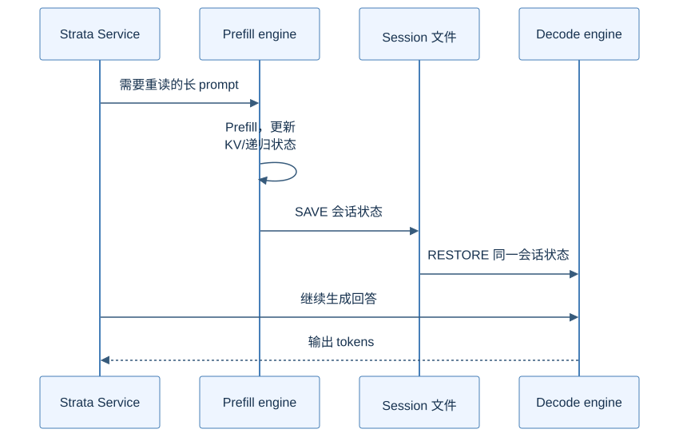

[放大查看 SVG](assets/svg/basalt-02-architecture-differences-02.svg) · [Mermaid 源图](assets/mermaid/basalt-02-architecture-differences-02.mmd)

这里传的是可恢复会话状态，不是把模型权重每次从 prefill 引擎复制到 decode 引擎。两个引擎要使用兼容的模型、版本、KV 与 session 设置。

该 Strata 基线实现是 opt-in，默认只在 decode 端需要重读至少 2048 个新 token 时考虑交接；当前这条路径限制为一次一个请求，不支持其中的 batch slot、layer split；图片请求由 decode 引擎单独处理，交接失败也回退到它读取 prompt。不能把这幅图当成无条件、高并发的分离服务集群。[Split serving 源码与限制](https://github.com/Niko1221/Strata/blob/ffa80d73133ea5c548aefe57889a16e8085a938f/serve/split.py#L1)

### 6. Structured output：提示后校验与生成中约束

用户要求 JSON 时，至少可以在两个位置保证结构：

1. 把格式要求写进 prompt，生成后解析并验证结果。
2. 在生成过程中，根据语法状态屏蔽不允许的 token。

Strata 该基线的 `serve/structured.py` 明确是“prompt once, validate before delivery”，原生引擎没有该模块所需的 grammar decoder；失败结果会作为结构化输出错误处理。可选 `jsonschema` 是否可用也影响验证强度。[Strata structured output](https://github.com/Niko1221/Strata/blob/ffa80d73133ea5c548aefe57889a16e8085a938f/serve/structured.py#L1)

Basalt 把 grammar 接进 C++ 请求/采样循环。当前顺序是主模型产生验证结果、确定可接受的 draft 前缀，再扫描 grammar；遇到不符合的 token 时，在 mask 下重采样，并截短本轮有效窗口，随后提交状态。[Basalt decode loop](https://github.com/jesdga95/basalt/blob/4998eb3733ee83b7e7d6ff94854c399dd89cfebe/src/program/serve/decode_loop.hpp#L79)

这不是“草稿模型说了算”，也不是“服务端收到错误 JSON 后随便修一下”。它说明**相同 API 字段不保证两个引擎采用相同约束机制**。实现比较应限定到上述版本和原生路径，不能推测未来版本或其他引擎的能力。

### 7. 面向源码阅读的对照表

| 想回答的问题 | Strata 基线起点 | Basalt 基线起点 |
|---|---|---|
| 谁启动引擎、命令怎样传递 | `serve/server.py` 的 StrataEngine | `serve/engine/process.py` |
| 请求怎样渲染与排队 | `serve/server.py` 的 Service | `serve/service.py`、`serve/router.py` |
| 多实例与 prefill/decode 分离 | `serve/replicas.py`、`serve/split.py` | 先查 Router/slot，不能套用同名配置 |
| 请求内部阶段 | 对应引擎的 serve 路径 | `src/program/serve/request.cpp` |
| 模型如何接入公共层 | 不同 engine/adapter 路径分别追踪 | `include/basalt/model/adapter.hpp`、`src/models/` |
| 专家算在哪里 | 当前模型/backend 的 dispatch/cache | Qwen `decode/expert_dispatch.cpp`；DeepSeek `tier.*` |
| 多卡到底是哪种 split | `docs/SPLIT_ENGINE.md`、`serve/split.py` 分开看 | `multi_gpu_plan.cpp` 与模型 load/prefill 分开看 |

读源码时先确定“项目 → 模型 → 后端 → 运行模式 → 请求阶段”，再跟函数调用。缺少其中一项，极容易拿一条可选路径去解释所有请求。

[返回学习手册](README.md) · [上一篇：Blackwell 优化](basalt/01-blackwell-optimizations.md) · [完整原始分析](archive/basalt-analysis-2026-11-08/Basalt项目分析.md)

---

## 来源、版本与整理范围

[返回学习手册](README.md) · [原始材料归档](archive/README.md)

整理日期：2026-11-08。本手册把原 Strata 六篇笔记与 Basalt 分析重写为同一条学习路线。共同概念先解释，项目差异再展开，原稿保留以便追溯。

### 1. 为什么固定到具体提交

项目在继续演进，“Strata 支持什么”若没有版本和执行路径，就很容易与旧笔记冲突。本手册采用本地可复核的源码快照，不将其标为最新版本。

| 材料 | 固定版本 | 用途 |
|---|---|---|
| Strata 源码 | [`ffa80d73133ea5c548aefe57889a16e8085a938f`](https://github.com/Niko1221/Strata/tree/ffa80d73133ea5c548aefe57889a16e8085a938f) | 整体架构、服务、数据流、推理与源码路线的学习基线 |
| Basalt 源码 | [`4998eb3733ee83b7e7d6ff94854c399dd89cfebe`](https://github.com/jesdga95/basalt/tree/4998eb3733ee83b7e7d6ff94854c399dd89cfebe) | Basalt 0.3.1 的硬件优化、服务与模型接口 |
| 历史 Strata 断面 | [`e69c1fb6f129bf813e655b818b91414fb894c0a3`](https://github.com/jesdga95/basalt/tree/e69c1fb6f129bf813e655b818b91414fb894c0a3) | 识别 Basalt 继承的基础机制，不代替当前 Strata 对照 |
| 原 Strata 笔记 | 其中启动笔记标注 0.2.12 / engine 0.1.58 | 原始学习材料，行号与默认值需重新核对 |
| 原 Basalt 分析 | `basalt-analysis-2026-11-08` | 保留完整历史分析、性能记录与交互式图表 |

Strata 学习快照的 [AGENTS.md](https://github.com/Niko1221/Strata/blob/ffa80d73133ea5c548aefe57889a16e8085a938f/AGENTS.md) 标注应用 0.2.10 / engine 0.1.56，和原笔记并非同一版本。正文已重新核对关键入口，不能把原稿行号直接套用。历史 `e69c1fb6` 在当时 [CMake](https://github.com/jesdga95/basalt/blob/e69c1fb6f129bf813e655b818b91414fb894c0a3/CMakeLists.txt#L12) 中标为 Strata 0.1.39；这里没有将它认定为今日两个仓库的严格 merge-base。

### 2. 三种证据分别能说明什么

| 证据 | 可以支持 | 不能独自支持 |
|---|---|---|
| 源码和接口合同 | 某个条件分支、调用顺序、内存/状态职责确实存在 | 当前机器实际选了该路径，或一定更快 |
| 项目文档与提交记录 | 作者说明的适用条件、设计目的和测量结果 | 独立复测结论，或对所有模型/硬件的普遍保证 |
| 教学图与假设例子 | 帮助理解因果、阶段和数据流 | 真实模型的专家数量、精确 kernel 时序或性能 |

各章源码链接使用固定提交。性能数字在句旁标出项目记录；本次没有运行 5090 推理、GPU benchmark、数值精度测试，也没有编译两个引擎。图中的“4 个专家选 2 个”等是明确标注的教学假设。

### 3. 整理时处理的关键区别

- **继承与新增：** CPU/GPU 异构、文件后备、CUDA Graph、MTP 和多卡已有历史基础；Basalt 的重点是 sm_120 专用执行、调度优化及后续组织重构。
- **历史与当前：** 当前 Strata 学习基线也有 NVFP4 和独立 all-cards split 引擎，不能根据早期断面将它们写成 Basalt 独有或 Strata 缺失。
- **文件与数值格式：** `.basalt` 是分区资源容器；NVFP4、Q6_K 等描述具体权重/数值表达，两者不是同一层概念。
- **精度与阶段：** NVFP4 decode 与满足阈值的 FP4 prefill 使用不同计算路径，“4-bit 模型”不表示全程 W4A4。
- **服务与设备：** Python/原生进程的 stdin/stdout 协议，和 CPU/GPU 的 pinned/mapped 通信，是不同边界。
- **专家与会话：** 专家缓存保存权重，KV/递归状态与 checkpoint 保存会话历史；二者的命中与淘汰含义不同。
- **多种并行：** HTTP 连接、slot、replica、expert tier、layer split、tensor split、prefill/decode 分离逐一说明，避免统称“多卡并行”。
- **模型条件：** Qwen 与 DeepSeek 的 session、KV、draft、peer 数量和并发实现分开标注，避免把一个模型的默认值泛化到整个引擎。

### 4. 材料如何合并

| 原材料 | 新的主要阅读位置 |
|---|---|
| Strata cli-launch、server | [整体架构](02-architecture.md)、[源码路线](05-source-reading.md) |
| Strata memory-weights | [数据流向](03-dataflow.md)、[基础概念](01-foundations.md) |
| Strata engine-core、kernels-spec | [完整推理流程](04-inference.md) |
| Strata dsv41-split-ports | [架构差异](basalt/02-architecture-differences.md) |
| Basalt 原分析的历史比较 | [Basalt 专章入口](basalt/README.md) |
| Basalt 原分析的硬件/性能内容 | [Blackwell 优化](basalt/01-blackwell-optimizations.md) |
| 原图与详细分析 | [归档](archive/README.md)，新手册另有配套图表 |

这次合并的是文档与知识结构，没有把两个项目的引擎源码、模型格式或配置合并成一个软件。现有 Basalt 源码与原 Obsidian 材料不在本次改写范围内。

### 5. 图表和交付检查

正文中的 Mermaid 是图表内容的源文件，SVG 是同一内容的渲染结果。架构图说明组件职责，数据流图注明数据类型，时序图展示执行先后与等待关系；它们不是 profiler trace。

新文档的相对链接、固定源码文件与行号范围、Mermaid 渲染、归档字节一致性分别检查。具体结果与范围见 [validation.json](validation.json)；图表列表见[图表目录](assets/README.md)。旧 Basalt 归档中的 Archify JSON 是原报告的检查记录，不充当新手册的验收记录。

以后更新时，先修改分章正文，再同步 Mermaid/SVG 和单文件阅读版；同时更新源码提交与验证记录。若换了模型、后端或执行模式，应重新追踪条件分支，不能只替换版本号。
