# WeKnora 流程详解：写给第一次接触的你

> 本文按“一个流程 = 一张图 + 一段讲解”组织，共 9 个流程，外加开头的全景图。
> 每张图都有可交互版本（点击每节标题下的链接用浏览器打开，可缩放、切换深色模式、点击“来源”跳到对应代码）。
> 分析基于提交 `bccb4b15`。

## 目录

- [第 0 部分 · 先建立整体印象](#第-0-部分--先建立整体印象)
- [第 1 部分 · 服务启动：WeKnora 是怎么跑起来的](#第-1-部分--服务启动)
- [第 2 部分 · 请求进门：一个 HTTP 请求经过哪些关卡](#第-2-部分--请求进门)
- [第 3 部分 · 上传文档：点击上传后立刻发生了什么](#第-3-部分--上传文档)
- [第 4 部分 · 后台处理：一份文档如何变成可检索的知识](#第-4-部分--后台处理)
- [第 5 部分 · 文档状态：处理中 / 完成 / 失败从哪来](#第-5-部分--文档状态)
- [第 6 部分 · 知识问答：RAG 流水线每一步在做什么](#第-6-部分--知识问答rag)
- [第 7 部分 · 混合检索：问题是怎么找到最相关分块的](#第-7-部分--混合检索)
- [第 8 部分 · Agent 问答：思考 → 调工具 → 观察的循环](#第-8-部分--agent-问答)
- [第 9 部分 · 流式输出：答案为什么能一个字一个字地出现](#第-9-部分--流式输出)
- [附录 · 名词表 & 源码入口](#附录)

---

## 第 0 部分 · 先建立整体印象

**一句话**：WeKnora 先把你的文档“读懂并记住”（入库），等你提问时再“翻出最相关的几段原文，交给大模型作答”（问答）。这种做法叫 **RAG**（检索增强生成）。

### 0.1 系统由哪些盒子组成

[打开交互版](architecture-weknora-overview-20260930-171426/weknora-overview.html)

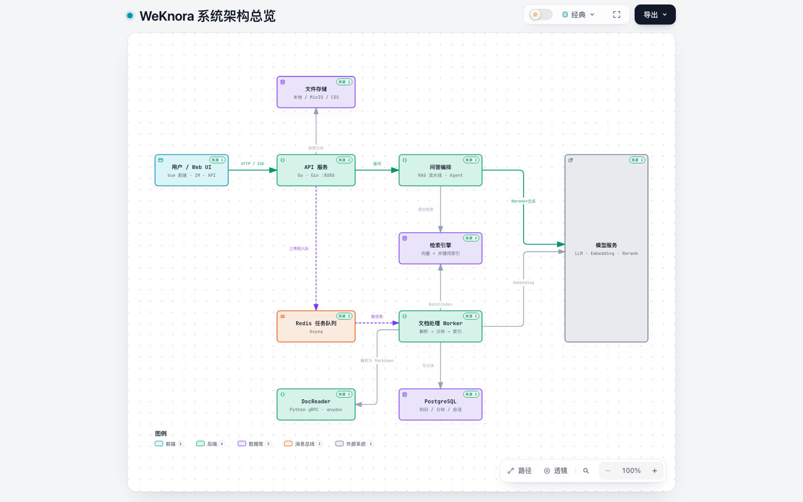

| 组件 | 通俗理解 | 真实身份 |
|---|---|---|
| Web UI | 你看到的网页 | Vue 前端（frontend 容器） |
| API 服务 | 总服务台，接收所有请求 | Go + Gin，端口 8080（app 容器） |
| 问答编排 | 答题的“流水线车间” | app 里的 chat_pipeline / Agent 引擎 |
| 文档处理 Worker | 后台慢慢整理资料的员工 | app 里的 Asynq 任务处理器 |
| Redis | 待办任务的“收件箱” | Asynq 任务队列；也存流式事件 |
| DocReader | 把各种文件“翻译”成纯文本 | Python gRPC 服务；Office 文档可由进程内 anydoc 解析 |
| PostgreSQL | 档案柜 | 知识记录、分块、会话、消息 |
| 检索引擎 | 索引卡片柜 | 默认 ParadeDB（pgvector + BM25），可换 ES / Qdrant / Milvus 等 |
| 文件存储 | 原件仓库 | 本地 / MinIO / 腾讯云 COS |
| 模型服务 | 外请的专家 | LLM 写答案、Embedding 做向量、Rerank 打分 |

> 注意：API、问答编排、Worker 是**同一个 Go 程序**的不同部分，不是三个独立服务。

### 0.2 数据是怎么流动的

[打开交互版](dataflow-weknora-rag-20260930-171426/weknora-dataflow.html)

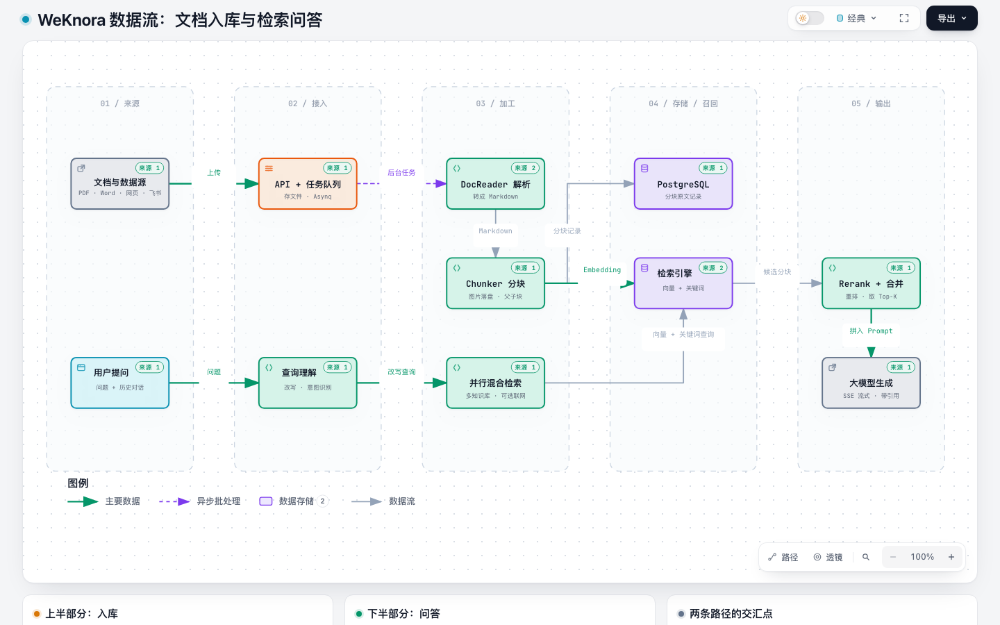

上半部分是**入库**（异步，后台慢慢做），下半部分是**问答**（同步，边生成边推送）。两条线在**检索引擎**交汇：入库时写入向量，问答时读取向量。

---

## 第 1 部分 · 服务启动

[打开交互版](workflow-weknora-startup-20260930-172606/weknora-startup.html)

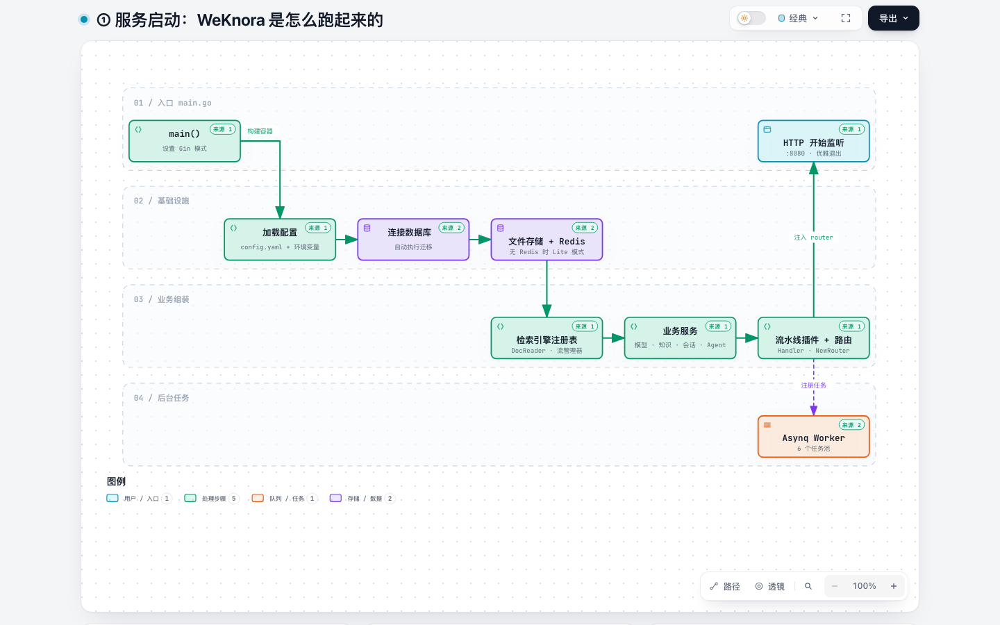

**一句话**：`main()` 让一个“依赖注入容器”按顺序把配置、数据库、存储、服务、路由一个个组装好，最后开始监听 8080 端口。

### 分步讲解

1. **main() 启动**：设置 Gin 的运行模式，然后调用 `BuildContainer` 构建容器。
2. **加载配置**：读取 `config.yaml` 和环境变量（比如数据库地址、模型配置）。
3. **连接数据库**：连上 PostgreSQL，并**自动执行数据库迁移**（建表、加字段）。设置 `AUTO_MIGRATE=false` 可以关掉。
4. **文件存储 + Redis**：初始化存文件的地方；连接 Redis。如果没配置 `REDIS_ADDR`，进入 **Lite 模式**。
5. **检索引擎注册表**：把可用的检索引擎（Postgres、ES、Qdrant……）登记好，同时连接 DocReader，创建“流管理器”（第 9 部分会用到）。
6. **业务服务**：创建模型服务、知识服务、会话服务、Agent 服务等。它们互相依赖，由容器自动按顺序创建。
7. **流水线插件 + 路由**：注册 RAG 流水线的各个步骤插件，创建所有 Handler，生成 Gin 路由。
8. **Asynq Worker**（后台）：有 Redis 时启动 6 个任务池（core / postprocess / enrichment / maintenance / shared / wiki）。没有 Redis 时退化为**同步执行**任务。
9. **HTTP 开始监听**：`main()` 拿到路由，启动 HTTP 服务。收到退出信号时，先停止接收新请求，再清理资源。

### 小白提示

- **依赖注入（DI）**：每个组件只声明“我需要什么”，由容器负责按顺序创建并传进去。好处是组件之间不直接 new 对方，方便替换和测试。WeKnora 用的是 `dig` 库。

---

## 第 2 部分 · 请求进门

[打开交互版](workflow-weknora-request-20260930-172606/weknora-request.html)

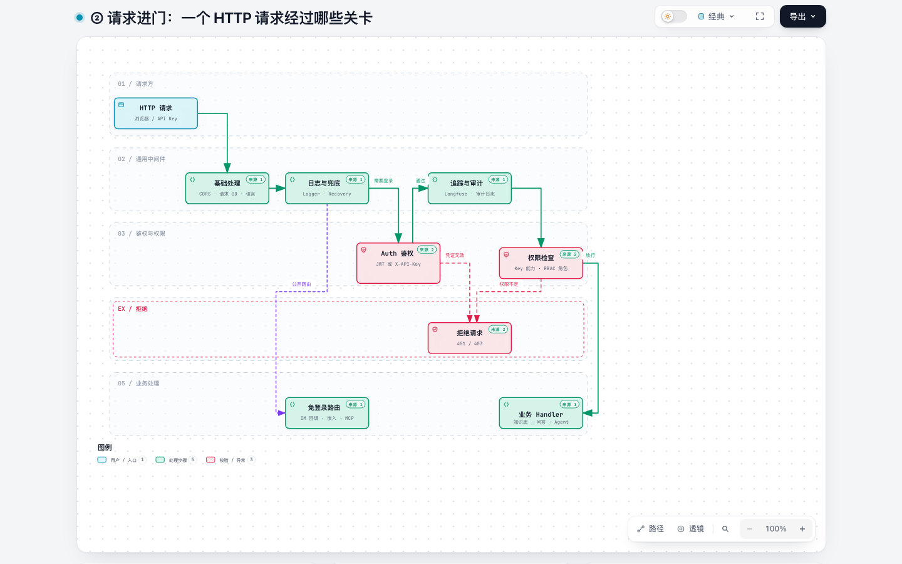

**一句话**：每个请求像过安检一样，按顺序经过一道道“中间件”，任何一关不通过都会被直接拦下。

### 分步讲解

| 顺序 | 关卡 | 做什么 | 不通过会怎样 |
|---|---|---|---|
| 1 | 基础处理 | 处理跨域（CORS）、给请求分配唯一 ID、识别语言 | — |
| 2 | 日志与兜底 | 打访问日志；`Recovery` 捕获代码崩溃（panic），避免整个服务挂掉 | 返回 500，而不是进程退出 |
| 3 | 公开路由分流 | IM 机器人回调、网站嵌入、MCP Server 等路由**在鉴权之前**注册，自己负责校验 | — |
| 4 | Auth 鉴权 | 确认“你是谁”：先看 `Authorization: Bearer <JWT>`，再看 `X-API-Key`；并确定你属于哪个租户（空间） | **401** |
| 5 | 追踪与审计 | Langfuse 链路追踪、审计日志 | — |
| 6 | 权限检查 | 确认“你能做什么”：API Key 的能力范围 + 空间角色（RBAC，比如查看者 / 编辑者 / 管理员） | **403** |
| 7 | 业务 Handler | 真正处理请求：上传文档、问答、Agent…… | — |

### 小白提示

- **中间件**：在请求到达业务代码之前或之后执行的一段通用代码，写一次就对所有接口生效。
- WeKnora 没有全局限流，只在登录注册、嵌入公开接口上做了限流。

---

## 第 3 部分 · 上传文档

[打开交互版](sequence-weknora-upload-20260930-172606/weknora-upload.html)

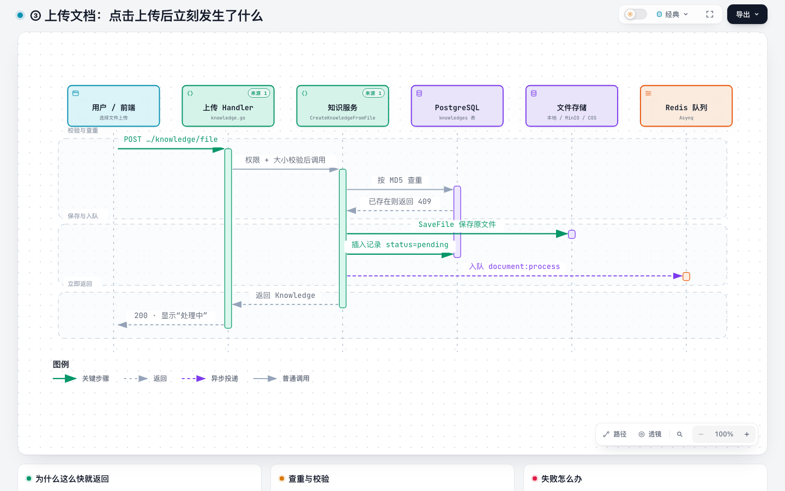

**一句话**：上传接口只做三件事：**存文件、记一条“待处理”记录、投递后台任务**，然后马上返回。所以你会先看到“处理中”。

> 这是一张**时序图**：从上往下是时间顺序，每条竖线是一个参与者，横向箭头是它们之间的调用，虚线箭头是返回。

### 分步讲解（对照图中每一条箭头）

1. **前端 → Handler**：`POST /knowledge-bases/:id/knowledge/file`，带上文件。
2. **Handler 校验**：
   - 你对这个知识库有没有写权限（只有管理员 / 编辑可以上传），否则 403；
   - 文件大小不能超过 `MAX_FILE_SIZE_MB`（默认 50MB）；
   - 然后调用知识服务 `CreateKnowledgeFromFile`。
3. **知识服务 → PostgreSQL：查重**。计算文件的 **MD5**，结合文件名和大小，看这个知识库里是否已有同样的文件。
4. **重复则返回 409**，前端会提示“文件已存在”。
5. **知识服务 → 文件存储**：`SaveFile` 把原文件存起来（本地磁盘 / MinIO / COS）。
6. **知识服务 → PostgreSQL**：插入一条 Knowledge 记录，`parse_status = pending`，此时 `enable_status = disabled`（还搜不到）。
7. **知识服务 → Redis**：投递一个 `document:process` 任务，内容包括知识 ID、文件路径、文件类型、是否开启多模态、是否自动出题等。最多重试 3 次，超时 2 小时。
8. **返回**：Handler 返回 200 和这条 Knowledge，前端显示“处理中”。

### 数据变化

| 位置 | 变化 |
|---|---|
| 文件存储 | 多了一个原始文件 |
| knowledges 表 | 多了一行，状态 `pending` |
| Redis | 多了一个 `document:process` 任务 |

### 失败怎么办

- 写数据库失败 → 删掉刚存的文件，避免产生“孤儿文件”。
- 入队失败 → 把记录标成 `failed`，但仍把记录返回给前端，方便用户看到并重试。
- 其他导入方式：网页 URL 导入同样走 `document:process`；手写文档先存为 `draft`，发布时才投递 `manual:process`。

---

## 第 4 部分 · 后台处理

[打开交互版](workflow-weknora-ingest-20260930-172606/weknora-ingest.html)

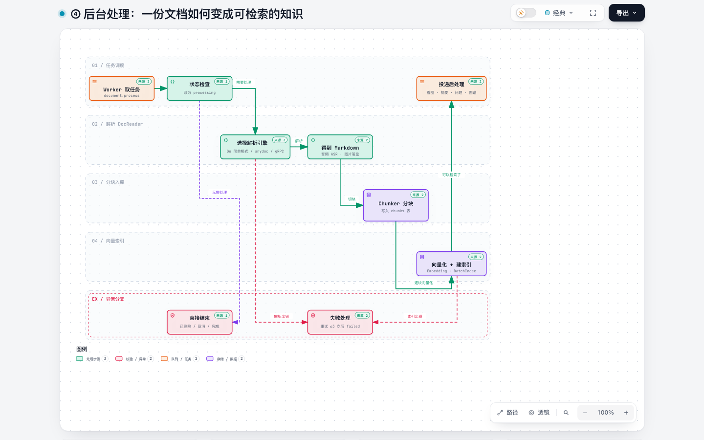

**一句话**：Worker 拿到任务后，把文档**解析成 Markdown → 切成小块 → 每块变成向量存进索引**，然后投递一些可选的“后处理”任务。

### 分步讲解

**① Worker 取任务**
Asynq 从 Redis 取出 `document:process`，交给 `ProcessDocument` 处理。

**② 状态检查**
- 如果文档已被删除、已取消、已完成，或者已经发起了新一轮解析 → **直接结束**（避免重复处理）。
- 否则把状态改为 `processing`。
- 图片文件没开多模态、音频没配语音识别、视频文件 → 直接标记失败。

**③ 选择解析引擎（DocReader 阶段）**

| 文件类型 | 谁来解析 |
|---|---|
| txt、md、csv、json 等简单格式 | Go 代码直接读取（`SimpleFormatReader`） |
| Word、Excel 等 Office 文档 | 优先用进程内的 **anydoc** |
| PDF、PPT、网页等 | Python **DocReader**（gRPC，流式返回正文和图片） |
| 知识库自定义 | 也可以配置 MinerU、PaddleOCR-VL 等引擎 |

没有可用的解析器时，文档会被标为失败，并提示“请配置 DOCREADER_ADDR”。

**④ 得到 Markdown**
- 所有格式最终都变成一份 **Markdown 文本**。
- 音频先调用 ASR 模型转成文字。
- 文档里的图片被提取出来存到文件存储，Markdown 里的图片链接换成新地址。
- 顺便清洗无效字符、统一换行符、规范化 HTML 表格。

**⑤ Chunker 分块**
- 按“空行 → 换行 → 句号”的优先级切分，每块约 **512 字**，相邻块**重叠 80 字**，避免一句话被切成两半后丢失意思。
- 开启**父子块**时：小块（384 字）用来检索，找到后换成它所在的大块（4096 字）交给大模型，兼顾“找得准”和“看得全”。
- 分块写入 PostgreSQL 的 **chunks 表**，并记录前后块关系。

**⑥ 向量化 + 建索引**
- 每块内容（标题 + 上下文标题 + 正文）调用 **Embedding 模型**得到向量，每批 40 条，最多 5 批并发，失败自动退避重试。
- 通过 `BatchIndex` 写入检索引擎。默认是 PostgreSQL 的 **embeddings 表**：同一行既有向量（pgvector，HNSW 索引）又有原文（BM25 关键词索引）。
- 写之前会先估算占用空间，超出租户配额会报“存储空间不足”。
- 写完后把文档设为可检索（`enable_status = enabled`）。

**⑦ 投递后处理（可选）**
- 有图片：每张图一个 `image:multimodal` 任务（OCR + 看图描述），全部完成后再进入后处理。
- 后处理 `knowledge:post_process` 按配置投递：**文档摘要**、**自动出题**、**自动打标签**、**知识图谱抽取**（需 `NEO4J_ENABLE=true`）、**Wiki 整理**。

### 数据变化

```
原始文件 ──解析──▶ Markdown 全文 ──分块──▶ N 个 Chunk（chunks 表）
                                               │
                                               └─Embedding──▶ N 条向量 + 原文（embeddings 表）
```

### 失败处理

- 解析出错：没到最后一次重试就交给 Asynq **自动重试**（最多 3 次）；最后一次仍失败才标记 `failed`。
- 写分块或写索引出错：直接标记 `failed`，并清理已写入的分块和索引，避免留下“半截数据”。
- 重试全部用尽的任务会进入“死信”，回调函数会把文档标成 `failed`。

---

## 第 5 部分 · 文档状态

[打开交互版](lifecycle-weknora-parse-status-20260930-172606/weknora-parse-status.html)

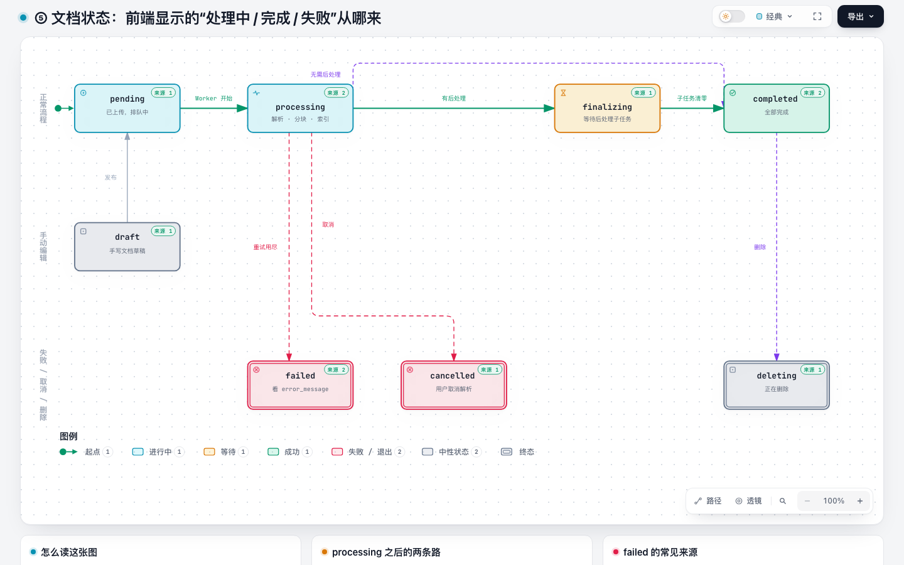

**一句话**：前端显示的状态，就是 knowledges 表里 `parse_status` 字段的值，它像红绿灯一样按固定规则切换。

| 状态 | 含义 | 什么时候进入 |
|---|---|---|
| `draft` | 草稿 | 手写文档保存但未发布 |
| `pending` | 排队中 | 上传成功 / 草稿发布 |
| `processing` | 处理中 | Worker 开始解析、分块、索引 |
| `finalizing` | 收尾中 | 索引已完成，还在等后处理子任务（摘要、出题、看图等） |
| `completed` | 完成 | 没有后处理，或所有子任务都已完成 |
| `failed` | 失败 | 重试用尽、写库失败、空间不足、长时间卡住被清扫 |
| `cancelled` | 已取消 | 用户主动取消解析 |
| `deleting` | 删除中 | 用户删除文档，后台正在清理 |

### 小白提示

- **finalizing 怎么知道何时结束？** 进入 finalizing 时记下“还有几个子任务”，每完成一个减 1，减到 0 就自动变成 completed。
- 文档在 `processing` 后期就已经可以被检索到了，后处理只是锦上添花。

---

## 第 6 部分 · 知识问答（RAG）

[打开交互版](workflow-weknora-rag-pipeline-20260930-172606/weknora-rag-pipeline.html)

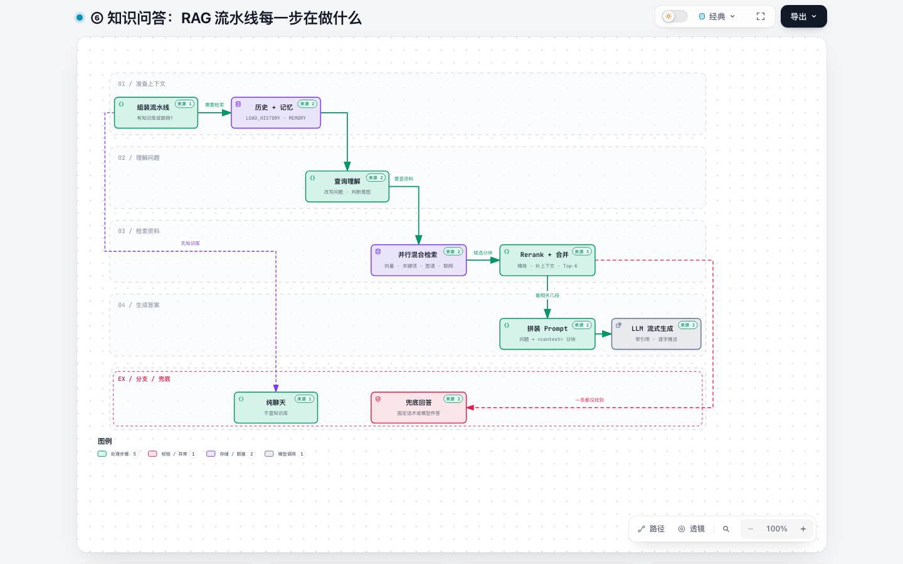

**一句话**：一次提问会被拆成一串固定的步骤，每一步读取上一步的结果、写入自己的结果，最后交给大模型生成答案。

### 这些步骤之间怎么传数据

所有步骤共享一个叫 **ChatManage** 的“工作单”对象。每一步都在上面读字段、写字段，就像一张在车间里传递的工单。

### 分步讲解

| # | 步骤（代码名） | 读取 | 写入 | 通俗解释 |
|---|---|---|---|---|
| 0 | 组装流水线 | 选的知识库、是否联网 | 步骤列表 | 没选知识库也没开联网 → 走**纯聊天**：只加载历史和记忆，然后直接生成 |
| 1 | `LOAD_HISTORY` | 会话 ID、轮数 | History | 取最近几轮对话 |
| 2 | `MEMORY_RECALL` | 问题 | MemoryPrompt | 取出用户长期记忆（偏好、确认过的事实） |
| 3 | `QUERY_UNDERSTAND` | 问题、历史、图片 | RewriteQuery、Intent | 一次小模型调用：把“那它呢？”改写成完整问题，并判断意图 |
| 4 | `CHUNK_SEARCH_PARALLEL` | RewriteQuery | SearchResult | 并行检索：知识库混合检索 + 知识图谱 +（可选）联网搜索，详见第 7 部分 |
| 5 | `CHUNK_RERANK` | SearchResult | RerankResult | Rerank 模型精排；Wiki 页面、用户常看的文档会额外加分 |
| 6 | `WEB_FETCH`（可选） | RerankResult | 网页正文 | 联网时抓取排名前 3 的网页全文 |
| 7 | `CHUNK_MERGE` | RerankResult | MergeResult | 去重、子块换父块、合并相邻块、给太短的块补上下文 |
| 8 | `FILTER_TOP_K` | MergeResult | MergeResult | 只保留最相关的 K 段 |
| 9 | `DATA_ANALYSIS`（可选） | CSV / Excel | 分析结果 | 让模型写 SQL，在 DuckDB 里算出答案 |
| 10 | `INTO_CHAT_MESSAGE` | MergeResult、问题 | UserContent | 把每段资料包成 `<context id="N">…</context>`，套进提示词模板 |
| 11 | `CHAT_COMPLETION_STREAM` | 系统提示 + 历史 + UserContent | 答案事件流 | 调用大模型**流式**生成，一段段发出，并附带引用 |

### 关键分支

- **意图是问候 / 闲聊 / 追问**（greeting、chitchat、follow_up 等）：第 4～9 步直接跳过，只让大模型回答。
- **一条资料都没找到**：走**兜底回答**。默认让模型基于“没找到资料”作答，也可以配置成固定话术。
- **没配置 Rerank 模型**：跳过精排，直接用检索分数排序。

### 小白提示

- **为什么要改写问题？** 追问“那它多少钱？”里的“它”，只有结合上文才知道指什么。改写成“XX 产品多少钱？”后，检索才能找得准。
- **为什么不直接把整篇文档给大模型？** 太长会超出模型上下文，也更贵、更慢。RAG 只挑最相关的几段。

---

## 第 7 部分 · 混合检索

[打开交互版](dataflow-weknora-hybrid-search-20260930-172606/weknora-hybrid-search.html)

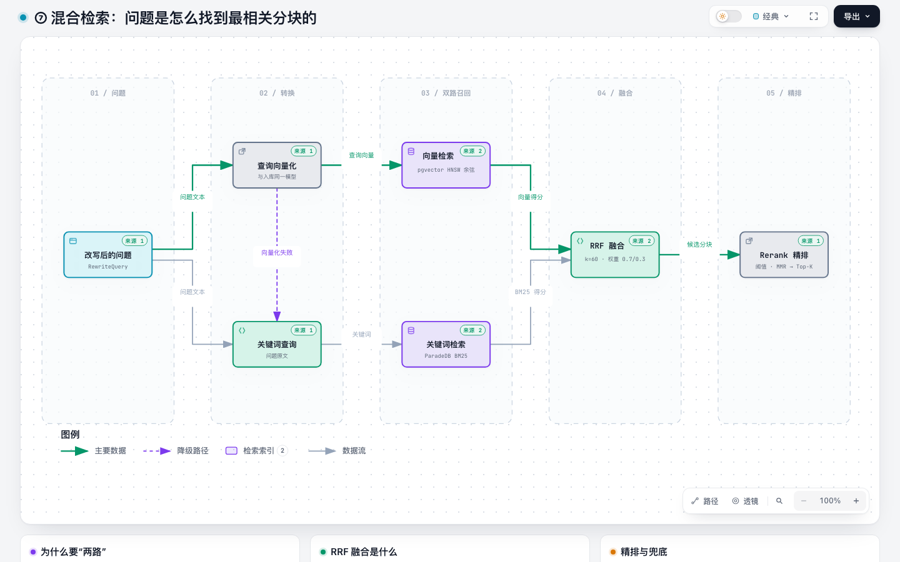

**一句话**：同一个问题同时走“按意思找”和“按字面找”两条路，再把两份结果融合、精排。

### 分步讲解

1. **改写后的问题**分成两路。
2. **语义路**：用**入库时同一个 Embedding 模型**把问题变成向量。
   - 在 embeddings 表上做**向量检索**（pgvector，HNSW 索引，余弦距离）；
   - 意思相近的分块向量距离近，所以“怎么请假”能找到“休假申请流程”。
3. **字面路**：用问题原文做**关键词检索**（ParadeDB 的 BM25 打分），擅长型号、人名、错误码这类精确词。
4. **RRF 融合**：两种分数没法直接比，所以改看**排名**：在各自榜单里排得越靠前，得分越高。向量路权重 0.7，关键词路 0.3，最后归一化到 0～1。
   - 为了给后续精排留余地，会先多召回一些（数量的 5 倍、至少 50 条，最多 500 条），融合后截到默认 50 条。
5. **Rerank 精排**：专门的打分模型逐条判断“这段话能不能回答这个问题”。
   - 分数不够时逐级放宽阈值；
   - 用 **MMR** 去掉意思重复的块；
   - 最后保留 Top-K。

### 降级与兜底

- 查询向量化失败（比如模型服务不可用）→ **只走关键词检索**，不至于完全搜不到。
- 结果不够多时可以开启**查询扩展**：生成几个关键词变体，再补充检索一次。

---

## 第 8 部分 · Agent 问答

[打开交互版](workflow-weknora-agent-20260930-172606/weknora-agent.html)

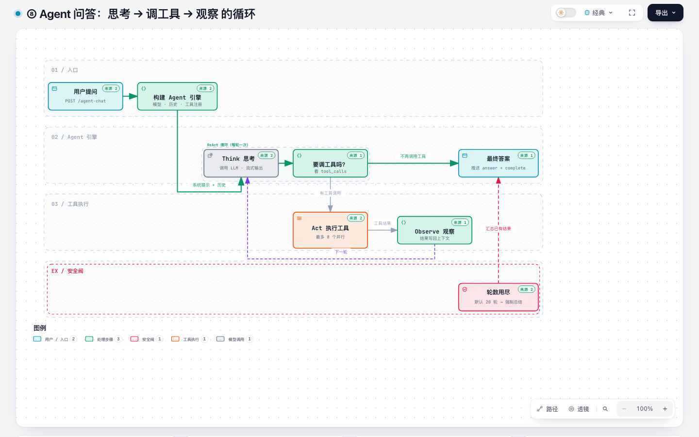

**一句话**：Agent 不走固定流水线，而是让大模型自己决定下一步：**想一想 → 调个工具 → 看结果 → 再想**，直到觉得信息够了再回答。这种模式叫 **ReAct**（Reason + Act）。

### 分步讲解

1. **用户提问**：`POST /agent-chat/:session_id`。Handler 先找到你选的智能体配置（自己的或别人共享的）。
2. **构建 Agent 引擎**：
   - 加载对话模型、历史消息（按 token 预算截取）、长期记忆；
   - **注册工具**：默认有 `search_knowledge`（查知识库）、`read_document`（读文档）、`list_documents`（列文档）、`search_conversations`（查历史对话）；
   - 按配置再加联网搜索、MCP 工具、沙箱等。
3. **Think 思考**：把系统提示、历史和工具清单发给大模型。模型的思考过程会**流式**推给前端（你看到的“思考中…”）。
4. **要调工具吗？** 看模型返回里有没有 `tool_calls`：
   - 没有 → 模型给出的就是**最终答案**，结束循环；
   - 有 → 进入下一步。
5. **Act 执行工具**：解析工具参数（JSON 格式不对会尝试自动修复），执行工具。多个工具可以**并行**，最多 8 个；默认超时 60 秒，Shell 约 10 分钟。
6. **Observe 观察**：工具结果追加到对话上下文里，**回到第 3 步**开始下一轮。
7. **最终答案**：流式推送 `answer` 事件，最后发送 `complete`，里面带上完整答案、每一步记录和 token 用量。

### 工具箱（部分）

| 类别 | 工具 |
|---|---|
| 知识库 | search_knowledge、read_document、list_documents、query_knowledge_graph |
| 记忆与历史 | search_memory、search_conversations |
| 联网 | web_search、web_fetch |
| 数据 | database_query、data_analysis、data_schema |
| 规划 | thinking（分步思考）、todo_write（写计划） |
| 沙箱 | shell_exec、read_file、write_sandbox_file、edit_sandbox_file |
| 扩展 | MCP 工具、local_browser（操作你自己的浏览器）、wiki_* |

### 安全阀

- **轮数上限**：默认 20 轮。用完还没答完，就基于已有结果**强制总结**一次。
- **上下文太长**：自动压缩较早的历史；还不够就裁剪工具结果。
- **异常输出**：输出被截断、重复、空回答都有重试上限。
- **人工审批**：外部 MCP 工具可以配置为“需要用户点同意才执行”。
- **中途插话（Steer）**：Agent 运行时你还可以继续发消息，它会在下一轮开始前读到。

---

## 第 9 部分 · 流式输出

[打开交互版](sequence-weknora-sse-20260930-172606/weknora-sse.html)

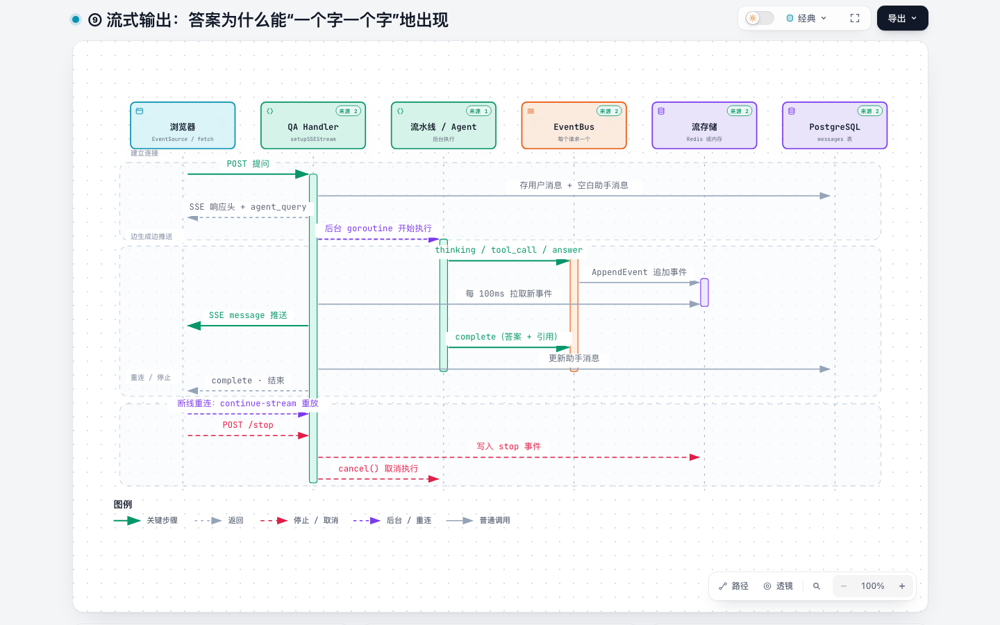

**一句话**：服务器用 **SSE** 保持一个不关闭的 HTTP 响应，模型每生成一小段就推一段。中间多存一份到“流存储”，所以断线可以重连，也可以随时停止。

### 分步讲解

**建立连接**
1. 浏览器发起提问（RAG 或 Agent 都一样）。
2. Handler 先在 messages 表里存两条消息：**用户消息**，和一条**空白的助手消息**（占位，状态“未完成”）。
3. 返回 SSE 响应头（`Content-Type: text/event-stream`），并先推一个 `agent_query` 事件。
4. 开一个后台 goroutine 去执行流水线或 Agent；当前请求线程留下来负责“推送”。

**边生成边推送**

5. 后台执行时不断向 **EventBus**（每个请求一个）发出事件：`thinking`（思考）、`tool_call`（调用工具）、`references`（引用）、`answer`（答案片段）……
6. 订阅者把事件**追加到流存储**：配置 `STREAM_MANAGER_TYPE=redis` 时存 Redis（1 小时过期），否则存内存。
7. Handler **每 100ms** 从流存储拉一次新事件……
8. ……逐条写进 SSE 响应推给浏览器。
9. 执行结束时发出 `complete`，里面带完整答案和引用。
10. Handler **先把答案和引用写回助手消息**，再推送 `complete`，关闭流。之后异步做一些收尾工作，比如生成追问建议、记录记忆。

**重连 / 停止**

11. 网络断了：浏览器调用 `GET /sessions/continue-stream/:session_id`，从流存储**从头重放**事件，内容不会丢。
12. 点击“停止”：`POST /sessions/:session_id/stop` 往流存储写一条 `stop` 事件。
13. Handler 发现 `stop` 后调用 `cancel()` 取消后台执行，并保存已生成的部分。

### 小白提示

- **为什么不直接把事件写给浏览器，还要绕一圈流存储？** 一是断线可以重放；二是部署多个副本时，重连请求落到另一台机器上也能读到同一份事件。

---

## 附录

### A. 名词表

| 名词 | 解释 |
|---|---|
| Knowledge | 一份文档在系统里的记录 |
| Chunk | 文档切出来的一小段，检索的最小单位 |
| Embedding / 向量 | 把一段文字变成一串数字，意思相近则距离相近 |
| BM25 | 经典的关键词相关度打分算法 |
| RRF | 按排名融合多份检索结果的方法 |
| Rerank | 用专门的模型对候选分块精确打分重排 |
| RAG | 先检索资料、再让大模型参考资料作答 |
| ReAct | Agent 的“思考 → 行动 → 观察”循环 |
| SSE | 服务器单向、持续向浏览器推送数据的 HTTP 技术 |
| Asynq | 基于 Redis 的 Go 后台任务队列 |
| 租户 / 空间 | 数据隔离单位，不同空间的数据互相看不到 |

### B. 源码入口（按流程）

| 流程 | 从这里看 |
|---|---|
| 1 启动 | [cmd/server/main.go](../cmd/server/main.go)、[internal/container/container.go](../internal/container/container.go) |
| 2 中间件 | [internal/router/router.go](../internal/router/router.go)、[internal/middleware/auth.go](../internal/middleware/auth.go) |
| 3 上传 | [internal/handler/knowledge.go](../internal/handler/knowledge.go)、[internal/application/service/knowledge_create.go](../internal/application/service/knowledge_create.go) |
| 4 后台处理 | [internal/router/task.go](../internal/router/task.go)、[internal/application/service/knowledge_process.go](../internal/application/service/knowledge_process.go)（`ProcessDocument` / `convert` / `processChunks`）、[internal/infrastructure/docparser/](../internal/infrastructure/docparser/)、[docreader/](../docreader/) |
| 5 状态 | [internal/types/knowledge.go](../internal/types/knowledge.go)、[internal/application/service/knowledge_post_process.go](../internal/application/service/knowledge_post_process.go) |
| 6 RAG | [internal/application/service/session_knowledge_qa.go](../internal/application/service/session_knowledge_qa.go)、[internal/application/service/chat_pipeline/](../internal/application/service/chat_pipeline/) |
| 7 检索 | [internal/application/service/knowledgebase_search.go](../internal/application/service/knowledgebase_search.go)、[internal/application/repository/retriever/postgres/](../internal/application/repository/retriever/postgres/)、[internal/reranking/rerank.go](../internal/reranking/rerank.go) |
| 8 Agent | [internal/application/service/session_agent_qa.go](../internal/application/service/session_agent_qa.go)、[internal/agent/engine.go](../internal/agent/engine.go)、[internal/agent/tools/](../internal/agent/tools/) |
| 9 流式 | [internal/handler/session/qa.go](../internal/handler/session/qa.go)、[internal/handler/session/stream.go](../internal/handler/session/stream.go)、[internal/stream/](../internal/stream/) |

**建议阅读路线**：先用 Docker 跑起来，上传一个文档、问一个问题 → 读第 3、4 部分，跟着代码走一遍“上传” → 读第 6、7 部分，跟着代码走一遍“提问” → 最后看 Agent 和流式输出。
